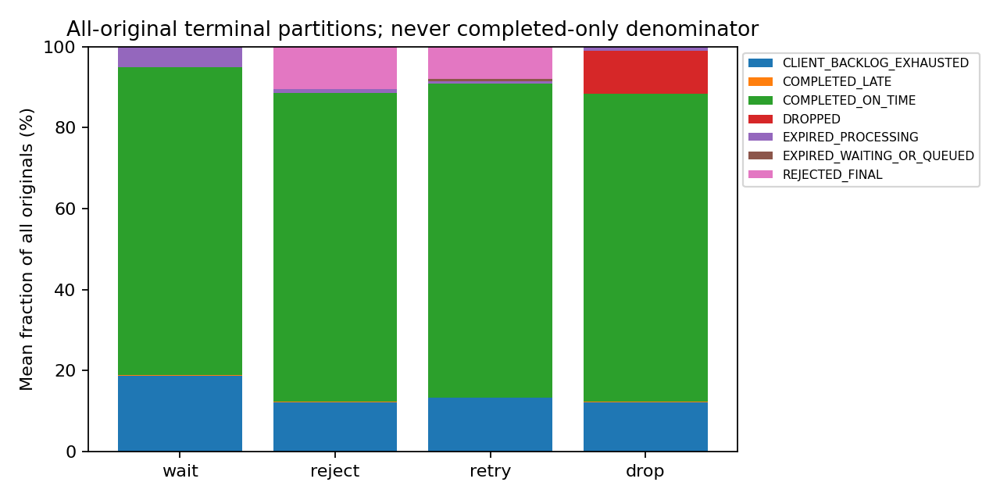
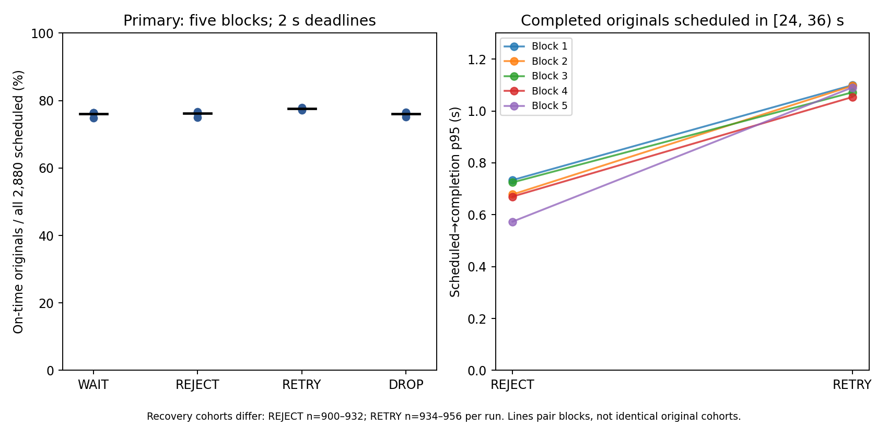
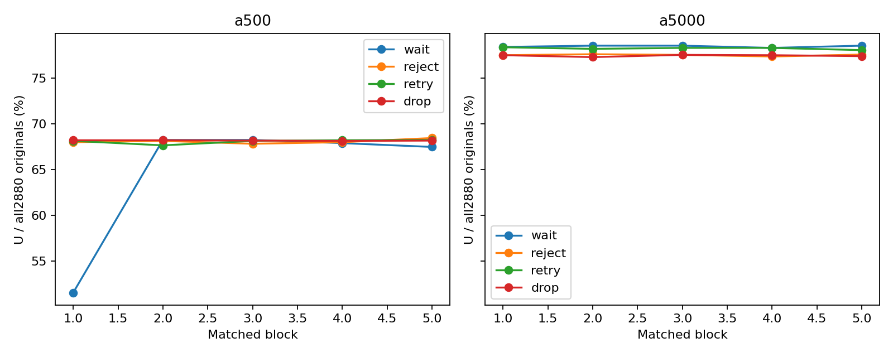
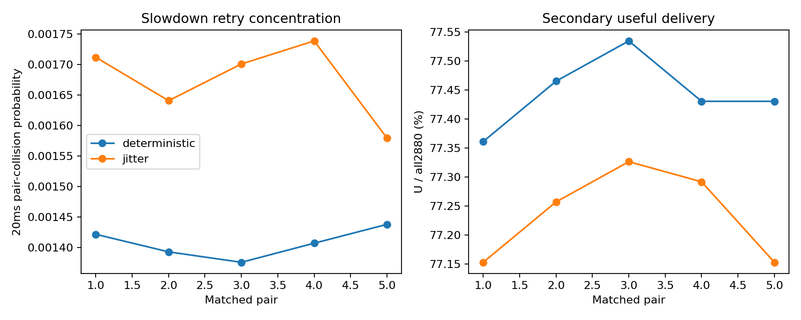

# Backpressure Is Not an Overload Policy: Wait, Reject, Retry, or Drop?

*Revised Markdown manuscript for technical-lead review. Evidence scope: Experiment 003, Stage 7-approved package.*

A server has reached its admission limit. Thirty-two pieces of work already own its available slots, including the work currently running. Another original message arrives. What should happen?

The transport can slow the sender. A bounded queue can stop the application from accepting unlimited unfinished work. Neither answers the product question: **should this message wait, receive an explicit refusal, be tried again, or be deliberately discarded?** The choice determines who holds the backlog, who spends more resources, and whether the original message can still finish before it matters.

In [Blog 1](https://github.com/huyhoang1001/grpc-under-pressure) we examined why gRPC flow control did not prevent application backlog. In Blog 2 we found that changing a pending-work admission budget could reduce local queue residence while making other tails worse. Here we hold the server's admission bound fixed and change what happens **when it fills**.

The answer is not a universal winner. In our primary experiment, bounded retries completed **1.410 percentage points more original messages on time than explicit rejection**, but required more attempts and had a worse conditional recovery-period latency tail. Separate deadline and eight-client experiments made the trade-offs less tidy, not more. That is the useful result: **backpressure limits where work accumulates; an overload policy decides what happens to demand that capacity cannot serve.**

## 1. The decision a full queue cannot make

Consider an event with a deadline. The Go sender's local `Send` call may return, yet that is not evidence that the Rust worker processed the event, or even that the remote application admitted it. Conversely, a server can correctly enforce a bounded admission budget and still finish too few original events before their deadlines.

We tested four choices at the same full-budget boundary. Each protects the **same server admission capacity**; each sends a different bill elsewhere.

| Policy | At full admission | Who pays, and how? |
|---|---|---|
| **WAIT** | Hold admission cancellably until a slot is available. | Waiting and backlog move upstream into bounded client pending queues, credits and transport; originals may still expire or be exhausted. |
| **REJECT** | Return an explicit nonblocking admission refusal. | The caller receives a refusal and must decide the original's fate. Nonblocking admission does **not** mean zero response latency. |
| **RETRY** | Refuse now; the client may repeat the attempt under the **same original deadline** and bounded backoff/attempt rules. | More attempts, elapsed time and client capacity may recover useful work. Retry requires stable identity and safe handling of ambiguous delivery. |
| **DROP** | Explicitly discard work designated expendable. | The application accepts accounted loss. Here DROP still sends a terminal per-message response; it is neither successful processing nor a no-ACK optimization. |

An **original** is the logical message scheduled once. An **attempt** is one effort to send it; retrying does not create another original. That distinction will matter more than any throughput leaderboard.

These policies cannot manufacture worker capacity. They choose where time, memory, attempts and loss are paid. The [frozen wire protocol and policy semantics](https://github.com/huyhoang1001/grpc-under-pressure/blob/25771cda76abfbcee32f994841a67e900efe5833/experiments/003/PROTOCOL-003.md) define the distinctions precisely. [Stage 7 claims C01, C02, C23](https://github.com/huyhoang1001/grpc-under-pressure/blob/25771cda76abfbcee32f994841a67e900efe5833/experiments/003/results/stage7/CLAIMS.md).

## 2. The small controlled model

We built a Go workload generator and a Rust/Tokio/tonic server, not a production queueing system. The client schedules **80 original messages per second for 36 seconds**: **2,880 originals per run**, including originals that never reach a `Send` call. Each carries a 16 KiB payload. One serial worker simulates service with a nominal **10 ms → 40 ms → 10 ms** delay across three 12-second phases. Actual timed service includes runtime overhead and is not exactly those nominal durations.

The server permits **32 total occupied application admission slots**, counting queued, running and cancellation-pending work under the experiment's ownership rules. That is not a claim that the whole process, transport or allocator has a 32-message memory ceiling. The client also has bounded pending/outstanding capacity.

For the primary comparison, each original has a **2-second application-level deadline measured from its scheduled arrival slot**. A retry does not reset that clock. This is **not** a two-second gRPC streaming-RPC context deadline: the RPC has a separate, longer lifetime. The experiment observes through 39 seconds, allowing eligible completions after the 36-second offer interval.

We repeated each policy in **five matched blocks**. We used the same original-demand and service schedule within comparisons, and assessed each block as one replication, not each message as an independent experiment.

A crucial measurement definition: **useful completion** (`U`) means that the server completed an original no later than that original's immutable deadline. Our main denominator is **all scheduled originals** (`N=2,880`), including never-sent, expired, refused, dropped and backlog-exhausted work. Thus `U/N` is the on-time fraction of offered demand, not the success fraction among the convenient subset that reached the worker.

Other counters answer different questions: `F` counts distinct originals with a first attempt, `A` counts all initiated attempts including retries, `S` counts successful local Sends, and `R` counts decoded server attempts. They must not be substituted for `N`. `U/36s` can describe useful completions per offered-workload second, including eligible drain completions, but it is not an instantaneous worker rate. [Stage 5 report](https://github.com/huyhoang1001/grpc-under-pressure/blob/25771cda76abfbcee32f994841a67e900efe5833/experiments/003/STAGE5-REPORT.md); [Stage 7 claims C02–C04, C29](https://github.com/huyhoang1001/grpc-under-pressure/blob/25771cda76abfbcee32f994841a67e900efe5833/experiments/003/results/stage7/CLAIMS.md).

## 3. Where each policy puts the bill

The first result is about *disposition*, not speed. The same capacity schedule produced different mixes of on-time work, late work, refusal, explicit discard and demand that never reached the server.

*Figure 1. Primary single-client, 2-second application-deadline study; five matched blocks. Bars show mean fractions of **all 2,880 scheduled originals per run**, including never-sent/backlog-exhausted originals. Late completions are separate from on-time completions; refusal, discard and expiry are not successful processing. A missing original is not necessarily one the server received. [Source figure and analysis](https://github.com/huyhoang1001/grpc-under-pressure/blob/25771cda76abfbcee32f994841a67e900efe5833/experiments/003/results/stage5/analysis/figures/outcomes.png).*

On-time completion averaged **76.042% WAIT**, **76.167% REJECT**, **77.576% RETRY** and **76.014% DROP**. These percentages should not be read as a simple ranking of operational goodness. WAIT may preserve a chance to execute work while making the caller hold it. REJECT makes refusal visible and, in these runs, retained less queued-plus-worker payload-time than WAIT by a mean **0.500 MiB·s over 39 seconds** across all five pairs. That integral excludes staging, transport, metadata and allocator memory; it is not a measured reduction in whole-process RSS.

DROP has different *semantics* from REJECT, even though we did not establish a distinct goodput/retention advantage for DROP in this all-expendable, response-acknowledged protocol. The paired descriptive intervals for WAIT versus REJECT versus DROP overlap zero. That leaves their goodput ordering **inconclusive**, not equivalent. [Stage 7 claims C07–C11](https://github.com/huyhoang1001/grpc-under-pressure/blob/25771cda76abfbcee32f994841a67e900efe5833/experiments/003/results/stage7/CLAIMS.md).

## 4. RETRY gained useful work, and sent a bill elsewhere

**RETRY completed about 41 more original messages on time than REJECT, while initiating about 91 more total attempts per run.** It is the clearest example of this experiment's bargain: a modest gain in useful work, paid for with repeated work and a worse latency tail among recovery-period completions.

The primary endpoint counts originals completed before their immutable application deadline out of **all 2,880 scheduled originals**, even those never sent. Across five matched blocks, RETRY improved that on-time fraction by **+1.410 percentage points** (mean **40.6 additional originals/run**). The five paired count differences were **75, 22, 34, 47, 25**; the prespecified **descriptive** 95% paired-block bootstrap interval was **+0.889 to +2.042 pp**. It is not a significance test or evidence of a universal winner.

*Figure 2. Primary single-client **2-second application-deadline** study; five matched blocks. **Left:** per-run on-time fraction of **all 2,880 scheduled originals**, with mean marks. **Right:** per-run p95 of **completed** originals scheduled during recovery **[24,36) s**; REJECT n=900–932/run, RETRY n=934–956/run. These are different completed cohorts, **not** a pooled p95 or same-original causal delay. [Reviewed figure](https://github.com/huyhoang1001/grpc-under-pressure/blob/25771cda76abfbcee32f994841a67e900efe5833/experiments/003/results/stage7/figures/primary-tradeoff.png) · [audited cohort values](https://github.com/huyhoang1001/grpc-under-pressure/blob/25771cda76abfbcee32f994841a67e900efe5833/experiments/003/results/stage7/audit/REVIEW-AUDIT.json).*

The accounting explains why **124.8 retry attempts** do not mean 124.8 extra attempts compared with REJECT:

| Mean per primary run | REJECT | RETRY |
|---|---:|---:|
| Distinct originals with a first attempt (`F`) | 2,529.8 | 2,496.2 |
| Additional retry attempts | 0 | 124.8 |
| **All initiated attempts (`A`)** | **2,529.8** | **2,621.0** |

RETRY initiated **33.6 fewer distinct originals**, so its **124.8 retries** yielded **91.2 more total attempts** than REJECT (**3.605%** more than REJECT's attempt count). Those retries are **4.333% of scheduled originals**; among RETRY's first-attempt originals, `A/F=1.0500`. Its `A/N=0.9101` is still below one because some scheduled originals were never attempted. Initiated attempts (`A`), local successful Sends (`S`), decoded server attempts (`R`) and useful originals (`U`) remain separate accounting events.

The cost was not only attempt volume. Among **completed originals originally scheduled in recovery [24,36) s**, RETRY's **per-run p95 was 1.054–1.100 s**, versus **0.573–0.733 s** for REJECT, higher in **all five blocks**. RETRY's completed cohort was **934–956/run** versus **900–932/run** for REJECT. A completed-only quantile excludes failures and unsent work; because membership differs, it does not show how much retrying delayed any particular original.

The logs also record **88, 95, 100, 83, 77** previously refused originals that later completed on time under RETRY. These are real retry conversions, **not** the net counterfactual benefit: changing admissions and send schedules also changes which *other* originals finish. The paired net useful-work differences remain **75, 22, 34, 47, 25**. [Primary per-run results](https://github.com/huyhoang1001/grpc-under-pressure/blob/25771cda76abfbcee32f994841a67e900efe5833/experiments/003/results/stage5/analysis/RESULTS.json) · [Stage 7 C03–C06](https://github.com/huyhoang1001/grpc-under-pressure/blob/25771cda76abfbcee32f994841a67e900efe5833/experiments/003/results/stage7/CLAIMS.md).

Even “recovery” needs careful scope. The server's pre-24-second admitted cohort cleared roughly 0.4 seconds after the slowdown ended, yet client pending/outstanding work remained at 36 seconds. Clearing old server work is **not** proof that the entire client-server system has recovered. [Stage 7 claims C03–C06, C11, C24](https://github.com/huyhoang1001/grpc-under-pressure/blob/25771cda76abfbcee32f994841a67e900efe5833/experiments/003/results/stage7/CLAIMS.md); [independent audit](https://github.com/huyhoang1001/grpc-under-pressure/blob/25771cda76abfbcee32f994841a67e900efe5833/experiments/003/results/stage7/audit/REVIEW-AUDIT.json).

## 5. Change the deadline, change the decision

What if the original has much less time, or much more?

We ran a **separate secondary study**, using a separately versioned runtime, with actual immutable **500 ms** and **5-second** original deadlines. These were new executions, not the primary 2-second results reclassified after the fact. We do not pool the studies or draw a single 500 ms → 2 s → 5 s performance curve across their different runtime families.

*Figure 3. Separate Stage 6 secondary-A executions at actual 500 ms and 5 s application-level original deadlines, five matched blocks per condition and the same secondary application binaries. Every fraction uses all 2,880 scheduled originals/run. The low **500 ms WAIT block 1** point is valid and unexplained; it remains included. These panels must not be joined to the primary 2-second study as a common deadline curve. [Source figure](https://github.com/huyhoang1001/grpc-under-pressure/blob/25771cda76abfbcee32f994841a67e900efe5833/experiments/003/results/stage6/analysis/figures/deadline-goodput.png).*

Within this secondary runtime, moving from 500 ms to 5 seconds improved `U/N` in **all five paired blocks for every policy**. The mean paired gains were **13.799 pp WAIT**, **9.444 pp REJECT**, **10.181 pp RETRY**, and **9.278 pp DROP**. But extra time did not make RETRY uniformly attractive: at **500 ms**, RETRY minus REJECT averaged **−0.007 pp**, with an interval crossing zero; at **5 seconds**, RETRY minus WAIT averaged **−0.222 pp** (descriptive interval **−0.382 to −0.063**). These comparisons are model-specific, not a recommendation to make deadlines arbitrarily long.

One valid observation complicates the deadline result: **500 ms WAIT block 1 completed only 51.5625% on time**, well below its other four blocks. It passed the frozen validity checks, was neither rerun nor excluded, and pulled the **five-block mean to 64.701%** versus **median 67.917%**. Its cause is **unknown**. We keep the point visible in Figure 3 and the full five-block accounting in the appendix; no CPU, scheduler, warm-up or cancellation story has been isolated as an explanation. [Audited anomaly](https://github.com/huyhoang1001/grpc-under-pressure/blob/25771cda76abfbcee32f994841a67e900efe5833/experiments/003/results/stage7/audit/REVIEW-AUDIT.json).

## 6. The jitter result we did not expect

Retry advice often includes randomized backoff to avoid a synchronized herd. We tested a narrower proposition: under our specified eight-client workload, would a **common fixed relative backoff** concentrate retries into the same short time bins more than uniform jitter?

Eight clients each scheduled **10 originals/s**, still **80/s total** and **2,880 originals**, sharing one 32-slot server and one worker. This was not eight times the offered demand. It did introduce eight connections and larger aggregate client capacity: **264 outstanding and 256 pending** rather than the single-client limits.

We measured **actual initiated retries** during the slowdown interval **[12,24) seconds**. Divide that interval into **600 bins of 20 ms**. For `M` initiated retries, the collision fraction is the number of distinct retry pairs sharing a bin divided by `M(M−1)/2`. This is a timing-concentration measure, not a transport stall, successful-processing rate or count of independent experimental replicates.

*Figure 4. Stage 6 secondary-B2, five matched eight-client pairs. The **left panel** measures the probability that two distinct **initiated retries in [12,24)** fall in the same one of **600 fixed 20 ms bins**, normalized by `M choose 2`; retry counts vary across runs (fixed **1,468–1,485**, jitter **1,476–1,515**). No synchronized original-arrival burst was injected. **Only the left panel supports the collision claim.** The right panel's U/N axis is deliberately zoomed; its approximately **0.208 pp** contrast is small and must not be visually read as a large winner. [Source figure](https://github.com/huyhoang1001/grpc-under-pressure/blob/25771cda76abfbcee32f994841a67e900efe5833/experiments/003/results/stage6/analysis/figures/retry-pairs.png); [reviewed bin calculations](https://github.com/huyhoang1001/grpc-under-pressure/blob/25771cda76abfbcee32f994841a67e900efe5833/experiments/003/results/stage7/audit/REVIEW-AUDIT.json).*

The directional prediction failed **in this model**. Fixed relative backoff had **lower** collision in all five pairs: the mean of paired relative differences was **−15.873%** (descriptive interval **−18.704% to −12.236%**). That measures *relative retry timing concentration*, not a percentage-point change in useful completion.

Why isn't that a verdict against jitter? The eight clients' original arrivals were **staggered**. If clients start at different times, waiting the same number of milliseconds *after each refusal* need not make them retry at the same absolute time. We did not inject a synchronized herd. Moreover, fixed **100/200 ms** delays versus uniform `[0, cap]` jitter changed **expected wait duration as well as variability**. Different retry populations, client timing and transport behavior remain possible contributors; the study does not isolate any one cause. The bin-width/offset checks and the pre-traffic B2 seed correction are documented in the appendix. [Audited H6 result](https://github.com/huyhoang1001/grpc-under-pressure/blob/25771cda76abfbcee32f994841a67e900efe5833/experiments/003/results/stage7/audit/REVIEW-AUDIT.json) · [Stage 7 C17–C21](https://github.com/huyhoang1001/grpc-under-pressure/blob/25771cda76abfbcee32f994841a67e900efe5833/experiments/003/results/stage7/CLAIMS.md).

## 7. Choose semantics and budgets before slogans

A useful overload design starts with questions, not a preferred policy name.

**Is late work still valuable?** If a result becomes worthless after a deadline, a queue that preserves everything may preserve the wrong thing. Make the original deadline explicit, and do not reset it on retry.

**Is loss allowed?** If an event is expendable, explicit DROP can be a valid contract. If not, “drop and count it” is not a substitute for delivery semantics. REJECT gives the caller a choice; it does not guarantee the caller will handle refusal well.

**Who owns the retry budget?** A client retry can recover useful work, as it did here, but it also consumes attempts, client capacity and time. Bound attempts and outstanding work, preserve original IDs, and specify what happens after refusal, expiry and ambiguous outcomes. Our in-memory deduplication showed no duplicate worker start in valid runs; it did **not** establish durable exactly-once external effects across crashes.

**Where is waiting allowed to live?** Measure client pending/outstanding work, original-schedule-to-completion outcomes, attempts per original, server queue and running ownership, refused/dropped/expired counts, and conditional latency **with cohort sizes**. Do not treat a successful local Go `Send` or a successful server response write as proof of remote application consumption. Local call durations include scheduling, serialization and instrumentation, not isolated HTTP/2 blocking.

**What happens when *those* bounds fill?** Bounded admission does not by itself cap total process RSS. Payload staging, metadata, transport, allocator state and client-side copies still exist. Sampled RSS is an observation, not a hard continuous ceiling.

Our measured primary result supports a specific trade: bounded RETRY yielded a small but repeatable all-original on-time gain over REJECT, while adding attempts and a worse completed-recovery-cohort p95. The deadline study shows that ranking changes with timing requirements. The eight-client study shows that a plausible synchronization prediction can fail under staggered arrivals without disproving jitter for actual herds. WAIT/REJECT/DROP primary goodput ordering and the cause of the anomalous WAIT run remain unresolved.

For a service I would first define the **value and deadline of an original**, the **admission ownership bound**, and the **observable terminal outcomes**. Then I would choose WAIT, REJECT, bounded RETRY or explicit DROP based on which costs the caller and service are permitted to bear. That is engineering guidance, not a universal ranking proved by this timer-based, single-worker study.

**Backpressure tells a sender to slow down. An overload policy decides what the system is willing to promise when slowing down is not enough.**

---

### Appendix: methods, scope and reproducibility

**Evidence hierarchy.** The [Stage 7 review](https://github.com/huyhoang1001/grpc-under-pressure/blob/25771cda76abfbcee32f994841a67e900efe5833/experiments/003/STAGE7-REPORT.md), [approved claim matrix](https://github.com/huyhoang1001/grpc-under-pressure/blob/25771cda76abfbcee32f994841a67e900efe5833/experiments/003/results/stage7/CLAIMS.md), [publication outline](https://github.com/huyhoang1001/grpc-under-pressure/blob/25771cda76abfbcee32f994841a67e900efe5833/experiments/003/results/stage7/PUBLICATION-OUTLINE.md) and [chart registry](https://github.com/huyhoang1001/grpc-under-pressure/blob/25771cda76abfbcee32f994841a67e900efe5833/experiments/003/results/stage7/CHARTS.json) govern this manuscript. Primary results: [Stage 5 report](https://github.com/huyhoang1001/grpc-under-pressure/blob/25771cda76abfbcee32f994841a67e900efe5833/experiments/003/STAGE5-REPORT.md), [primary analysis](https://github.com/huyhoang1001/grpc-under-pressure/blob/25771cda76abfbcee32f994841a67e900efe5833/experiments/003/results/stage5/analysis/RESULTS.json). Secondary results: [Stage 6 report](https://github.com/huyhoang1001/grpc-under-pressure/blob/25771cda76abfbcee32f994841a67e900efe5833/experiments/003/STAGE6-REPORT.md), [secondary analysis](https://github.com/huyhoang1001/grpc-under-pressure/blob/25771cda76abfbcee32f994841a67e900efe5833/experiments/003/results/stage6/analysis/RESULTS.json), [independent raw arithmetic audit](https://github.com/huyhoang1001/grpc-under-pressure/blob/25771cda76abfbcee32f994841a67e900efe5833/experiments/003/results/stage7/audit/REVIEW-AUDIT.json). The review independently recomputed key arithmetic but was not an external-laboratory replication.

**Replication and intervals.** Five paired blocks per comparison. Descriptive 95% paired-block bootstrap intervals enumerate 3,125 ordered five-block resamples. These are not significance/equivalence tests or guarantees of population coverage. Primary (20 runs), secondary deadline (40 runs), and eight-client B2 (10 runs) are **separate populations**, not a 70-run pooled experiment. Conditional latency cohorts and initiated retry populations differ.

**Observation and recovery.** Primary and secondary 500 ms observations end at 39 s; secondary 5 s ends at 42 s. The separate [boundary-correct recovery figure](https://github.com/huyhoang1001/grpc-under-pressure/blob/25771cda76abfbcee32f994841a67e900efe5833/experiments/003/results/stage5/analysis/figures/recovery-observed-intervals.png) shows observed rate bins through **[38,39)** and client backlog endpoints at 39 s. The older recovery plot's zero at 39 s is an unobserved closure sentinel, not a measured [39,40) rate. Clearance of work admitted before 24 s is not full-system recovery.

**Implementation and resource boundaries.** Rust used normal debug builds and Go default builds. Work is simulated with timers, not production CPU saturation. Shared-host scheduling, polling, logging, state locks, client payload generation/hashing/serialization, and native secondary multi-stream routing are part of the measured model; their overhead was not isolated. The primary and secondary applications differ. Server-owned payload-time, staging, ledger estimates, transport allocations, sampled RSS and client memory are distinct. CPU and RSS samples have finite resolution; the experiments do not establish a continuous memory bound, durable exactly-once effects, isolated HTTP/2 stalls or remote consumption from successful writes.

**The valid 500 ms WAIT anomaly, all five blocks.** On-time original counts: **1,485, 1,966, 1,966, 1,956, 1,944** (each out of 2,880). Block 1 recorded **363 late completions** versus **5–26** in the other blocks. Its paired 5 s-minus-500 ms gain was **26.875 pp**; the all-five mean deadline gain was **13.799 pp** versus median **10.417 pp**. This changes the estimated magnitude and uncertainty, not the direction of all five deadline contrasts. [Stage 6 per-block table](https://github.com/huyhoang1001/grpc-under-pressure/blob/25771cda76abfbcee32f994841a67e900efe5833/experiments/003/STAGE6-REPORT.md) · [Stage 7 C15–C16](https://github.com/huyhoang1001/grpc-under-pressure/blob/25771cda76abfbcee32f994841a67e900efe5833/experiments/003/results/stage7/CLAIMS.md).

**Eight-client H6 sensitivity and provenance.** The primary collision measure uses initiated retries in **[12,24) s**, 600 fixed **20 ms** bins and `M choose 2` unordered distinct retry pairs per run. Fixed retry counts ranged **1,468–1,485**, jitter **1,476–1,515**. The paired fixed-minus-jitter collision difference averaged **−0.000267843**, and the negative direction also held for shifted 20 ms and 10/50 ms bin definitions. These are sensitivity checks, not independent replications. The originally planned B client seed derivation produced overlapping finite RNG sequences. A source-inspection boundary stop occurred **before B traffic**; the domain-separated SHA-256 seed amendment was committed and frozen before the corrected B2 runs, preserving the original plan, interruption records and all outcomes. The amendment did not respond to a B result. [Stage 7 H6 arithmetic](https://github.com/huyhoang1001/grpc-under-pressure/blob/25771cda76abfbcee32f994841a67e900efe5833/experiments/003/results/stage7/audit/REVIEW-AUDIT.json) · [B2 amendment](https://github.com/huyhoang1001/grpc-under-pressure/blob/25771cda76abfbcee32f994841a67e900efe5833/experiments/003/STAGE6-B-SEED-AMENDMENT.md) · [boundary verification](https://github.com/huyhoang1001/grpc-under-pressure/blob/25771cda76abfbcee32f994841a67e900efe5833/experiments/003/results/stage6/BOUNDARY-VERIFICATION.json).

**Figure provenance and presentation QA.** All four main images reference the **Stage 7-reviewed commit `25771cda76abfbcee32f994841a67e900efe5833`**, not mutable `main`. They reproduce approved figures without changing endpoints. Figure 4 retains the original two-panel artifact: **only its left collision panel supports the H6 claim**; the right goodput axis is zoomed and its ~**0.208 pp** difference must not be mistaken for a large win. Before WordPress publication, verify all four image URLs resolve and inspect labels, legends, figure widths and mobile legibility at **700–800 CSS px**. Image rendering was **not independently verified** during this Markdown revision. [Chart registry](https://github.com/huyhoang1001/grpc-under-pressure/blob/25771cda76abfbcee32f994841a67e900efe5833/experiments/003/results/stage7/CHARTS.json).

**Archived exceptions and provenance.** The valid 500 ms WAIT block 1 remains in every five-run result. The B2 seed amendment preceded any B traffic; the superseded seed plan and boundary-stop record remain available. Source hashes, immutable workloads/deadlines, per-original reconciliations, attempt events, freeze records, validity outputs and exclusions are linked from the [Stage 5](https://github.com/huyhoang1001/grpc-under-pressure/blob/25771cda76abfbcee32f994841a67e900efe5833/experiments/003/STAGE5-REPORT.md), [Stage 6](https://github.com/huyhoang1001/grpc-under-pressure/blob/25771cda76abfbcee32f994841a67e900efe5833/experiments/003/STAGE6-REPORT.md) and [Stage 7](https://github.com/huyhoang1001/grpc-under-pressure/blob/25771cda76abfbcee32f994841a67e900efe5833/experiments/003/STAGE7-REPORT.md) reports. Reproduce analysis from preserved evidence; do not overwrite raw run directories.

*Manuscript status: revised for technical-lead review. No experiments or frozen artifacts modified.*
