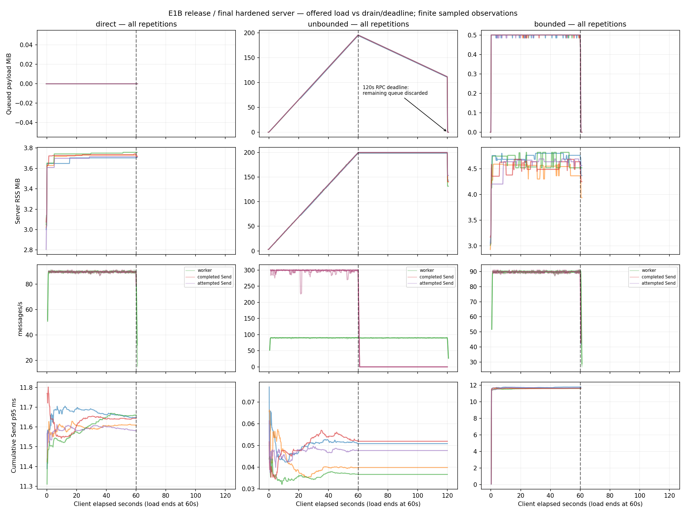
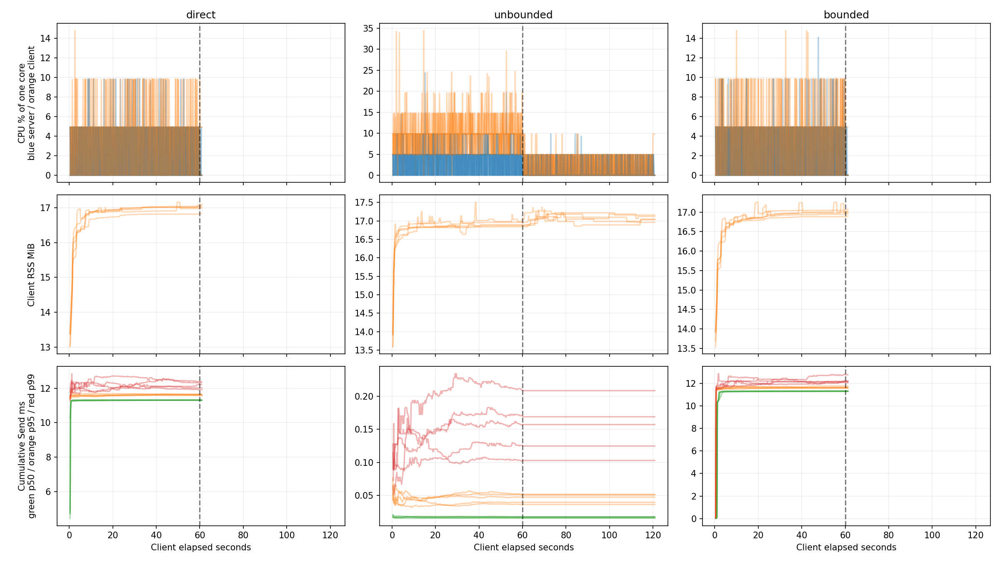
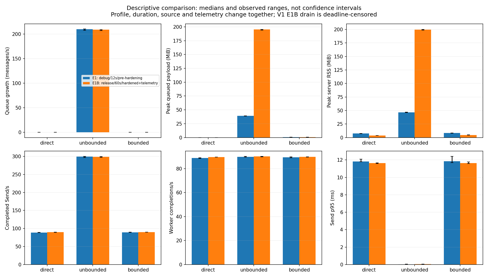

# EXPERIMENT-001B — Release-Build Sustained Overload Validation

Measured source/harness commit: `9773403fbb8d156b2773687254fe038c6a5105d1`. Baseline E1 evidence: `3374f126e3009991ec97c95e64dabd03c734b575`.

## Outcome

All **15 requested 60-second offered intervals** were collected (five per variant). All ten direct/bounded RPCs completed and drained. All five unbounded RPCs completed their offered interval but **hit the unchanged 120-second whole-RPC deadline during drain**. They are retained as deadline-aborted runs, not successful drains. No RSS/queue/CPU/file/wall safety guard fired, and there were no unexplained collection or accounting failures.

Repeated positive unbounded queue/RSS growth, bounded occupancy at K=32, and direct/bounded producer throughput near measured worker throughput are consistent with E1. The lifecycle timeout prevents a complete-drain or post-drain RSS conclusion for unbounded E1B.

## Protocol, environment and provenance

The [predeclared extension](EXTENSION-001B.md) preserves the workload: 300 scheduled/s; 16 KiB payload; seed 1; one worker with 10 ms sleep; K=32; fixed 65,535-byte windows; adaptive server windows off; no compression/retries; two Tokio workers and GOMAXPROCS=2; no traffic warmup. Offered duration and Rust profile are the intended experimental changes; telemetry and the already-hardened server source are explicit comparison differences. The explicitly declared optional Go telemetry adds timestamped cumulative latency percentiles, snapshot-copy/sort and an additional file sync every 200 ms. It is an observer-effect confounder, not a pacing or transport change.

The Rust application source is byte-identical to baseline 3374f12 (the final hardened source). Go was already optimized by default in E1; E1B changes the Rust build to release and adds observer telemetry to Go. [environment.json](results/e1b/environment.json) records compiler versions, dependency tree, OS/kernel, cgroup/disk/CPU and build commands. Original E1 had an earlier pre-cancellation-hardening server snapshot. No separate independent-review file was found; the user supplied the EXTEND decision.

Each [run manifest](results/e1b/runs/) records the exact Git SHA, full dirty-tree status, source-clean flag, source-input SHA256, binary SHA256, start/finish clocks, command arrays, parameters, limits and exit/error outcome. Source/harness was committed before primary measurement and remained unchanged. New result files made the overall working tree dirty; this is recorded rather than represented as a clean checkout. Binaries were built before that freeze commit with matching source content; the captured Go build metadata still records the earlier revision and dirty flag. The pinned source-input hashes, not that embedded VCS stamp, establish the measured source. No byte-identical compiler-rebuild guarantee is made.

[integrity-audit.json](results/e1b/integrity-audit.json) checks all source inputs against the pinned Git objects, identical binaries across primary runs, and **250 original evidence files unchanged**. [Baseline integrity inventory](results/e1b/baseline-evidence-sha256.txt) preserves their hashes. The older full-package E1 checksum inventory and recursive review verifier describe the baseline checkout; run those on 3374f12 rather than treating the expanded results tree as the old package. New Go telemetry legitimately changes application source, not historical raw measurements. Postmeasurement plot annotation and packaging scripts do not alter the pinned measured binaries.

## Commands and validation

Executed from `/workspace/grpc-under-pressure` after `source scripts/dev-env.sh`:

```sh
cargo build --release --locked --manifest-path server/Cargo.toml -j 4
(cd loadgen && go test -mod=readonly -v ./...)
(cd loadgen && go build -mod=readonly -o /workspace/toolchains/bin/pressure-loadgen-e1b ./cmd/loadgen)
python3 experiments/001/e1b/run.py --phase preflight
# Protocol/harness/telemetry committed as 9773403 before this phase:
python3 experiments/001/e1b/run.py --phase measured
MPLCONFIGDIR=/workspace/toolchains/matplotlib python3 experiments/001/e1b/analyze.py
MPLCONFIGDIR=/workspace/toolchains/matplotlib python3 experiments/001/e1b/finalize.py
```

The original eight integration tests were also executed against release binaries by loading `tests/test_runtime.py`, replacing its SERVER and CLIENT constants with the release executable paths, and running unittest. [Integration log](results/e1b/release-integration.log), [Go tests/build](results/e1b/build-go.log), [Rust build](results/e1b/build-rust-release.log), and [preflight log](results/e1b/preflight-runner.log) retain results. The two Go protocol tests plus the new percentile test passed, as did all eight process integration tests. Integration-test temporary safety/cancellation CSVs were not archived; primary deadline-aborted runs are fully retained.

Preflight used independent fresh processes: 3 s sender calibrations with a 1 ms worker, 4 s 50/s controls with a 10 ms worker, and 3 s saturated direct-worker calibration. These are not counted as primary repetitions. [Preflight raw data](results/e1b/preflight/) and analysis include all seven runs. Calibration showed >=285/s sender capability in each variant and no sustained control queue growth.

All primary child commands are wrapped with `prlimit --cpu=120 --fsize=67108864 --core=0`. Original limits remain 256 MiB queued payload, 512 MiB server RSS, 120 s RPC deadline; supplemental guards use 128 MiB client RSS and 125 s external wall timeout. The deadline is not raised to conceal unbounded drain failure. The inspected cgroup allows 32 GiB; see environment evidence. Execution is sequential, with fresh processes and seed-1 shuffled order in [run-order.json](results/e1b/run-order.json).

## Measurement definitions and synchronization

Each run retains `server.csv`, `client.csv`, `latency.csv`, `process.csv`, `observations.csv`, `client.json`, stdout/stderr logs and manifest. Offline `synchronized.csv` aligns observer snapshots on the same host monotonic clock. Process samples and observation brackets carry common timestamps; latency.csv carries native wall timestamp and elapsed time. Server clock origin is inferred from export-visibility brackets, with width/method retained in analysis. This is bounded sampling alignment with unmeasured export overhead, not exact event synchronization. Native values may be held for a ~200 ms sample interval; export ages are explicit. No cross-host timestamps are subtracted.

Steady slopes use **5–55 s after client start**. Early 5–20 s and late 40–55 s windows check sustained behavior. Rates are derived from counter increments on native actor time; Send throughput is not computed by dividing completed Sends by the entire RPC/drain lifetime. Latency series are **cumulative p50/p95/p99**, not interval histograms. Send call time includes serialization/scheduling and possible blocking; it is never labeled isolated HTTP/2 transport wait. Calls >20 ms are a coarse indicator and can be zero despite worker-paced ~11 ms Send latency. CPU is sampled from Linux ticks and expressed as a fraction of one core, with tick quantization and finite sampling. E1B CPU uses the offered interval; E1 reported a full-RPC average including drain, so those CPU averages are not directly comparable. RSS is OS process memory, separate from logical owned payload bytes.

## Measured primary results

Medians [observed minimum, maximum] across five offered intervals per variant; ranges are not confidence intervals. Full per-run/early/late/CPU/clock statistics are in [analysis.json](results/e1b/analysis.json).

| Metric | Direct | Unbounded | Bounded K=32 |
|---|---:|---:|---:|
| Queue growth, messages/s | 0.000 [0.000, 0.000] | 208.881 [207.299, 209.208] | 0.000 [-0.001, 0.003] |
| Queue bytes growth, MiB/s | 0.000 [0.000, 0.000] | 3.264 [3.239, 3.269] | 0.000 [0.000, 0.000] |
| RSS growth, MiB/s | 0.000 [0.000, 0.001] | 3.275 [3.252, 3.279] | 0.001 [-0.002, 0.003] |
| Peak queued messages | 0 [0, 0] | 12505 [12433, 12520] | 32 [32, 32] |
| Peak queued payload, MiB | 0.00 [0.00, 0.00] | 195.39 [194.27, 195.62] | 0.50 [0.50, 0.50] |
| Peak server RSS during offered load, MiB | 3.73 [3.70, 3.76] | 199.59 [198.48, 200.14] | 4.69 [4.59, 4.82] |
| Attempted Sends/s | 89.62 [89.51, 89.68] | 298.86 [297.38, 299.36] | 89.82 [89.59, 89.84] |
| Completed Sends/s | 89.62 [89.51, 89.68] | 298.86 [297.38, 299.36] | 89.82 [89.59, 89.84] |
| Worker completions/s | 89.62 [89.51, 89.68] | 90.08 [89.78, 90.17] | 89.82 [89.59, 89.85] |
| Send p50, ms | 11.318 [11.302, 11.322] | 0.018 [0.016, 0.018] | 11.308 [11.291, 11.331] |
| Send p95, ms | 11.643 [11.581, 11.661] | 0.048 [0.037, 0.052] | 11.634 [11.585, 11.770] |
| Send p99, ms | 12.220 [11.928, 12.387] | 0.157 [0.103, 0.208] | 12.182 [12.064, 12.772] |
| Cumulative time inside Send, s | 59.667 [59.622, 59.726] | 0.521 [0.454, 0.653] | 59.529 [59.477, 59.568] |
| Fraction Send calls >20 ms | 0.0000 [0.0000, 0.0007] | 0.0002 [0.0001, 0.0003] | 0.0002 [0.0002, 0.0004] |

All primary server clock-origin estimates had nonempty export-visibility bracket intersections (widths 0.125–0.556 ms). These widths exclude unmeasured exporter overhead and do not remove the ~200 ms native sampling/held-value uncertainty.

### Sustained growth and CPU

- **direct**: early queue slopes 0.000–0.000 msg/s; late 0.000–0.000 msg/s. Median offered-window CPU: server 1.80%, client 3.30% of one core. Peak sampled client RSS 16.83 MiB.
- **unbounded**: early queue slopes 208.379–209.524 msg/s; late 208.172–209.228 msg/s. Median offered-window CPU: server 3.09%, client 9.78% of one core. Peak sampled client RSS 17.22 MiB.
- **bounded**: early queue slopes -0.002–0.008 msg/s; late -0.008–0.004 msg/s. Median offered-window CPU: server 1.93%, client 3.33% of one core. Peak sampled client RSS 16.89 MiB.





### Every primary outcome, including aborted drains

| Run | 60 s data eligible | RPC outcome | Completed Sends | Processed at cleanup | Explicitly discarded | Manifest |
|---|---|---|---:|---:|---:|---|
| overload-1-bounded | True | completed_and_drained | 5419 | 5419 | 0 | [JSON](results/e1b/runs/overload-1-bounded/manifest.json) |
| overload-1-direct | True | completed_and_drained | 5381 | 5381 | 0 | [JSON](results/e1b/runs/overload-1-direct/manifest.json) |
| overload-1-unbounded | True | rpc_deadline_abort | 17851 | 10782 | 7069 | [JSON](results/e1b/runs/overload-1-unbounded/manifest.json) |
| overload-2-bounded | True | completed_and_drained | 5432 | 5432 | 0 | [JSON](results/e1b/runs/overload-2-bounded/manifest.json) |
| overload-2-direct | True | completed_and_drained | 5390 | 5390 | 0 | [JSON](results/e1b/runs/overload-2-direct/manifest.json) |
| overload-2-unbounded | True | rpc_deadline_abort | 17932 | 10794 | 7138 | [JSON](results/e1b/runs/overload-2-unbounded/manifest.json) |
| overload-3-bounded | True | completed_and_drained | 5429 | 5429 | 0 | [JSON](results/e1b/runs/overload-3-bounded/manifest.json) |
| overload-3-direct | True | completed_and_drained | 5384 | 5384 | 0 | [JSON](results/e1b/runs/overload-3-direct/manifest.json) |
| overload-3-unbounded | True | rpc_deadline_abort | 17928 | 10790 | 7138 | [JSON](results/e1b/runs/overload-3-unbounded/manifest.json) |
| overload-4-bounded | True | completed_and_drained | 5431 | 5431 | 0 | [JSON](results/e1b/runs/overload-4-bounded/manifest.json) |
| overload-4-direct | True | completed_and_drained | 5386 | 5386 | 0 | [JSON](results/e1b/runs/overload-4-direct/manifest.json) |
| overload-4-unbounded | True | rpc_deadline_abort | 17894 | 10774 | 7120 | [JSON](results/e1b/runs/overload-4-unbounded/manifest.json) |
| overload-5-bounded | True | completed_and_drained | 5429 | 5429 | 0 | [JSON](results/e1b/runs/overload-5-bounded/manifest.json) |
| overload-5-direct | True | completed_and_drained | 5391 | 5391 | 0 | [JSON](results/e1b/runs/overload-5-direct/manifest.json) |
| overload-5-unbounded | True | rpc_deadline_abort | 17925 | 10777 | 7148 | [JSON](results/e1b/runs/overload-5-unbounded/manifest.json) |

The five unbounded `client_exit=1` outcomes are real DeadlineExceeded errors after a full offered interval; server cleanup exits zero. Discarded bytes/messages are not called processed. Their post-cancellation zero queue does not indicate a successful drain. No primary run was silently excluded, replaced or retried. Sampling/ownership equations passed before and after cleanup, with discarded counts included after cancellation. A finite sampler cannot prove every transient occupancy; bounded capacity also follows from the unchanged reserve-before-receive/channel implementation.

## E1 comparison and contradictions



[e1-comparison.json](results/e1b/e1-comparison.json) retains both summaries. E1 measured 12 s debug-build overloads using pre-hardening server source; E1B uses 60 s release runs on the final hardened server plus Go telemetry. The longer unbounded interval accumulates more queue-owned bytes and RSS. Throughput remains close to measured consumer capacity in direct/bounded and materially higher in unbounded. These changes occur together; the experiment cannot isolate a build-profile, duration, source-version or instrumentation causal effect.

**No observed result contradicts E1’s central application-level finding.** A material lifecycle difference is that E1 drained normally whereas all E1B unbounded RPCs exceed the retained deadline during drain. This limits drain/reconciliation interpretation; it is not evidence that the queue stopped growing or transport flow control failed. Small rate/RSS changes are measured differences, not proof of a particular cause.

## Acceptance and limitations

- Sustained unbounded occupancy: repeated positive early/late and pooled queue/byte slopes support it for the finite 60 s load window.
- Queue/RSS correspondence: compare separately measured slopes and time series; observed joint growth supports correspondence, not heap attribution or byte-for-byte allocator identity.
- Bounded occupancy: K=32 plateau in every repetition; this is not a bound on all process memory.
- Backpressure: direct/bounded completed Send rates approach worker rates, with much longer Send calls than unbounded; no isolated transport-wait duration is inferred.
- Repeatability: five release-build offered intervals per variant, with original resource/time limits and all deadline outcomes retained. This does not mean fifteen successful, fully drained RPCs.

Remaining limits: single localhost host, fixed windows, sleep-based service, five-run ranges rather than confidence intervals, source/duration/profile/telemetry confounding, observer overhead, periodic RSS/CPU/counter sampling, no isolated HTTP/2 wait, no new wire trace/packet capture, no allocator/live-heap attribution, no independent-machine reproduction, and V1 drain censored by the unchanged deadline. The client binary was built from dirty pre-freeze source content, whose hashes match the pinned commit; embedded Go VCS metadata alone is insufficient provenance.

A separately approved follow-up could extend only the drain deadline (not weaken memory limits) to measure full unbounded reconciliation/post-drain RSS, and use a factorial comparison to isolate release/source/duration effects. That follow-up was **not executed**. No adaptive concurrency or blog content was started.
