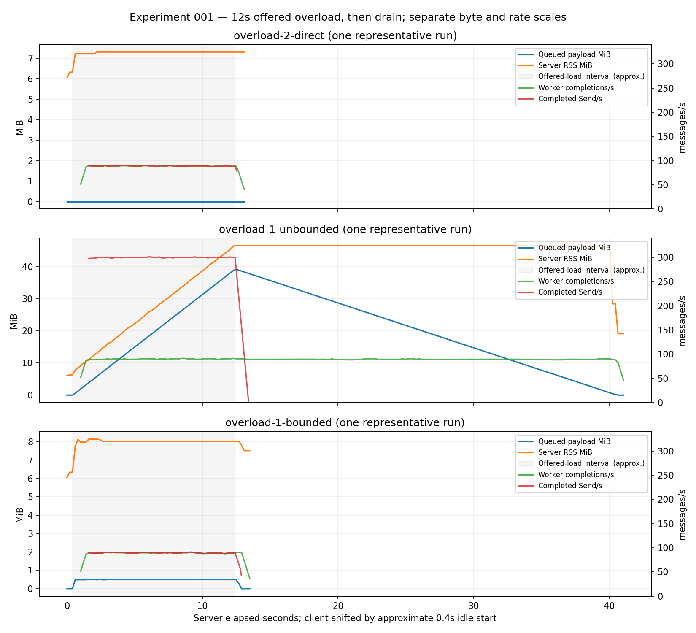
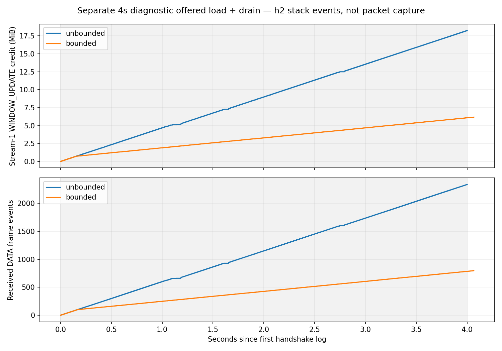

# Experiment 001 — Where Does gRPC Backpressure Stop?

## Scope and repository inspection

The initial repository contained the frozen EXPERIMENT-001.md, decisions, conceptual protobuf contract and toolchain target, but no Cargo package, Go module, executables or tests. M1 was the next incomplete milestone. We established its pinned build/codegen/source-audit foundation, then implemented only the Experiment 001 scenarios and validation needed to exercise H1. No adaptive concurrency or Blog 2 work was added. The frozen specification is unchanged.

## Environment and setup

Linux x86_64, kernel `6.18.55`, Rust 1.99.1, Go 1.27.3, protoc 31.1. Exact OS, compiler output, dependency graph and cgroup limit are in [results/environment.json](results/environment.json). The cgroup allowed 32 GiB; the experiment used much smaller safety thresholds. Tools/caches live under `/workspace/toolchains` and were installed from official sources with checksum verification. Cargo.lock and go.sum preserve package verification. All measured server runs used the same **debug build**, not a release performance build.

Pinned direct stack: Tokio 1.48.0, tonic/tonic-prost/tonic-prost-build 0.14.2, prost 0.14.1, grpc-go 1.76.0, Go protobuf 1.36.10. Compiler package `protoc-bin-vendored` 3.2.0 supplies protoc 31.1; Go plugins are 1.36.10 and protoc-gen-go-grpc 1.5.1. Resolved Hyper is 1.12.0 and h2 is 0.4.20. See [source audit](SOURCE-AUDIT.md) for exact Rust crate VCS commits and inspected paths.

## Implemented scenarios and controls

| Scenario | Receive/processing order | Application queue |
|---|---|---|
| V0 direct | Receive one message, await service interval, discard | None |
| V1 unbounded | Receive owned payload, enqueue; one worker processes | Tokio unbounded MPSC |
| V2 bounded | Reserve capacity **before** receiving, then hand off; same worker | Tokio bounded MPSC, K=32 |

One RPC/stream/connection per fresh server process; retries disabled. No per-message tasks, compression, result retention, or client application work queue. Payloads contain 16 KiB deterministic pseudorandom bytes, seed 1. Client Send completions are not server-processing acknowledgments. Payload allocations are independently owned; encoding/decoding and channel tests cover this.

All primary variants use two Tokio workers and Go GOMAXPROCS=2, 65,535-byte server stream and connection receive windows, server adaptive windows disabled, client receive windows set to 65,535, 1 MiB maximum message size and identical configured 10 ms sleep service. Sleep models a slow non-CPU consumer. Server samples cumulative counters and RSS every 200 ms; the runner separately samples server/client Linux CPU ticks, RSS and thread counts. Measurements use CSV instead of a live Prometheus exporter; this changes collection format, not metric meaning.

Queue receive, handoff, counters and snapshots share a mutex. The worker uses `try_recv` under that lock and Notify while idle, avoiding the race where dequeue frees a bounded slot before its metric decrements. Handler and worker bytes are separate from queue bytes. Handoff transitions are instantaneous at sample boundaries; brief handler ownership need not appear as a positive sampled gauge. Transport memory is not included in application byte gauges. Connection instrumentation counts total accepted TCP connections; exactly one accepted connection plus one active RPC establishes topology, not a continuously exported active-socket gauge.

Cancellation drops a task guard that aborts the worker. Normal EOF releases a reserved permit and drains the channel before returning Summary. Deadline and safety tests verify cleanup. A final postmeasurement hardening adds a cancellation flag so worker completion cannot race cleanup's discarded-message accounting. **The measurements refer to the retained pre-hardening source snapshots** in `results/e1/source/`, with source and executable SHA256 in each manifest. Final regression tests and three new smoke runs validate the hardened code; the primary repeats were not rerun after that cancellation-only change.

## Executed protocol and commands

From `/workspace/grpc-under-pressure`:

```sh
bash scripts/bootstrap.sh
source scripts/dev-env.sh
bash scripts/generate-go.sh
bash scripts/check.sh
cargo clippy --locked --manifest-path server/Cargo.toml --all-targets -- -D warnings
python3 experiments/001/run.py --output experiments/001/results/e1 --phase calibration
python3 experiments/001/run.py --output experiments/001/results/e1 --phase measured
# One replacement: run(..., 'overload-6-direct', 'direct', 300, 12)
python3 experiments/001/run.py --output experiments/001/results/e1 --phase diagnostic
python3 experiments/001/analyze.py experiments/001/results/e1
MPLCONFIGDIR=/workspace/toolchains/matplotlib python3 experiments/001/plot.py experiments/001/results/e1
MPLCONFIGDIR=/workspace/toolchains/matplotlib python3 experiments/001/transport.py experiments/001/results/e1
```

The replacement used `experiments/001/run.py`'s `run` function; its exact server/client arguments are in `results/e1/overload-6-direct/manifest.json`. Final smoke runs used that same function with each variant, 300 messages/s and 1 s offered duration, under `results/final-smoke/`. Per-run manifests retain the actual process commands, parameters, exit statuses, source/binary hashes and start time. Existing result directories are never overwritten by the runner. Reproduction commands for new output directories are in README.md.

Preparation initially hit a non-Go `/usr/bin/go`, absent Rust/protoc, and a read-only home Go cache. Installing official compilers and selecting writable caches resolved these. An early Go test ran before dependency checksum preparation finished and failed with missing go.sum entries; it is retained in `results/m1-go-test.log`. Early Rust build errors (address type inference) and Clippy's map/inspect diagnostic were fixed; the original failing diagnostics and final passing logs are retained. No TLS, checksum or signature verification was disabled.

The executed measurement plan:

- Independent 3 s fast-consumer calibration per variant (service=1 ms, offered=300/s), and a separate direct saturated-worker calibration (service=10 ms, offered=1000/s).
- One 4 s below-capacity control per variant (50/s, service=10 ms).
- Five valid fresh-process overload repetitions per variant: 300/s offered for **12 s**, followed by EOF and complete drain within a 120 s whole-RPC deadline. Variant order was shuffled within each repetition using seed 1; `run-order.json` preserves it.
- No workload warmup: calibration runs are separate processes; each measured process starts idle, with about 0.4 s pre-traffic sampling. Missed sender schedule slots are skipped and counted rather than replayed in catch-up bursts.
- Queue-byte limit 256 MiB, checked before unbounded enqueue; server RSS limit 512 MiB sampled every 200 ms. All measured runs stayed well below these. Separate tests deliberately exercise both abort paths and preserve a sample before RSS exit.
- One 4 s h2-trace diagnostic each for V1 and V2, outside the primary repeats. Logging changes overhead, so these are not mixed into primary statistics.

This is a shorter initial experiment than the specification's proposed 60 s overload. The shared 12 s choice was stated before measured runs; it bounds cost/memory while allowing stable saturation. It does not establish long-duration stability.

## Calibration and measured results

Sender calibration sustained **298.98–299.63 completed Sends/s** with no sampled application backlog. Worker calibration measured **89.22 service completions/s** from accumulated service durations. Thus the Go sender demonstrated capacity above the slow worker. Each 50/s control accepted and processed 200 messages with zero sampled queue depth. Actual sleeping-worker capacity is about 89–90/s, not the nominal 100/s: timer/runtime overhead matters.

The table reports medians across five valid runs; brackets contain observed run-to-run minima and maxima, **not confidence intervals**. Queue/processing slopes use server elapsed 2.5–10.5 s; sender rates use client elapsed 2–10 s, entirely inside offered load. OLS is applied to cumulative counters and queue gauges. Complete per-run values are in [analysis.json](results/e1/analysis.json).

| Metric | V0 direct | V1 unbounded | V2 bounded |
|---|---:|---:|---:|
| Queue growth, messages/s | 0 | 209.82 [207.39, 210.20] | 0.0023 [-0.0042, 0.0354] |
| Maximum queue depth | 0 | 2,512 [2,487, 2,514] | 32 in every run |
| Maximum queued payload, MiB | 0 | 39.25 [38.86, 39.28] | 0.50 in every run |
| Steady completed Sends/s | 88.88 [88.44, 89.13] | 299.64 [297.06, 300.06] | 89.49 [88.99, 89.80] |
| Worker completions/s | 88.87 [88.48, 89.10] | 89.72 [89.64, 90.19] | 89.49 [89.03, 89.78] |
| Send p95, ms | 11.82 [11.80, 12.08] | 0.037 [0.028, 0.042] | 11.85 [11.68, 12.41] |
| Cumulative time inside Send, s | 11.91 [11.90, 11.92] | 0.084 [0.059, 0.201] | 11.77 [11.73, 11.78] |
| Peak server RSS, MiB | 7.32 [7.29, 7.40] | 46.66 [46.29, 46.75] | 8.29 [8.14, 8.37] |
| Post-drain server RSS, MiB | 7.31 [7.29, 7.40] | 22.02 [19.15, 23.34] | 7.77 [7.51, 8.07] |

V1 median queue-byte slope was **3.278 MiB/s**; median RSS slope was **3.274 MiB/s** in the steady window. This close correspondence is observed for these runs, not a general allocator identity. RSS remained above idle after logical payloads drained. V2's small near-zero fitted slope reflects switching between nearby bounded depths, not sustained accumulation.

Every included run passed sampled queue-depth = enqueue − dequeue, queued bytes = depth × payload size, consistent total ownership accounting, one connection/stream, complete final drain, and received = processed. No measured run hit a safety limit or had a nonzero process exit. Primitive/implementation review establishes bounded capacity; finite 200 ms samples alone cannot prove every transient state. All raw samples remain available.

The preselected “blocked >20 ms” fraction had median **zero in all variants**. It was too coarse for the observed roughly 11–12 ms pacing by the worker. Pressure is instead evidenced by much higher Send latency, almost the entire offered interval spent inside Send, skipped schedule slots, and throughput reduction. Time inside Send includes serialization/scheduling overhead; it is not independently measured pure transport-wait time. Client CPU averaged roughly 2.5–3.0% of one core over the full primary RPC (including drain), and peak sampled client RSS stayed below 17 MiB. The calibration, rather than this drain-diluted CPU average, establishes sender capacity.



The figure shows one explicitly labeled representative run per variant; variability is in the table and raw data. Client timestamps are shifted by an approximate 0.4 s idle start for visualization only; rate and queue statistics are computed within each process clock, not from that alignment.

## HTTP/2 evidence

The audited Hyper receiver releases h2 receive capacity when delivering a DATA body frame, before the slow worker completes. tonic can continue decoding and delivering owned messages to V1's application queue. h2 coalesces WINDOW_UPDATE; there is no required one-to-one correspondence with protobuf messages.

Separate diagnostic logs contain received DATA frame events and stream-1 WINDOW_UPDATE encoding events:

| First approximately 4 s since handshake | V1 unbounded | V2 bounded |
|---|---:|---:|
| Received DATA frame events | 2,334 | 785 |
| Logged stream receive credit, bytes | 19,117,606 | 6,377,914 |

These count unique h2 DEBUG frame events, excluding repeated TRACE descriptions. DATA frames are not messages. `transport.py` preserves parsing rules and produces [transport-summary.json](results/e1/transport-summary.json). The source audit plus these logs supports that flow control remained active while V1 accepted more data than its worker processed. **This is stack instrumentation, not a packet capture or proof of exact on-wire timing.** tcpdump/tshark were unavailable. It does not establish where every byte of hidden buffering resides.



## Exclusions, tests and provenance

One direct run (`overload-1-direct`) is retained and excluded because its source hash captured a temporary uncompiled assertion edit while the running executable remained unchanged. It was replaced by `overload-6-direct`. This exclusion concerns provenance, not its measured outcome; original data and the annotated manifest were retained. Five unambiguous direct runs remain. The primary run source snapshots and executable hashes are retained even though the subsequent cancellation-only hardening changes the current source.

Final checks: **four Rust unit tests, two Go protocol tests and eight process integration tests passed**, including normal completion for all variants, cancellation for all variants, queue safety abort and RSS safety abort. Rust/Go builds and Clippy with warnings denied passed. Codegen was rerun and the committed Go files remained byte-identical. Final source passed three additional fresh-process smoke runs. See `results/final-tests.log`, `final-clippy.log` and `final-smoke/`. Generated Go packages and Rust doc tests have zero tests and are not counted as executed test coverage.

## Supported conclusions and limitations

For this pinned stack and finite, non-CPU slow-consumer workload, repeated measurements support H1's application-level prediction: an unbounded application channel accumulates owned decoded payloads while the worker proceeds at its slower rate. Reserving bounded capacity before receiving caps that queue and is associated with sender throughput settling near worker throughput. HTTP/2 flow control does not cap arbitrary application retention. Bounded queues do not bound all process memory.

Limitations: localhost co-location; debug builds; short 12 s overload and 4 s controls; five runs describe ranges, not statistical confidence; no independent-machine reproduction; timer-based service; periodic rather than instantaneous RSS sampling; source/log evidence rather than packet capture; no live heap attribution; approximate cross-process plot alignment; no exported service-time percentile histogram or live Prometheus endpoint; and primary repeats precede the final cancellation-accounting hardening. Final cleanup tests and smoke runs validate the current code, but do not replace a new primary dataset for publication.

## Open questions and next experiment

Repeat the same matrix in a release build for the proposed 60 s interval, with predeclared longer controls, identical fixed windows, final hardened source and retained aborted runs. Collect a packet capture or equivalent independently verified frame trace, inspect live heap versus RSS after drain, and investigate how window size and K change pressure onset in separately labeled diagnostics. Add service-time distributions and more repetitions before making confidence claims. Do not begin adaptive concurrency or generalize these results to all gRPC stacks.
