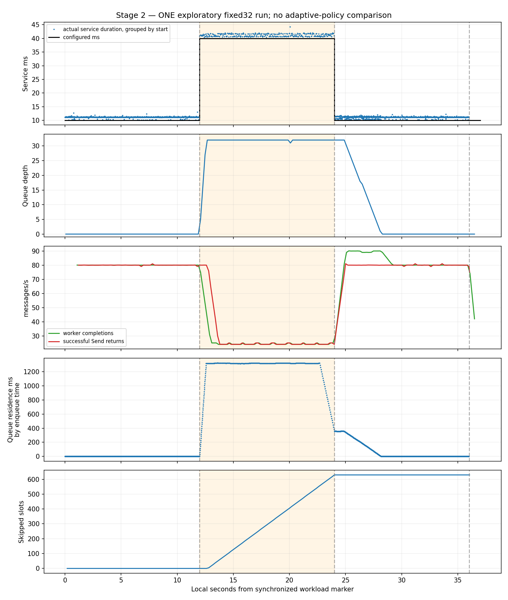

# Experiment 002 — Stage 2 report

**Stage 2 completed: the frozen fixed32 workload produced the intended capacity disturbance and recovered.** Exactly one exploratory 36-second run was executed, without adjusting parameters afterward. No fixed8, dynamic budget, adaptive controller, primary five-repeat matrix, or article was added.

Baseline: accepted Stage 1 commit `b92d2c77a64714de99694a8e0561ffc94d0276a2`. Measured application/harness commit: `84509545abf6a5f139687250757e67703477a5c1`. The [frozen contract](EXPERIMENT-002.md) is unchanged. **687 historical files** match the baseline byte-for-byte, covering E1/E1B and Stage 1 raw evidence/report/README/contract; see [historical-integrity.json](results/stage2/historical-integrity.json).

## Files changed

- `server/mod.rs`: opt-in contract schedule, monotonic service-start selection, selected-delay metadata, actual phase markers, completed-service/queue observation sums, and event-format/write/flush wall timers. Default remains Stage 1 constant 10 ms. Discard event destination is explicitly control-only.
- `server/tests.rs`: four targeted tests for exact boundaries/drain, start versus enqueue/completion selection, failure wakeup during slowdown, and sink equivalence. Existing cancellation/EOF/accounting/bounded-storage tests remain.
- `stage2/run.py`, `analyze.py`, `report.py`, [README.md](stage2/README.md): exclusive-create runner, overhead-before-exploration gate, one-attempt guard, predeclared analysis and reproducible report. Post-run edits clarified actor-local drain and slot/Send-return phase attribution, omitted unexecuted full phase windows from short controls, and rendered this report; measured binaries and inputs were unchanged.
- `results/stage2/` and this report: all controls, smoke/integration and exploratory evidence, ledgers, manifests, environment, checks and graphs. No Go client, dependency declaration, lockfile, protocol, E1/E1B source/report/data, or historical Stage 1 report/data was changed.

The worker selects 10 ms before t=12 s, 40 ms for service starts in [12,24), and 10 ms at every start >=24 s, including drain. An executing job is never retimed. Enqueue-phase histogram assignment remains independent of service-start phase. K/static pending limit stay 32; reservation ordering, EOF release, terminal disposition, busy/idle accounting and 200 ms collection remain. Phase-log I/O errors signal terminal failure rather than silently continuing.

## Commands and checks

Executed from `/workspace/grpc-under-pressure` after `source scripts/dev-env.sh`:

```sh
cargo build --locked --manifest-path server/Cargo.toml -j4
cargo test --locked --manifest-path server/Cargo.toml -j4
cargo clippy --locked --manifest-path server/Cargo.toml --all-targets -- -D warnings
cargo fmt --manifest-path server/Cargo.toml -- --check
(cd experiments/002/client && go mod verify && go test -mod=readonly -race -v ./... && go vet ./...)
(cd experiments/002/client && go build -mod=readonly -o /workspace/toolchains/bin/pressure-stage1-client .)
# Source frozen as 8450954 before collecting measurements.
python3 experiments/002/smoke.py --output experiments/002/results/stage2/stage1-regression
python3 experiments/002/stage2/run.py --output experiments/002/results/stage2 --phase smoke
python3 experiments/002/stage2/run.py --output experiments/002/results/stage2 --phase overhead
python3 experiments/002/stage2/analyze.py experiments/002/results/stage2
python3 experiments/002/stage2/run.py --output experiments/002/results/stage2 --phase exploratory
MPLCONFIGDIR=/workspace/toolchains/matplotlib python3 experiments/002/stage2/analyze.py experiments/002/results/stage2
python3 experiments/002/stage2/report.py
```

**20 Rust tests passed** (16 E2 including four additions, plus four original protocol/channel tests); **four E2 Go tests passed with race detection**. Build, formatting, warnings-denied Clippy, Go vet and module verification passed. Six Stage 1 lifecycle fixtures and a short opt-in schedule fixture passed before collection. Synthetic tests cover real 12/24/36 s decisions without accelerating the exploratory schedule. [Check logs](results/stage2/checks/) retain actual output. Zero-test doc/generated packages are not counted.

Every buffered run passed the Stage 1 verifier: physical/counter/byte invariants, reservations, exact timestamp differences, histogram reconstruction and unique final message dispositions. Every selected delay was also checked against its service-start timestamp. Controls, integration and exploratory outcomes are retained; [ledger](results/stage2/ledger.jsonl). No invalid run was replaced or hidden. Discard controls intentionally lack per-message events, and are not full experiment evidence.

## Observer assessment before exploration

Four fresh constant-10-ms, 80/s, 4-second controls ran **buffered, discard, discard, buffered**. Each processed all 320 scheduled messages. Discard retains formatting, the 64 KiB buffer, histograms, locks, counters and sampling; only the event destination changes to a no-retention sink. Aggregate byte/counter/histogram/final Summary checks passed. [Pre-exploration assessment](results/stage2/checks/overhead-assessment-before-exploratory.log) and order are retained.

| Observation: median [min,max], two cases/mode | Buffered file | Discard sink |
|---|---:|---:|
| Timed event write+flush / worker-observed wall (%) | 0.0975 [0.0949, 0.1002] | 0.0947 [0.0900, 0.0994] |
| Event formatting/write total (ms) | 3.397 [3.331, 3.464] | 3.755 [3.566, 3.943] |
| Event flush total (ms) | 0.505 [0.466, 0.544] | 0.034 [0.034, 0.034] |
| Largest flush (microseconds) | 46.349 [26.349, 66.350] | 1.868 [1.772, 1.963] |
| Actual completed-service mean (ms) | 11.1203 [11.0999, 11.1407] | 11.1380 [11.1269, 11.1491] |
| Service p95 upper histogram bucket (ms) | 11.5056 [11.5056, 11.5056] | 11.5056 [11.5056, 11.5056] |

Buffered flushes cost more, but discard was not consistently faster in every component; means overlap and the approximate p95 bucket is identical. Two offered-limited controls per mode do not establish saturated-capacity loss, statistical confidence, or zero overhead. Timers cover writeln/buffered-write and flush portions under the lock, not all field preparation, timer bookkeeping, histogram/check/snapshot work, other I/O or contention. Wall time can include descheduling. Flush is an OS/page-cache write, not fsync/durable-disk latency.

In the exploratory run the timed portions totaled **28.063 ms** formatting/write plus **4.870 ms** flush: **0.0915%** of worker-observed time. Largest write/format and flush were 450.958 and 228.013 microseconds. I/O under the lock can still delay admission/dequeue/completion and inflate measured service/residence. These are partial observer costs, not a total overhead bound; the caveat remains for later policy comparisons.

## Workload and reproducibility

One fixed32 run: 80 scheduled slots/s for 36 s; 16,384-byte seeded pseudorandom payloads; one connection/stream/handler/worker; two Tokio workers/GOMAXPROCS=2; 65,535-byte stream/connection windows; server adaptive windows off; no retries/compression; 1 MiB message limit; same debug-Rust/default-optimized-Go build and inherited CPU placement as controls. [Environment](results/stage2/environment.json) records compilers, dependencies, OS/kernel, cgroup, affinity and hashes.

Manifests retain exact child command arrays, Git SHA/dirty state, input/binary hashes, parameters, clock offsets and exits. Binaries and inherited affinity are identical across four controls, the short schedule fixture and exploratory run; [integrity check](results/stage2/run-integrity.json). New results make the overall tree dirty; source inputs stayed unchanged and match pinned Git objects. Historical full-package checksums describe baseline source, not the intentionally extended current server.

Guards remain 512 MiB server RSS, 128 MiB client RSS, 10 s process CPU, 16 MiB per file and no core dumps; RPC deadline stays 120 s from creation. External wall timeout is 125 s rather than the 12 s short-smoke guard, to encompass this scenario and its existing RPC deadline. No safety guard, forced shutdown, RPC error or telemetry gap occurred.

## Phase transitions and measured behavior

Marker release alignment error: **0.495 ms**, below 100 ms. Logger wakeup is independent of the monotonic function choosing service delay.

| Boundary s | Observed marker s | Lateness ms | Configured delay ms |
|---:|---:|---:|---:|
| 0 | 0.000610 | 0.610 | 10 |
| 12 | 12.001125 | 1.125 | 40 |
| 24 | 24.000683 | 0.683 | 10 |
| 36 | 36.000867 | 0.867 | 10 |

First 40 ms service: **12.001448 s**. First recovery 10 ms service: **24.005989 s**. A job starting at **23.965018 s** kept its 40 ms choice and completed at **24.005964 s**, demonstrating selection at start rather than completion. No message began service at >=36 s: the retained 10 ms drain setting is logged/tested, not invented as a measured drain distribution.

| Metric | Healthy [0,12) | Slowdown [12,24) | Recovery [24,36) |
|---|---:|---:|---:|
| Actual service mean ms, grouped by start | 11.153 | 41.225 | 11.146 |
| Actual service p95 ms, grouped by start | 11.390 | 41.935 | 11.488 |
| Worker completions/s, by completion time | 79.917 | 24.250 | 83.417 |
| Successful Send returns/s, by return time | 80.000 | 27.583 | 80.000 |
| Skipped scheduled slots | 0 | 628 | 1 |
| Maximum sampled physical Q | 0 | 32 | 32 |
| Queue-residence p95 ms, grouped by enqueue | 0.079 | 1323.315 | 356.174 |
| Send wall-duration p95 ms | 0.052 | 39.673 | 0.056 |

The slowdown was capacity-constrained: 80/s offered exceeded **24.25/s** worker completion, Q reached 32, Send durations increased, and 628 slowdown slots were skipped. One additional slot was skipped during recovery. Boundary-crossing jobs retain their start-selected delay; service is grouped by start, worker throughput by completion, Send-return throughput by return time, Send-duration distributions by call start, queue residence by enqueue, and skipped slots by planned slot phase.

After the delay returned, early recovery [24,28) completed **89.75/s** while clearing backlog; late recovery [32,36) completed **80.25/s**, near offered load. First sampled Q=0 after t=24: **28.282441 s**. Capacity recovery precedes queue-delay recovery. The pooled recovery p95 includes initial backlog and does not establish H4's three-second healthy-delay band or adaptive benefit.

Cumulative logical admission wait: **12.344393 s**; physical-acquisition wait/bookkeeping: **1.574 ms**. Send calls consumed **9.472875 s** wall time; 273 exceeded 20 ms and their whole durations summed to **9.391722 s**. These are backpressure indicators, not isolated HTTP/2 stalls or message end-to-end latency.



## Successful EOF/drain and work accounting

**2880 scheduled = 629 skipped + 2251 attempted**. All **2251 Sends succeeded**; failed Sends=0. Final received=admitted=dequeued=processed=Summary.accepted=Summary.processed=2251. Discarded and received-not-admitted=0; R=Q=W and payload-owner byte gauges=0. One accepted connection and stream; exactly one processed disposition per admitted sequence. Successful Sends remain distinct from server acknowledgments.

Client half-close: **36.000864110 s** on its workload clock. Server last service completion: **35.999757904 s**; server EOF: **36.000989428 s**; worker stop: **36.001000234 s**. Server-local EOF-to-worker-stop: **10.806 microseconds**, since payload work was already complete before EOF. Worker-stop time comes from continuous busy+idle accounting, which freezes at exit; this excludes response/JoinHandle overhead. Client whole-RPC elapsed: **36.348828 s**, including setup/marker wait, sends and response—not an inferred drain time of RPC duration minus 36. No cross-process monotonic subtraction invents per-message latency.

[Exploratory manifest/commands](results/stage2/exploratory-1/manifest.json) · [Analysis](results/stage2/analysis.json) · [Exact events](results/stage2/exploratory-1/server/events.csv) · [Transitions](results/stage2/exploratory-1/server/phase-transitions.csv) · [Send records](results/stage2/exploratory-1/client/sends.csv) · [Run output](results/stage2/checks/exploratory.log)

## Remaining limitations and decision

**No Stage 2 blocker remains.** This one run demonstrates the requested deterministic disturbance and successful fixed32 recovery/drain on this host. It does not establish repeatability, adaptive superiority, H2–H5, or bounded process memory. Periodic samples miss brief occupancy changes; source invariants and exact records supplement them. Marker alignment is not wire-event timing. Phase percentiles above use exact streams rather than approximate histogram upper bounds.

The small, healthy/offered-limited I/O study does not isolate all instrumentation or storage-tail overhead and must not be generalized to another host or a primary policy comparison. No workload retuning, second exploratory attempt, primary matrix, later policy or blog work was performed.
