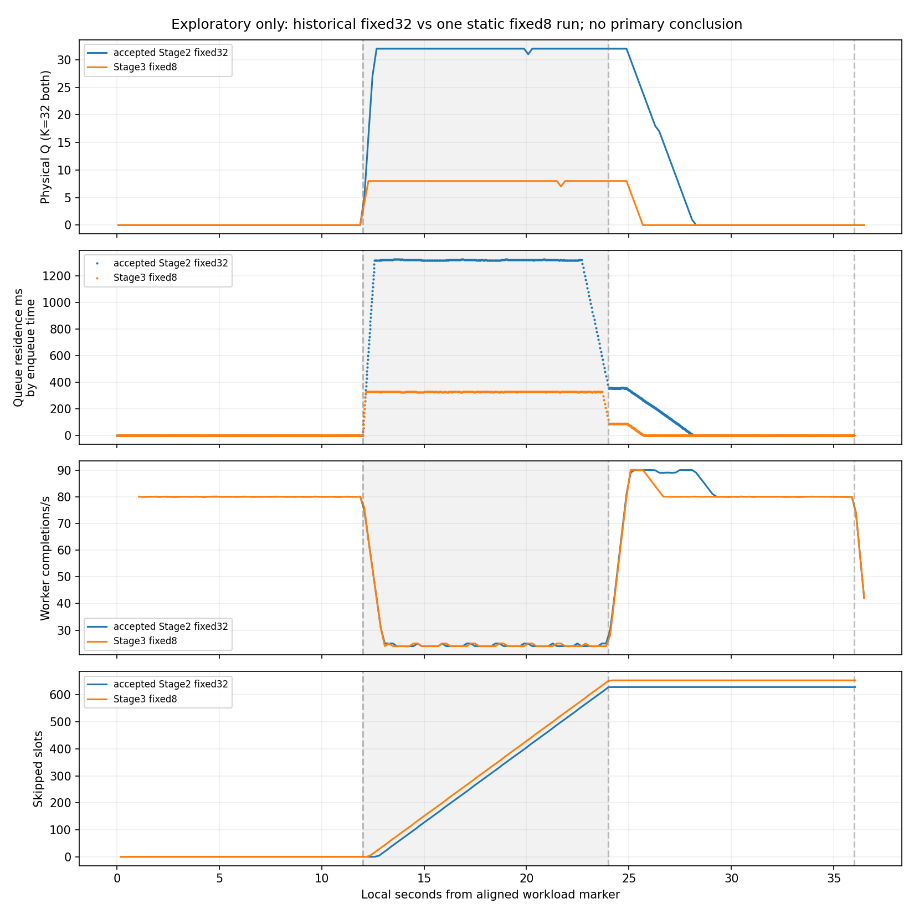

# EXPERIMENT-002 — Stage 3 static pending-work budgets

Stage 3 acceptance is met. `fixed32` (B=32) and `fixed8` (B=8) share one admission implementation and the same physical Tokio MPSC K=32. Tests and all 13 declared runs passed their purpose-specific checks, including three deliberately failed RPC fixtures. Exactly one exploratory fixed8 slowdown/recovery run executed; no primary comparison, dynamic budget updates, controller, tuning or adaptive behavior was implemented.

## Changes and contract

- [Server](server/mod.rs): startup `--policy fixed32|fixed8`, default fixed32; immutable budget stored in shared state. The gate acquires logical R before reserving physical capacity and before calling `stream.message()`. Physical acquisition failure releases that logical reservation. Shared receive/worker, cancellation supervision, service schedule, histograms and event I/O remain in place. Added numeric `physical_capacity`, `physical_available_capacity`, and `logical_pending` columns; existing E1/E2 field meanings are unchanged. E1 server and Go client code are unchanged.
- [Tests](server/tests.rs): six additional test functions covering B=8 without resizing, R counted in B, no read-ahead, repeated budget-window EOF/drain, cancellation, blocked-gate worker error/panic, physical-acquisition failure, and 200 handoff/cancellation races with varying payload sizes. All earlier tests retained.
- [Runner/protocol](stage3/README.md), [run.py](stage3/run.py): exclusive-create results, manifests separating actual server/client sources, exact accepted binary hash checks, 200 ms process sampling, resource guards and complete attempt ledger. Exploration is gated on acceptance/overhead checks and refused after one exploratory attempt.
- [Analysis](stage3/analyze.py), [audit](stage3/audit.py): offline verification, exact streamed-event quantiles, qualified historical comparison and graphs. Analysis uses enqueue cohorts for queue residence, service-start cohorts for service time, and completion/Send-return times for rates.
- All new raw evidence is under [results/stage3](results/stage3/). No historical report or measurement was edited. [Historical integrity](results/stage3/historical-integrity.json) checks 888 historical files byte-for-byte against `4763ce8b7f2798a3bdfb0dcb5ae61b48914c7fdc`.

No ambiguity was found for the requested static policies. Pending occupancy is O=Q+R; executing W is excluded. Eight queued messages plus one worker-owned message is legal for fixed8. Both policies use the same admission condition O<B at acquisition and physical K=32. The single-handler design makes physical reservation immediately available when O<B<=K; a physical inconsistency/closed receiver causes a terminal error with reservation rollback, never receive-ahead.

The frozen [contract](EXPERIMENT-002.md) remains SHA256 `fdd38c609ca7802f9f4a07ecc1d865a707aa9daed258034b943c66361e147b6a`. Its future shrink rule is intentionally not implemented: the static assertion O<=B must be extended to its carryover rule before legal shrink below occupancy can work. Merely adding a budget setter would be incorrect.

## Reproducibility and commands

Runtime server/harness source: `e104d0899a9d4c03ffc5803a69336f984ff31b9c`. Accepted Stage 2 server source and the identical shared Go client source: `84509545abf6a5f139687250757e67703477a5c1`. The subsequent evidence archive adds offline audit/report material; it does not change measured Rust/Go source. Each manifest records actual source-file hashes, executable hashes, exact argv, dirty-tree state, clocks, exit statuses, and limits. During runs tracked source was clean; dirty-tree entries were new untracked Stage 3 evidence, not source changes. Source hashes remained unchanged during every run.

| Executable role | SHA256 |
|---|---|
| Stage 3 debug Rust server | `77377a6b15f3c130756e99539878e2842a0ebcd42008c97254f962b72dde7e3a` |
| Retained accepted Stage 2 debug server | `b3b9effc68e9861f9a4bbea5b9cab68f99455fabcab130039cb7086dc17d540e` |
| Identical client used in every run | `a2e6746e71041666bf9f8beec2f03c68482659c98bb882062d1c88f5e842fcb7` |

[Environment](results/stage3/environment.json): Debian 13.6, Linux 6.18.55 x86_64; rustc/cargo 1.99.1, Go 1.27.3, vendored protoc 31.1. Rust debug and default optimized Go, matching Stage 2. Cgroup CPU quota 400000/100000 (four CPUs), affinity CPUs 0–4, cgroup memory limit 32 GiB. Dependency versions and Go build provenance are archived. The accepted server executable was retained locally and hash-verified against Stage 2; binaries are excluded from Git. The separately rebuilt Go build-check executable was not used in runs.

Frozen exploratory configuration: one connection/stream/handler/serial worker; Tokio worker threads=2, GOMAXPROCS=2; 80 scheduled slots/s for 36 seconds, 2,880 slots, 16,384 pseudorandom payload bytes, seed=1; no catch-up, retry or compression. Stream/connection HTTP/2 windows both 65,535, adaptive window disabled, maximum message 1,048,576 bytes. Service is selected at monotonic worker service start: 10/40/10 ms over [0,12)/[12,24)/[24,36), retaining 10 ms in drain. Gauge/process collection is 200 ms. Limits unchanged: RSS server/client 512/128 MiB, CPU 10 seconds per process, file 16 MiB, no core dump, RPC deadline 120 seconds including send/drain, external wall guard 125 seconds. No safety guard tripped.

Commands executed from repository root (tool activation via `source scripts/dev-env.sh`):

```sh
cargo fmt --manifest-path server/Cargo.toml -- --check
cargo test --locked --manifest-path server/Cargo.toml -j4
cargo clippy --locked --manifest-path server/Cargo.toml --all-targets -- -D warnings
cargo build --locked --manifest-path server/Cargo.toml -j4
(cd experiments/002/client && go mod verify && go test -mod=readonly -race -v ./... && go vet ./... && go build -mod=readonly -o /workspace/toolchains/bin/pressure-stage3-client-buildcheck .)
git diff --check
git diff --exit-code 4763ce8 -- experiments/001 experiments/002/EXPERIMENT-002.md experiments/002/STAGE1-REPORT.md experiments/002/STAGE2-REPORT.md experiments/002/results experiments/002/client loadgen proto server/src/main.rs server/Cargo.toml server/Cargo.lock
python3 experiments/002/stage3/run.py --output experiments/002/results/stage3 --phase acceptance
python3 experiments/002/stage3/run.py --output experiments/002/results/stage3 --phase overhead
python3 experiments/002/stage3/analyze.py experiments/002/results/stage3
python3 experiments/002/stage3/run.py --output experiments/002/results/stage3 --phase exploratory
MPLCONFIGDIR=/workspace/toolchains/matplotlib python3 experiments/002/stage3/analyze.py experiments/002/results/stage3
python3 experiments/002/stage3/audit.py experiments/002/results/stage3
```

Build/test and phase stdout/stderr are retained in [checks](results/stage3/checks/). Additional environment capture used `rustc -Vv`, `cargo -V`, `go version`, `go version -m /workspace/toolchains/bin/pressure-stage1-client`, `cargo tree --locked --manifest-path server/Cargo.toml`, and `(cd experiments/002/client && go list -mod=readonly -m all)` plus OS/cgroup/affinity reads. This was evidence collection, not a workload change. Use a **new** output directory to reproduce; do not overwrite these measurements. Exact per-process `prlimit` and server/client invocations are in each `manifest.json`.

## Acceptance and fault evidence

Rust: 26 tests passed (22 E2, four original library); Go: four tests passed with race detection (cached), module verification and vet passed. Cargo build, fmt and warnings-denied clippy passed. No tests were disabled. Offline verification passed all 13 runs; median server/client sampling gaps were 200.008/199.975 ms and maxima 200.939/200.969 ms in the exploratory run.

| Fixture | Result |
|---|---|
| default fixed32, explicit fixed32, fixed8 normal | Each 0.8 s × 80/s; 64 sent/admitted/processed, zero discards, successful Summary/drain |
| fixed32/fixed8 schedule smokes | Each 0.8 s × 80/s; 64 processed, correct initial phase; not full disturbance validation |
| fixed8 capacity cancellation | Explicit 1000/s fixture, 1200 ms RPC deadline; admitted=89, processed=80, discarded=9 (8 queued + 1 worker), failed Sends=1; final ownership empty |
| fixed8 injected worker error/panic | Each fails at first worker message: admitted=1, processed=0, discarded=1, failed Sends=1; error RPC and final cleanup recorded |
| accepted32-1, shared32-1, shared32-2, accepted32-2 | Four 4 s × 80/s controls in ABBA order, 320 processed each, no skipped slots/errors |
| exploratory-fixed8 | One 36-second contract schedule, valid successful EOF/drain; results below |

The integration worker fault fixtures fail before filling the gate; the deterministic **unit** tests establish worker error and panic while Q=8,W=1 and the logical gate is blocked. The cancellation integration also samples Q=8,W=1 with 24 physical slots still available. These fixtures demonstrate the logical bound without disguising K=8 as B=8.

Continuous assertions and offline sample/event checks retain:

- Q = admitted − dequeued − discarded_from_queue; W = dequeued − processed − discarded_from_worker; R<=1, W<=1, Q<=32 and static Q+R<=B.
- Reservations acquired = admitted + released + R; received = admitted + received_not_admitted; admitted = processed + discarded + Q + W.
- Payload-byte ownership balances separately for queued, handler and worker state; every admitted sequence has exactly one terminal processing/discard disposition. Histograms recompute exactly from streamed events and contain no growing in-memory event collection.
- `physical_available_capacity + Q + R = 32` in new-server snapshots, Q agrees with receiver length, and all terminal gauges/payload owners are zero.
- Client scheduled = skipped + attempted and attempted = successful + failed (+inflight during the run); normal Summary counts agree with server totals. EOF is capacity-gated and eventually drains.

See [verification](results/stage3/verification.json) and the complete [attempt ledger](results/stage3/ledger.jsonl). The three expected failed RPCs are preserved as evidence, not excluded or claimed as successful drains. There were no unexpected failures, aborted runs, replacements or retries.

## Shared gate / telemetry overhead assessment

Assessed before the exploratory comparison. Accepted Stage 2 binary and new fixed32 used identical retained client bytes and workload/configuration in ABBA order. Both use buffered event I/O under the shared lock; this checks the combined gate change and three extra sample gauges against the accepted implementation.

| Healthy 4-second control metric | Accepted Stage 2 (two runs) | Shared fixed32 (two runs) |
|---|---:|---:|
| Service mean ms, median (range) | 11.115 (11.110–11.121) | 11.139 (11.135–11.142) |
| Histogram service p95 upper bound ms | 11.506 | 11.506 |
| Timed event formatting/write/flush fraction, median | 0.1028% | 0.1002% |
| Worker observation seconds, median | 4.000852 | 4.000672 |
| Whole RPC seconds, median | 4.350010 | 4.353037 |
| Processed / skipped, each run | 320 / 0 | 320 / 0 |

New mean service duration is about 0.21% higher; two tiny controls cannot attribute this to code rather than scheduler/timer variation. No gross healthy-load regression or worker starvation was observed; performance equivalence and saturated-capacity overhead remain unproven. Direct event timers cover only a subset of telemetry cost (not all lock acquisition, histograms, sampling, syscalls or instrumentation itself); they include descheduling. Buffered writes may occasionally flush while holding the lock; page-cache writes are not fsync. The exploratory timed-I/O fraction was 0.0952%, with max individual format/write 231 µs and flush 323 µs. Existing Stage 2 buffered/discard controls are preserved; no new uninstrumented workload was substituted. Shared-host background activity and short control duration remain confounders.

## Single exploratory fixed8 observation

[Manifest](results/stage3/exploratory-fixed8/manifest.json), [server samples](results/stage3/exploratory-fixed8/server/server.csv), [exact events](results/stage3/exploratory-fixed8/server/events.csv), [phase markers](results/stage3/exploratory-fixed8/server/phase-transitions.csv), [client Sends](results/stage3/exploratory-fixed8/client/sends.csv), [client summary](results/stage3/exploratory-fixed8/client/summary.json), [process samples](results/stage3/exploratory-fixed8/process.csv), and [derived analysis](results/stage3/analysis.json).

Phase alignment error was 0.776858 ms (<100 ms). Phase markers observed at 0.001592, 12.000981, 24.001750 and 36.001318 seconds. First service starts selecting 10/40/10 ms were 0.001972, 12.000956 and 24.031940 seconds. Marker timing does not imply a worker started exactly at the boundary: selection occurs at actual service start, and an already running 40 ms service completes normally.

| Fixed8 phase | Actual service mean / p95 ms (by service start) | Worker completions/s | Send returns/s | Skipped slots | Queue-residence p95 ms (by enqueue) |
|---|---:|---:|---:|---:|---:|
| Healthy [0,12) | 11.142 / 11.376 | 80.000 | 80.000 | 0 | 0.089 |
| Slowdown [12,24) | 41.170 / 41.894 | 24.250 | 25.667 | 652 | 331.178 |
| Recovery [24,36) | 11.139 / 11.488 | 81.167 | 79.833 | 2 | 88.852 |

Slowdown demonstrably constrains worker capacity; queue Q reaches 8 while physical K remains 32. Peak queued payload ownership is 131,072 bytes (8 × 16,384), separately from worker ownership and transport/allocator memory. After restoration, first sampled Q=0 is at 25.683528 s (1.684 s after t=24); early recovery [24,28) throughput is 83.75/s and late [32,36) 79.75/s. A first Q=0 sample is **not** the contract's three-second healthy-delay recovery criterion; that primary recovery criterion was not evaluated here.

Final scheduled=2880, skipped=654, attempted=successful Sends=2226, failed=0. Server received=admitted=dequeued=processed=2226, received_not_admitted=discarded=errors=0; Summary accepted=processed=2226. Received/processed payload totals are both 36,470,784 bytes. Reservations acquired=2227, released=1 for EOF. Final Q=R=W=0; queued/handler/worker payload bytes=0.

Client half-close is 36.000726 s on its own workload clock. Server last completion is 36.000091 s, EOF 36.000991 s, worker stop 36.001088 s on the server clock: about 0.097 ms EOF-to-worker-stop, and no service remains after server EOF. One final completion fell just after t=36; 2225/36 = 61.806 worker completions/s during the offered interval, 2226 processed overall. Final RPC status is success, total RPC 36.350321 s **including** setup/barrier wait, not a 350 ms drain. No client/server monotonic clock subtraction is used.

The [process-sample supplement](results/stage3/supplement-new.json) shows observed CPU 0.93 s server / 1.04 s client over approximately 36.7/36.3 s sampled spans (2.54%/2.87% of one CPU). Process-sampled peak RSS is 6.53/16.81 MiB; server's independently sampled self-RSS peak is 6.879 MiB. Different sample instants explain different peaks. These samples do not establish a bound on total process memory. Worker busy/idle totals are 33.567/2.434 s, including 82.706 ms recorded idle-with-backlog transitions; no persistent healthy-load starvation was observed.

## Descriptive comparison with accepted Stage 2

This reuses [historical fixed32](results/stage2/exploratory-1/manifest.json); it does not rerun or edit it. One historical fixed32 versus one new fixed8, different server source versions and execution times, no randomization or uncertainty estimate: **exploratory observations only**. Identical accepted client bytes and healthy fixed32 controls reduce some confounding but cannot remove it. Skipped slots change admitted cohorts and are retained as workload outcomes.

| Observed metric | Historical fixed32 | New fixed8 |
|---|---:|---:|
| Peak sampled Q (physical K=32 both) | 32 | 8 |
| Pooled enqueue-[12,36) residence p95 ms | 1321.890 (1291 messages) | 330.106 (1266 messages) |
| Slowdown / recovery residence p95 ms | 1323.315 / 356.174 | 331.178 / 88.852 |
| Slowdown worker completions/s | 24.250 | 24.250 |
| Worker completions in [0,36) / per second | 2251 / 62.528 | 2225 / 61.806 |
| Processed overall / completed Sends | 2251 / 2251 | 2226 / 2226 |
| Scheduled / skipped slots | 2880 / 629 | 2880 / 654 |
| Slowdown successful Send returns/s | 27.583 | 25.667 |
| Cumulative logical admission wait seconds | 12.344 | 12.797 |
| Sum of whole Send-call durations seconds | 9.473 | 9.882 |
| >20 ms Send calls / sum of their whole durations seconds | 273 / 9.392 | 285 / 9.812 |
| First sampled Q=0 after t=24, seconds | 28.282 | 25.684 |
| Whole RPC seconds / final status | 36.348828 / success | 36.350321 / success |

Fixed8's local pooled residence p95 is about 75% lower in these two runs; fewer queued payload bytes are retained in the server application queue. This accompanies 25 additional skipped slots, fewer completed messages, and more time inside Send calls. This is consistent with waiting moving upstream and a smaller backlog available to drain. It is not end-to-end improvement, isolated HTTP/2 blocking, or proof of an adaptive advantage. Whole Send latency combines encoding, client buffering, scheduling and transport backpressure. Physical-reservation acquisition was only 1.167 ms cumulative in fixed8; logical gating is separate from that and from Send duration.



[SVG](results/stage3/exploratory-comparison.svg). Throughput curves use approximately one-second sample differences; the final shutdown interval includes time after worker stop and must not be interpreted as a renewed capacity collapse. Queue residence is plotted by enqueue cohort, not completion time. No hypothesis threshold or primary recovery criterion is claimed satisfied by this graph.

## Deviations, limitations and Stage 4 recommendation

No frozen workload/research decisions changed, no unexpected runtime blocker arose, and no additional full exploratory run was attempted. Small fault fixtures intentionally alter rate/deadline/fault injection as labeled, solely for correctness. Historical evidence remains byte-identical. All generated artifacts, including deliberately failed RPC logs, remain in the ledger. Source/binary version, admitted-cohort differences, OS timer granularity, lock-held buffered I/O, sampling resolution and a shared host limit causal performance interpretation. Short default/explicit fixed32 fixtures and old/new controls support regression safety but do not prove 36-second performance equivalence. There is no primary five-repeat result or adaptive result.

Recommend Stage 4 proceed to **implementation and targeted correctness testing of dynamic budget updates only**, subject to preserving the frozen contract. Required before any dynamic experiment: use the specified range [1,32]; test shrink below Q+R with carryover occupancy and no permit revocation, no acquisition until O<B, growth/terminal notifications waking waiters, existing R during a shrink, update/EOF/cancellation/worker-failure races, byte/lifecycle accounting, and absence of worker starvation. Replace the static O<=B assertion with the frozen shrink-safe invariant, not a disabled safety check. No update API, shrinking, adaptive ticks, tuning or primary matrix is part of Stage 3. The present static gate provides a tested base, not proof that a future controller is safe or useful.
