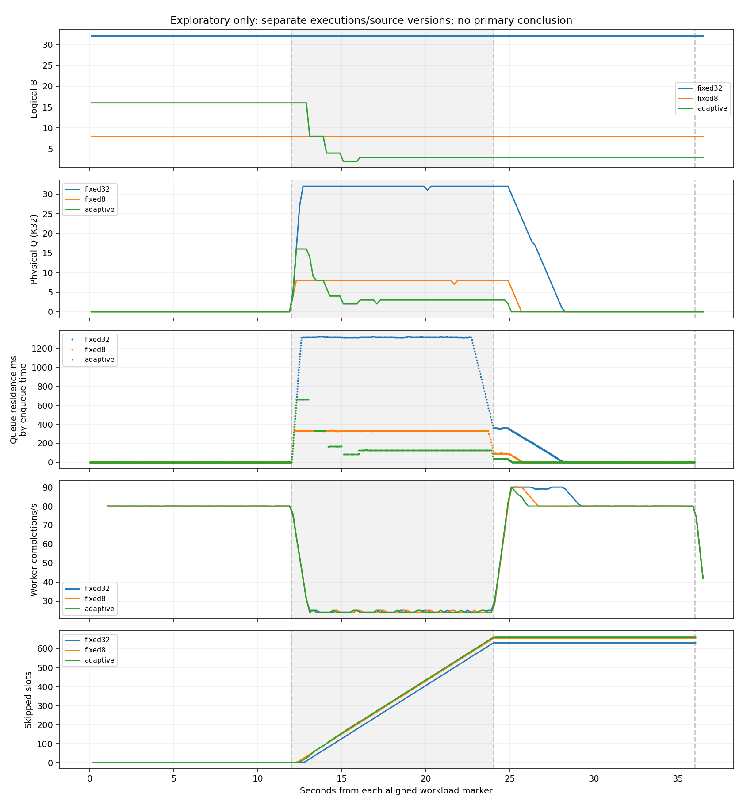

# EXPERIMENT-002 — Stage 4 adaptive logical admission

Stage 4 correctness acceptance is met. The frozen controller is implemented without tuning, and exactly one exploratory adaptive 36-second workload completed successfully. Seven short acceptance fixtures passed; one earlier cancellation fixture is explicitly retained **invalid for its intended coverage**. No primary matrix ran. The observed latency tradeoff is mixed: adaptive improved pooled queue-residence p95 relative to historical fixed8, but its slowdown-only p95 and pooled p99 were worse. This does not establish an overall adaptive advantage.

## Implementation and frozen semantics

- [controller.rs](server/controller.rs): constant-storage feedback law, initial B=16 for adaptive, range [1,32], 500 ms ticks, minimum five completed services, EWMA alpha=.2 initialized from first eligible mean. Ineligible windows hold B/EWMA and reset both streaks. Queue-delay proxy is Q × EWMA, not measured p95. Strict >125 ms / <75 ms comparisons, two consecutive eligible ticks, near-full Q+R>=B−1, ceil-halving and +1 growth, decrease priority, and post-action streak resets match the [frozen contract](EXPERIMENT-002.md). No tunable controller flags were added.
- [Shared server](server/mod.rs): fixed32/fixed8/adaptive share the gate, handler, single worker, physical K=32, histograms, service-start delay selection and sampling. Every policy runs the same tick observation/feedback path; fixed policies log proposals with `fixed_policy_hold` and apply no updates. No extra worker, channel resizing, revocation or receive implementation.
- Static O<=B assertion becomes O<=max(B,O_at_last_shrink), with Q=physical receiver length, exact reservation/message/byte invariants retained. Every **new** reservation still requires O=Q+R<B under the same lock; W is excluded. Shrink records existing O and preserves queued work and outstanding R. That R may hand off or release normally even above the new B. Growth/shrink and worker state changes wake registered gate waiters. Logical and physical reservation still precede `stream.message()`.
- The first tick is workload-marker +500 ms, then a monotonic 500 ms grid, with no synthetic tick at zero or EOF. Completed-service count/sum deltas between actual tick snapshots provide feedback; the first interval begins at workload start. Scheduled/observed time, lateness and actual window start are recorded. This makes scheduler jitter explicit rather than assigning configured service delay as feedback or replaying synthetic missed windows.
- Tick decisions, counters and snapshots share the state lock. [controller.csv](results/stage4/exploratory-adaptive/server/controller.csv) records every tick: Q/R/W, B before/proposed/after, feedback count/sum/mean, EWMA/proxy, near-full, pre/post streaks, decision reason and carryover occupancy. CSV uses a fixed 64 KiB buffer flushed per tick; only scalar controller state is retained. New sampler fields include carryover, running/tick/update counters and timed controller I/O; existing metric meanings remain unchanged.
- Handler owns worker and tick join handles through completion/cancellation. EOF atomically stops further updates before worker drain; cancellation/failure wakes waits and terminates both tasks. Unexpected controller abort/panic is supervised as `controller_failed`. Normal EOF joins the controller, then completes worker drain before returning Summary.
- [Tests](server/adaptive_tests.rs), [controller unit tests](server/controller.rs), and the existing [regression tests](server/tests.rs) exercise these behaviors. [Stage 4 protocol/runner](stage4/README.md), [offline verification](stage4/verify.py), [analysis](stage4/analyze.py) and [environment/integrity audit](stage4/audit.py) preserve reviewable evidence.

No research decision or frozen parameter was changed. Contract SHA256 remains `fdd38c609ca7802f9f4a07ecc1d865a707aa9daed258034b943c66361e147b6a`. No ambiguity requiring a behavior-changing contract interpretation arose; actual tick-window timing and the descriptive recovery screen are documented explicitly.

## Source, environment and exact commands

Rust was built and initially tested/pinned at `a6942a337bea7304b98bf86a5711bf2d6b939b9e`. The fixture-only correction/harness pin is `40bb23fd888a0fdc1c98a1d7b695b9eb7a80c202`, used by the exploratory manifest. [Source reconciliation](results/stage4/source-reconciliation.json) verifies identical server/build inputs at both commits. The unchanged accepted Go client is from `84509545abf6a5f139687250757e67703477a5c1`. All manifests record their own Git state, source hashes, commands, binary hashes, runtime and clocks. Tracked source was clean during execution; untracked Stage 4 results account for dirty-tree entries. Source hashes stayed unchanged during each attempt.

| Executable actually used | SHA256 |
|---|---|
| Debug Rust server | `25f65e00c39765a696e5ad79614646dcdc679403bd07a774aba4ce4812732f54` |
| Identical retained Go client for every attempt | `a2e6746e71041666bf9f8beec2f03c68482659c98bb882062d1c88f5e842fcb7` |

[Environment](results/stage4/environment.json): Debian 13.6, Linux 6.18.55 x86_64; rustc/cargo 1.99.1, Go 1.27.3, vendored protoc 31.1; debug Rust/default optimized Go as in Stages 2/3. Cgroup CPU quota 400000/100000 (four CPUs), affinity 0–4, memory limit 32 GiB. Compiler/dependency versions and Go binary build provenance are retained. A separate Go build-check executable was built but never used in measurements; binaries are outside Git.

Frozen exploratory settings: one connection/stream/handler/serial worker, Tokio/GOMAXPROCS=2; 80 scheduled slots/s ×36 s=2880 slots; no catch-up; 16,384 pseudorandom payload bytes, seed1; no retries/compression; HTTP/2 stream/connection windows both65535 with adaptive windows disabled; maximum message1048576 bytes. Service delay selected at monotonic service start is 10 ms [0,12), 40 ms [12,24), 10 ms thereafter including drain. Sampler/process interval200 ms. Guards unchanged: server/client RSS512/128 MiB, CPU10 s/process, file16 MiB, core0, whole-RPC deadline120 s including send/drain, external wall125 s. No guard tripped or unexplained process exit occurred.

Commands executed from repository root (logs in [checks](results/stage4/checks/)):

```sh
source scripts/dev-env.sh
cargo fmt --manifest-path server/Cargo.toml
cargo fmt --manifest-path server/Cargo.toml -- --check
cargo test --locked --manifest-path server/Cargo.toml -j4
cargo clippy --locked --manifest-path server/Cargo.toml --all-targets -- -D warnings
cargo build --locked --manifest-path server/Cargo.toml -j4
(cd experiments/002/client && go mod verify && go test -mod=readonly -race -v ./... && go vet ./... && go build -mod=readonly -o /workspace/toolchains/bin/pressure-stage4-client-buildcheck .)
python3 -m py_compile experiments/002/stage4/*.py
git diff --check
python3 experiments/002/stage4/audit.py experiments/002/results/stage4 --environment
python3 experiments/002/stage4/run.py --output experiments/002/results/stage4 --phase acceptance
# Stopped on the preserved insufficient-duration cancellation fixture; diagnosed first.
python3 experiments/002/stage4/run.py --output experiments/002/results/stage4 --phase acceptance-completion
python3 experiments/002/stage4/verify.py experiments/002/results/stage4
python3 experiments/002/stage4/analyze.py experiments/002/results/stage4
python3 experiments/002/stage4/run.py --output experiments/002/results/stage4 --phase exploratory
MPLCONFIGDIR=/workspace/toolchains/matplotlib python3 experiments/002/stage4/analyze.py experiments/002/results/stage4
python3 experiments/002/stage4/verify.py experiments/002/results/stage4
python3 experiments/002/stage4/audit.py experiments/002/results/stage4
```

Exact `prlimit` and server/client argv are in each manifest; use a fresh directory to reproduce. The environment command runs selected version/dependency/OS/cgroup reads, not an environment-variable dump. Evidence collection did not rebuild or alter the measured binaries between policies.

## Tests, acceptance and preserved invalid attempt

All 38 Rust tests passed: 34 E2 tests and four original library tests. Go's four tests passed with race detection (cached); module verification, vet and build passed. Cargo fmt, locked build/test and warnings-denied clippy passed. Python scripts compile and the independent event/tick audit passes all eight valid runs. No Rust/Go tests were disabled or failed.

Deterministic coverage includes strict equality at125/75 ms (no action), odd ceil-halving, min/max bounds, missing feedback/first initialization/EWMA update, eligibility and threshold streak resets, R-aware near-full, shrink below occupancy with outstanding R, both handoff and release of R after shrink, no new reservation at O=B, dequeue below B allowing progress, growth wakeup, fixed-policy observation-only behavior, receive error and EOF during shrink, controller abort supervision/termination, worker error/panic and cancellation while over-budget, 100 four-way update/handoff/completion/cancellation races, and paced healthy progress with a live controller. Earlier fixed32/fixed8 lifecycle/byte/histogram tests remain intact. Tests inject controlled updates to isolate gate/race semantics; the production controller is replayed separately against real completion feedback.

| Retained attempt | Observed outcome |
|---|---|
| fixed32-regression, fixed8-regression | Each1.6 s ×80/s:128 sent/admitted/processed,3 ticks,0 updates/skips/errors, successful Summary/drain |
| adaptive-healthy, adaptive-schedule-smoke | Same short workload:128 processed,3 ticks, B16 held,0 skips/discards; schedule smoke covers initial phase only |
| **adaptive-cancel (invalid for coverage)** | Original1000/s,1200 ms RPC deadline: only1 tick before deliberate cancellation; exact accounting passed, but no shrink occurred |
| adaptive-cancel-after-shrink | Distinct1000/s,2.5 s offered/2 s RPC deadline fixture:3 ticks,16→8 shrink below occupancy; admitted160=processed151+discarded9; failed Sends1; terminal ownership empty |
| adaptive-worker-error / adaptive-worker-panic | Each deliberately fails first message before first tick: admitted1,processed0,discarded1,failed Sends1; proper error status and cleanup |
| exploratory-adaptive | Exactly one36 s contract workload:71 ticks,4 budget changes,successful RPC and complete drain |

The first cancellation deadline includes setup/barrier (~350 ms), leaving less than1 s of workload time. Requiring two ticks was therefore an invalid fixture assumption. Its raw data/failed validation remain unchanged in the [ledger](results/stage4/ledger.jsonl), [manifest](results/stage4/adaptive-cancel/manifest.json), [exclusion record](results/stage4/declared-exclusions.json), verification and analysis. We explained the issue before proceeding, corrected only the separately named fault fixture deadline, and did not repeat passing fixtures or change the controller/frozen36 s workload. The correction is the only validation-protocol deviation. Three expected error RPC fixtures are valid for their fault purpose, not successful drains; the additional initial attempt remains invalid.

[Offline verification](results/stage4/verification.json) recomputes feedback from streamed processed events, independently replays EWMA/streak/decision logic, merges ticks and lifecycle events in state-lock order, and checks every acquisition occurred at O<B and before EOF/terminal. It verifies shrink-safe bounds, physical K/available slots, exact message and byte ownership, single terminal disposition per admitted sequence, histograms, sample cadence, client slot/Send balances, final Summary and stopped controller. No tick occurs after server EOF or failure. The fixed policies keep B unchanged.

## Budget trajectory and exploratory evidence

[Manifest](results/stage4/exploratory-adaptive/manifest.json), [all ticks](results/stage4/exploratory-adaptive/server/controller.csv), [server samples](results/stage4/exploratory-adaptive/server/server.csv), [message events](results/stage4/exploratory-adaptive/server/events.csv), [phase markers](results/stage4/exploratory-adaptive/server/phase-transitions.csv), [client samples](results/stage4/exploratory-adaptive/client/client.csv), [Sends](results/stage4/exploratory-adaptive/client/sends.csv), [client Summary](results/stage4/exploratory-adaptive/client/summary.json), [process samples](results/stage4/exploratory-adaptive/process.csv), [analysis](results/stage4/analysis.json), and [process/final-accounting supplement](results/stage4/supplement.json).

Adaptive held B16 during healthy load. Its four actual changes were:

| Observed time s | Interval completions | Q/R/W | EWMA ms | Proxy ms | B before→after | Decision |
|---:|---:|---|---:|---:|---|---|
|13.000979|12|16/0/1|21.978|351.648|16→8|second high tick|
|14.001658|12|8/0/1|28.936|231.485|8→4|second high tick|
|15.001277|12|4/0/1|33.364|133.455|4→2|second high tick|
|16.001432|12|2/0/1|36.160|72.321|2→3|second low, near-full tick|

The increase to3 occurred **during slowdown**, as the frozen low-delay/demand condition became true; no recovery override was introduced. B3 then held through recovery/EOF. One decrease-to-increase direction reversal was observed, with no repeated budget cycling or uncontrolled oscillation. Existing work above the new budget drained normally after each shrink. Final stored carryover4 is historical O_at_last_shrink, not outstanding work or a new admission allowance.

There were71 ticks on the500 ms grid from0.5 through35.5 s; maximum lateness2.814 ms. Server EOF at36.000223 s stopped control before the next timer callback, so no artificial final tick was added. Phase alignment error was0.155839 ms (<100 ms). Phase markers observed at0.001089/12.001478/24.001474/36.001602 s. First worker starts selecting10/40/10 ms were0.001515/12.000325/24.012772 s; a service already in progress is not shortened at a boundary.

| Adaptive phase | Actual service mean / p95 ms by service start | Worker completions/s | Send returns/s | Skipped slots | Queue-residence p95 ms by enqueue |
|---|---:|---:|---:|---:|---:|
|Healthy[0,12)|11.157 /11.386|80.000|80.000|0|0.099|
|Slowdown[12,24)|41.237 /41.925|24.167|25.167|657|660.918|
|Recovery[24,36)|11.156 /11.452|80.917|79.917|2|33.082|

Peak Q16 corresponds to262144 queued payload bytes, separate from worker/transport/allocator memory. Steady slowdown budget3 can retain up to49152 queued payload bytes. These are application payload accounting, not process-memory bounds. Server self-sampled peak RSS7.148 MiB; independent process-sampled server/client peaks6.695/16.562 MiB (different sampling instants). Observed CPU0.97/0.92 s over36.674/36.273 s sampled spans, about2.64%/2.54% of one CPU.

Final scheduled2880=skipped659+attempted2221; successful Sends2221,failed0. Server received=admitted=dequeued=processed2221; received_not_admitted=discarded=errors=telemetry_errors0. Summary accepted=processed2221. Received/processed payload totals36388864 bytes. Reservations acquired2222=released1+admitted2221. Final Q=R=W=0, all queued/handler/worker payload bytes0, controller_running0 and active_streams0. Every admitted sequence has exactly one processed event.

Client half-close36.000067 s on its own clock. On the server clock, last completion35.999253 s, EOF36.000223 s, worker stop36.000260 s: EOF-to-worker-stop0.03654 ms, no remaining service at EOF. Whole RPC36.350250 s includes setup/barrier; it is not a350 ms drain. All2221 completions fell within the offered interval (61.694/s). Client/server monotonic clocks are not subtracted for invented per-message end-to-end latency.

## Descriptive historical comparison

The comparison reuses accepted [fixed32 Stage2](results/stage2/exploratory-1/manifest.json) and [fixed8 Stage3](results/stage3/exploratory-fixed8/manifest.json). These are separate executions and server source versions, with different skipped/admitted cohorts, on a shared host. The identical Go client, workload, build mode/windows/affinity and guards reduce some differences; they do not produce a randomized repeated comparison or uncertainty estimate.

| Observed metric | Historical fixed32 | Historical fixed8 | Adaptive |
|---|---:|---:|---:|
|Peak sampled Q (K32 all)|32|8|16|
|Pooled enqueue-[12,36) residence p95 ms|1321.890|330.106|164.732|
|Pooled p99 ms|1323.487|331.271|661.060|
|Pooled cohort messages|1291|1266|1261|
|Slowdown-only residence p95 ms|1323.315|331.178|660.918|
|Recovery-only residence p95 ms|356.174|88.852|33.082|
|Slowdown worker completions/s|24.250|24.250|24.167|
|[0,36) completions/s|62.528|61.806|61.694|
|Processed overall / successful Sends|2251|2226|2221|
|Scheduled / skipped slots|2880 /629|2880 /654|2880 /659|
|Cumulative logical admission wait s|12.344|12.797|12.581|
|Sum of whole Send-call durations s|9.473|9.882|9.833|
|>20 ms calls / sum of their whole durations s|273 /9.392|285 /9.812|265 /9.744|
|First sampled Q0 after t24, absolute time s|28.282|25.684|25.083|
|Whole RPC s|36.348828|36.350321|36.350250|
|Final RPC status|success|success|success|

Adaptive's pooled p95 was about50% lower than fixed8 in these runs, but its transient B16 backlog before feedback caused about twice fixed8's slowdown-only p95 and pooled p99. Fixed8 processed five more messages, with five fewer skipped slots, and retained a smaller peak application queue. Adaptive's lower steady queue/recovery residence is a tradeoff, not a global win. No necessity of adaptation or primary H2/H3/H4/H5 success is demonstrated. The algorithm and its worse tail result are preserved without tuning.

Waiting remains upstream: slowdown Send p95 was40.275 ms,657 slowdown slots were skipped, and cumulative Send-call wall time was9.833 s overall. Compared with fixed8 this was slightly less Send wall time but more skipped slots; these coupled scheduler/backpressure outcomes are not interchangeable measures. Whole Send duration includes encoding, client buffering, runtime scheduling and transport pressure; it is **not** isolated HTTP/2 blocking or end-to-end completion latency. Physical reservation acquisition was only1.084 ms cumulative; logical gate wait is separate.

Recovery observations: first sampled Q0 was1.083 s after service restoration, versus1.684 s fixed8 and4.282 s fixed32. As a separately labeled exploratory screen, analysis checks3 s enqueue-cohort windows on a200 ms start grid, with queue p95 <= each policy's own healthy p95 and worker throughput >=95% of healthy. Earliest qualifying window starts/confirmation ends were fixed32 28.2/31.2 s, fixed8 25.8/28.8 s, adaptive25.2/28.2 s. Adaptive's window has240 messages, p95 .075544 ms,79.667 completions/s. This finite-window screen and a Q0 sample do not prove a continuous instantaneous healthy band or satisfy primary H4. Full window results and the method are in analysis.json; no recovery definition was silently substituted for the frozen primary decision.



[SVG](results/stage4/exploratory-comparison.svg). Curves use each aligned local workload clock; approximate one-second throughput differences include post-worker shutdown in the final interval, so the final fall is not another capacity disturbance. The budget curve is sampled at200 ms; exact update times are in controller.csv.

## Overhead, starvation, limitations and Stage 5

Controller CSV formatting/write/flush is under the shared lock. Direct controller **I/O-subset** time totals2.180 ms (~0.0061% of36 s), while existing event formatting/write/flush totals33.315 ms (~0.0925%). Controller timers omit formatting of the field array, decision/snapshot/lock costs and timer overhead; both timers can include descheduling. Buffered I/O may flush/page-cache-write under the lock and is not fsync. These numbers do not estimate total instrumentation overhead or prove equivalence to old fixed32/fixed8. All newly implemented policies share this path; the historical runs lacked it. No overhead benchmark matrix was added.

Healthy adaptive completions were80/s with0 skipped slots, no budget changes in the healthy phase, and the paced progress/unit and fixed-policy regressions passed. Total worker busy/idle33.532/2.468 s, with89.366 ms accumulated idle-with-backlog transition time across the run; that gauge is not zero and includes scheduling/transition latency. No persistent healthy worker starvation or gate deadlock was observed. Finite tests and one run cannot guarantee every scheduling race; exact lifecycle assertions and independent event replay remain required in future runs.

The [historical-byte audit](results/stage4/historical-integrity.json) verifies1106 files against accepted archive `e32bc0ab4639ece7991a587758f5ccb441db3627`, including all E1/E1B and Stage1–3 evidence/reports. All new artifacts are under experiments/002. No original raw output was overwritten. One invalid attempt plus eight valid purpose-specific attempts are retained; exactly one was a36-second adaptive exploration. Host noise, debug-build timer granularity, finite sampling, tick jitter, newly added observation overhead and differing source/admitted cohorts limit causal performance conclusions. No resource abort, unexpected failure, unresolved accounting defect or uncontrolled oscillation remains.

Recommend Stage5 proceed after review to a prespecified comparison using **all three policies from the same final source/binary and instrumentation**, the unchanged frozen controller/workload, interleaved/randomized repetitions, retained failures and the contract's full recovery/throughput/uncertainty analysis. Preserve the poor adaptive transient-tail observation as a risk to test, not a reason to tune. Stage4 provides correctness readiness, not evidence that adaptive is necessary or superior. The primary five-repeat matrix, parameter tuning, additional workers and Blog2 were not started.
