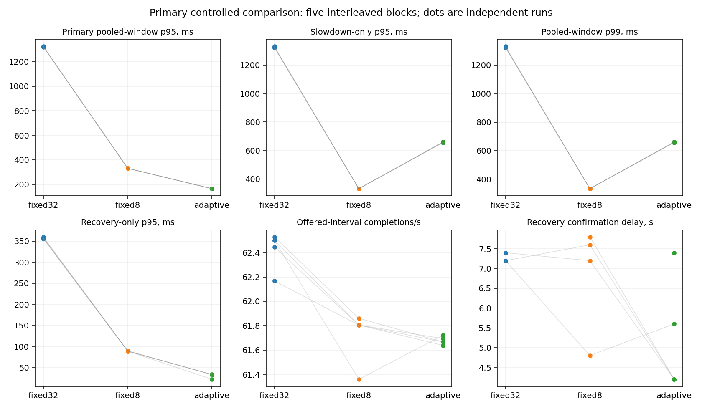
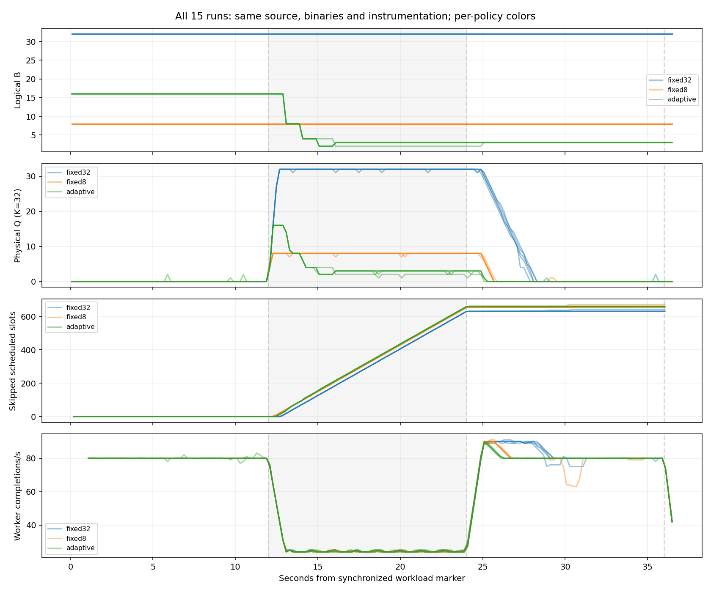

# EXPERIMENT-002 — Stage 5 primary controlled comparison

The corrected primary cohort completed **five valid fresh-process repetitions per policy** with identical application source, executables, instrumentation and frozen workload. Adaptive met H2's pooled queue-p95 criterion but did **not** establish overall success: its worse slowdown tail persisted in all five blocks; H3's full idle-materiality clause, H4's prespecified confidence decision and H5's material added value were not established. No controller/workload tuning or article writing occurred.

One initial matrix stopped on a startup marker-file race. Every attempt remains available: **18 attempts total, 17 valid measurements and one invalid startup**, with 15 valid runs in the wholly restarted primary cohort. The two valid original measurements are reported separately, not selectively combined with replacement runs.

## Frozen design, source and environment

The authoritative [contract](EXPERIMENT-002.md) is unchanged (SHA256 `fdd38c609ca7802f9f4a07ecc1d865a707aa9daed258034b943c66361e147b6a`). The [analysis plan](stage5/PLAN.md), scripts and initial order were committed before the first primary run at `37fbdddf53918392043dd17e53b5740134eed4c1`. The original [freeze](results/stage5/FROZEN.json) SHA256 is `f4fc4c48c0454db629707697709827d8f4780fa4a289d17af3ee9258db8ca543`.

After the diagnosed startup failure, [amendment 1](stage5/AMENDMENT-1.md) was committed at `22fa491dc15084dd58ce95446ecfdefd12ad1ee4`, before the corrected matrix. Its [freeze](results/stage5/primary-v2/FROZEN.json) SHA256 is `5289bfff82e6ef0a3846f2b9142397d964dd1cf8613ce9a8e2042e848db15765`. [Reconciliation](results/stage5/freeze-reconciliation.json) verifies unchanged application/binary hashes, configuration, order/seed, analysis-plan hash, endpoint-analysis and verifier bytes across the correction. No comparative endpoints had been inspected when amending the harness.

Application baseline: accepted Stage 4 `ccbd497f85346c7825394924a25db5617e5680e5`; Rust/Go application files, dependencies and RPC are untouched. The accepted server was built during Stage 4 from byte-identical inputs; retained client build source is `84509545abf6a5f139687250757e67703477a5c1`. Every run records actual source hashes, exact commands, clocks, Git state, exits and before/after freeze checks. Tracked source stayed clean during each matrix; dirty entries are new untracked evidence. [Source proof](results/stage5/source-proof.json) verifies each freeze's harness hashes against its committed Git bytes and unchanged application/executable bytes after collection.

| Executable used for every policy | SHA256 |
|---|---|
| Debug Rust server | `25f65e00c39765a696e5ad79614646dcdc679403bd07a774aba4ce4812732f54` |
| Identical retained Go client | `a2e6746e71041666bf9f8beec2f03c68482659c98bb882062d1c88f5e842fcb7` |

Pre-run environment: Debian 13.6, Linux 6.18.55 x86_64, rustc/cargo1.99.1, Go1.27.3, vendored protoc31.1; Rust debug/default optimized Go. CPU affinity0–4, cgroup quota400000/100000 (four CPUs), memory32GiB. Compiler/dependency/build provenance are in each freeze. Selected CPU model was captured **after** collection as an additive environment detail: AMD EPYC9V74 ([supplement](results/stage5/postrun-environment-supplement.json)); it is not presented as an additional pre-run measurement.

Frozen configuration: one loopback plaintext client-streaming RPC, connection, handler and serial worker; Tokio/GOMAXPROCS2; payload16384 pseudorandom bytes/seed1;80 scheduled slots/s ×36s,2880 slots, no catch-up/retry/compression. Service selected at monotonic service start:10ms[0,12),40ms[12,24),10ms thereafter/drain. Physical K32; fixed32 B32, fixed8 B8, adaptive initial16/range1–32. Controller500ms, alpha.2, minimum5 completions, strict125/75ms thresholds, two eligible ticks, ceil-halving/+1, near-full Q+R>=B−1; fixed policies run the identical feedback/instrumentation path but hold B. Windows65535/65535, adaptive transport windows disabled, maximum message1048576. Telemetry200ms, start marker300ms in the future. Guards: sampled server/client RSS512/128MiB, CPU10s/process, file16MiB, core0, whole-RPC deadline120s including setup/send/drain, external wall125s. These guards were never weakened.

The five adjacent blocks each contain one seeded random permutation (order seed2005):

| Block | Position 1 | Position 2 | Position 3 |
|---|---|---|---|
|1|adaptive|fixed32|fixed8|
|2|adaptive|fixed8|fixed32|
|3|adaptive|fixed8|fixed32|
|4|fixed32|fixed8|adaptive|
|5|fixed8|adaptive|fixed32|

This is randomized within blocks, not perfectly counterbalanced: adaptive occupies first position in three blocks. No simultaneous workloads or performance-dependent exclusions. The corrected matrix ran on2026-10-28 from04:49:51.968 to04:59:12.083 UTC.

## Startup failure, amendment and validity

Original run `b01-03-fixed8` exposed `Path.write_text(marker)`: file creation made an empty file briefly visible before the timestamp write. The server clock task's `parse().unwrap()` observed empty content and panicked (`ParseIntError { kind: Empty }`, server/mod.rs1120). The server workload marker was never released; received/admitted/dequeued/processed remained0, no server clock/phase evidence existed, and the client hit the unchanged120s deadline. Server process exit0 after shutdown did not make the run valid. The generic runner validation exception is preserved, with additive [diagnosis](results/stage5/startup-failure-diagnosis.json), [server log](results/stage5/b01-03-fixed8/server.log), [client log](results/stage5/b01-03-fixed8/client.log), and original manifest/ledger. Successful gRPC Send returns before that failure are not server admission acknowledgments.

The stop rule was honored. We explained the issue, then explicitly amended **only the harness** to write a complete same-directory temporary marker and atomically rename it into place. The300ms target/barrier semantics, application, binaries, controller, limits, workload, seeds and analysis definitions are unchanged. The application's fragile marker-reader behavior remains a robustness limitation for separately authorized hardening; no application fix was smuggled into the comparison.

The original incomplete matrix remains immutable. Rather than selectively replacing fixed8 or reusing successful outcomes, the amendment restarted **all15 runs in the same order** under `primary-v2/`. This is an explicit operational departure from the original no-replacement plan, recorded before restart. The original two valid measurements belong to a separate incomplete cohort; no endpoint-based selection occurred. There was one whole-matrix restart and no individual-policy replacement. The corrected matrix completed without invalid runs, resource aborts, instrumentation gaps or unexpected failures.

Review the [fully qualified all-attempt ledger](results/stage5/ALL-ATTEMPTS.jsonl), [exclusions/cohort disposition](results/stage5/EXCLUSIONS.json), original and corrected canonical ledgers, and independently regenerated verification files. The initial failure is not hidden by the final15/15 success rate. The [historical-byte audit](results/stage5/historical-integrity.json) verifies1280 E1/E1B and E2Stage1–4 evidence/report files byte-identical to accepted archive ccbd497.

All38 Rust tests and four Go race tests passed, as did locked builds, fmt, warnings-denied clippy, module verification and vet. Initial six analysis/verifier tests passed; the amended harness adds an atomic-visibility test, bringing the passing suite to seven. No application changes were made after these checks. [Checks/logs](results/stage5/checks/) preserve the original failure and corrected collection.

[Independent verifier](stage5/verify.py) applies accepted lifecycle/histogram/byte/slot checks and controller replay to every attempt, plus frozen config/source/binary/payload/order checks. For all15 primary runs: exact message/payload balances, unique terminal dispositions, Q<=32, R/W<=1, physical-slot accounting, shrink carryover, acquisition only at Q+R<B, bounded replayed controller updates, no post-EOF ticks, phase schedule/alignment, completed-Send/server counts, normal Summary and empty final ownership all passed. Maximum alignment error0.782ms, maximum controller lateness4.435ms and maximum sampled gap226.061ms meet the declared bounds. All healthy phases processed80/s with0 skipped slots. Full-span worker busy/idle-with-backlog reconstruction matches server counters to0ns in every run.

Reservation-before-receive is source/test-backed plus per-run event evidence: pinned handler source awaits logical+physical reservation before its sole `stream.message()` call; test Inbound asserts both at invocation, and raw replay checks every acquisition/handoff/release. Existing telemetry does not expose tonic's private receive invocation or prove that HTTP/2 internals never buffer. We make no such transport claim.

## Estimators and uncertainty

All definitions were frozen before collection and remained byte-identical after the harness correction. Queue quantiles use exact streamed durations, nearest rank, by **enqueue** cohort: primary[12,36), plus slowdown[12,24), recovery[24,36), healthy[0,12). Service groups by service start; worker throughput groups by completion time. Offered throughput counts completions in[0,36)/36, separately from overall processed count. Whole-RPC includes setup/barrier/send/drain; EOF-to-stop uses server clock only. Send wall durations are not transport-only blocking or end-to-end latency.

Uncertainty uses all3125 ordered resamples of five whole paired blocks (126 unique count compositions), preserving policy pairing and recomputing pooled quantiles from run cohorts. Intervals are nearest-rank percentile95%; scalar effects use paired mean differences/ratios of resampled means. Messages are not treated as independent repetitions. With five blocks these are descriptive small-n intervals, not calibrated population guarantees, significance tests or p-values. Every per-run value, phase distribution and paired effect is available in [analysis.json](results/stage5/primary-v2/analysis.json) and [per-run.csv](results/stage5/primary-v2/per-run.csv).

Recovery: first contiguous3s window starting on the200ms grid t24..33 whose enqueue-cohort p95 <= that run's own healthy p95 and completion rate >=95% healthy, with at least5 observations/completions. Report both window-start delay and confirmation delay (start+3−24). If none qualifies by36, right-censor; no imputation, epsilon, shared healthy baseline or first-Q0 substitution. This is a3s aggregate-band operationalization at200ms search resolution, not a claim about infinitesimal p95 or indefinite future recovery. The preregistered conservative H4 confidence rule requires all five pairs uncensored; this limitation is preserved rather than changed after results.

## Primary and phase queue results

These quantiles pool all valid primary run cohorts per policy; they are not medians of per-run quantiles.

|Policy|Enqueue-[12,36) messages|p50 ms|p95 ms|p99 ms|
|---|---|---|---|---|
|fixed32|6439|23.050|1321.235|1325.096|
|fixed8|6312|0.051|330.739|332.546|
|adaptive|6302|0.048|164.863|658.698|

|Policy / enqueue phase|Messages|p50 ms|p95 ms|p99 ms|
|---|---|---|---|---|
|fixed32 slowdown|1617|1318.455|1324.535|1330.429|
|fixed32 recovery|4822|0.051|357.195|361.646|
|fixed8 slowdown|1498|329.364|332.431|333.658|
|fixed8 recovery|4814|0.042|88.978|90.329|
|adaptive slowdown|1473|123.427|657.598|661.579|
|adaptive recovery|4829|0.041|32.917|34.153|

Adaptive's primary pooled-p95 reduction is **87.52%** versus fixed32 (95% block-bootstrap interval87.48–87.56%), exceeding the frozen20% criterion even at the interval's lower bound. Versus fixed8 the reduction is50.15% (49.96–50.38%).

The worse adaptive slowdown tail **persists in5/5 paired blocks**, not an outlier explanation. Per-run slowdown-p95 median is658.998ms adaptive versus332.557ms fixed8; paired mean penalty **+326.187ms** (95% interval324.695–327.679), about1.98×. Slowdown p99 and pooled-window p99 are also worse in every pair. Controller traces show the initial B16 backlog before the first shrink, consistent with this transient cost. No run or tail observation was removed.



[SVG](results/stage5/primary-v2/primary-endpoints.svg). Dots are runs and lines join block mates. Recovery panel omits right-censored values, which remain explicit in the table below: two fixed32 and one fixed8 run; blank points are not zero recovery time. Overlapping dots do not imply fewer repetitions.

## Per-run primary observations

All rows scheduled2880 slots. Completed Sends=attempted=overall processed for every successful run; failed Sends0. Throughput can exclude a last completion after36s, so it is recorded independently.

|Run|Primary p95 ms|Slowdown p95 ms|Recovery p95 ms|Processed / Sends|Skipped|Completions/s|RPC s|
|---|---|---|---|---|---|---|---|
|b01-01-adaptive|164.090|658.998|33.121|2221|659|61.694|36.350859|
|b01-02-fixed32|1320.729|1322.199|356.059|2249|631|62.444|36.352674|
|b01-03-fixed8|330.947|332.557|88.604|2225|655|61.806|36.351911|
|b02-01-adaptive|166.244|655.878|22.110|2219|661|61.639|36.349341|
|b02-02-fixed8|330.377|331.612|88.616|2225|655|61.806|36.347633|
|b02-03-fixed32|1321.358|1323.351|358.222|2239|641|62.167|36.349259|
|b03-01-adaptive|164.781|660.337|33.228|2222|658|61.722|36.353499|
|b03-02-fixed8|330.461|331.696|89.023|2209|671|61.361|36.349945|
|b03-03-fixed32|1323.652|1330.429|356.633|2250|630|62.500|36.351557|
|b04-01-fixed32|1319.621|1322.589|355.304|2250|630|62.500|36.351714|
|b04-02-fixed8|331.343|333.007|89.262|2226|654|61.806|36.349973|
|b04-03-adaptive|164.105|657.256|33.243|2220|660|61.667|36.349717|
|b05-01-fixed8|330.822|332.837|89.220|2227|653|61.861|36.351125|
|b05-02-adaptive|164.584|660.172|33.037|2220|660|61.667|36.351755|
|b05-03-fixed32|1321.722|1324.965|359.699|2251|629|62.528|36.351121|

## Throughput, upstream waiting, ownership and resource observations

Unless labeled otherwise the following are medians across five runs, with ranges in brackets. Counts and finite offered interval are part of the outcome; similar RPC durations do not mean identical work was delivered.

|Metric|fixed32|fixed8|adaptive|
|---|---|---|---|
|Offered completions/s|62.500 [62.167, 62.528]|61.806 [61.361, 61.861]|61.667 [61.639, 61.722]|
|Skipped slots|630 [629, 641]|655 [653, 671]|660 [658, 661]|
|Sum of Send-call wall durations s|9.516 [9.417, 9.558]|9.870 [9.838, 9.881]|9.833 [9.816, 9.889]|
|Logical admission wait s|12.357 [12.238, 12.490]|12.780 [12.761, 12.829]|12.653 [12.589, 12.665]|
|Whole RPC s|36.351557 [36.349259, 36.352674]|36.349973 [36.347633, 36.351911]|36.350859 [36.349341, 36.353499]|
|Overall processed / attempted / completed Sends|2250 [2239, 2251]|2225 [2209, 2227]|2220 [2219, 2222]|
|Server self-sampled peak RSS MiB|7.805 [7.750, 7.906]|7.008 [6.992, 7.074]|7.117 [7.008, 7.125]|
|Client sampled peak RSS MiB|17.324 [17.129, 17.395]|17.156 [17.098, 17.258]|17.227 [17.137, 17.320]|
|Worker busy s (whole workload)|33.854 [33.755, 33.885]|33.573 [33.393, 33.634]|33.543 [33.507, 33.584]|
|Worker idle s (whole workload)|2.147 [2.116, 2.247]|2.428 [2.367, 2.607]|2.458 [2.418, 2.494]|
|>20ms Send-call count|273 [273, 274]|284 [284, 285]|267 [266, 267]|
|Sum of those entire calls s|9.409 [9.341, 9.438]|9.780 [9.776, 9.823]|9.757 [9.718, 9.808]|
|Offered worker utilization %|94.038|93.258|93.175|
|Idle-with-backlog fraction %, mean|0.551|0.686|0.710|
|Idle-with-backlog time ms, mean|89.529|94.832|95.153|
|Backlog-positive time s, mean|16.242|13.821|13.401|
|Peak Q / queued payload bytes|32 /524288|8 /131072|16 /262144|

Adaptive offered-throughput ratio versus fixed32 is98.799% (95% interval98.667–98.983%), meeting the95% requirement. Versus fixed8 the mean ratio is99.919% (99.721–100.262%). Slowdown completion rates are24.17–24.25/s for all policies; nominal80/s is intentionally overload during40ms service. Healthy completion rates are80/s with0 skipped slots in every run.

Idle-with-backlog is conditional time with Q>0,W=0 divided by time with Q>0, reconstructed from ownership transitions clipped to[0,36). Adaptive's mean difference versus fixed32 is+0.158 percentage points (95% interval+0.123 to+0.200). Absolute accumulated idle-backlog time remains about95ms versus90ms; its denominator is shorter with adaptive. This is a measurable increase in the conditional fraction, not evidence of persistent healthy worker starvation. The contract supplies no numeric *materiality* margin; we do not invent one or call the full H3 proven just because throughput passed.

Client Send p50/p95/p99 medians (across per-run quantiles) are approximately fixed32 .030/35.499/39.663ms, fixed8 .027/35.702/39.730ms, adaptive .030/35.666/39.790ms. All per-phase and per-run Send distributions, >20ms whole-call/excess sums and actual start/return rates are retained in analysis.json. Adaptive's maximum Send in each run was359–370ms, while fixed32/fixed8 maxima were <=46ms. The adaptive maxima start near t13s, coinciding with the first shrink; this is consistent with waiting shifting upstream while carryover drains. It is not isolated HTTP/2 blocking or a per-message end-to-end measurement. Ordinary p95 alone hides this upstream tail too.

Whole-RPC mean ratio adaptive/fixed32 is0.999994 (95% interval0.999959–1.000029), below1.10, but all RPCs are anchored to the36s schedule and include about350ms setup/barrier. Median server EOF-to-worker-stop times are65/53/53 microseconds (fixed32/fixed8/adaptive), with no unfinished service at EOF; no material drain was required then. Adaptive delivered fewer total messages because skipped slots were not caught up. Thus near-identical RPC duration does not establish end-to-end completion improvement at equal admitted work.

Peak worker-owned payload is16384 bytes in every run. Handler payload snapshots are0 at atomic ownership boundaries; that does not measure transient decode/handler allocation peaks. Queue payload accounting is distinct from process RSS, transport/encoder buffers, allocator and kernel memory. Low observed RSS and K32 do not prove bounded total process memory. Process CPU samples are retained: server/client roughly0.9–1.25 CPU seconds over each36s workload; healthy target attainment and low CPU do not suggest a gross client throughput bottleneck here, but they do not exclude scheduler/I/O effects. RSS abort guards are sampled200ms checks, not kernel-enforced per-process memory ceilings.

## Budget trajectory and stability

All adaptive runs start16 and end3, with exactly four budget changes and one decrease-to-increase direction reversal. Four follow16→8 at13s→4 at14s→2 at15s→3 at16s. Block2 follows16→8 at13s→4 at14s→2 at16s→3 at25s: actual EWMA/threshold feedback delays the latter changes; the algorithm was not tuned to make trajectories identical. Budgets remain1–32, no existing reservation/work is revoked, and acquisition remains blocked while O>=new B. Fixed policies retain32/8 despite recording identical feedback/proposals. Each run has71 or72 ticks depending on EOF/timer ordering, with no post-EOF update. No repeated cycling, uncontrolled oscillation or persistent healthy starvation was observed.

Direct controller-I/O-subset time is about2.3ms median per run in every policy; existing event I/O is also recorded. These timers omit other formatting/lock/controller/sampling overhead, and buffered writes can flush under the lock. All three primary policies share that instrumentation; unlike earlier exploratory cross-source comparisons, no policy alone uses an uninstrumented path. This does not estimate the overhead of the whole measurement system versus a production server.



[SVG](results/stage5/primary-v2/primary-trajectories.svg). All15 traces are shown; throughput uses approximately1s counter differences and the final shutdown interval includes post-worker time, not another capacity collapse.

## Recovery and censoring

Confirmation delays below are seconds after t24, including the qualifying3s interval. `>12` means no qualifying window confirmed by t36, not an observed recovery at12s. Start delays are confirmation−3 for uncensored runs.

|Block|fixed32|fixed8|adaptive|
|---|---|---|---|
|1|7.2|7.6|4.2|
|2|>12 (censored)|>12 (censored)|7.4|
|3|7.2|4.8|5.6|
|4|>12 (censored)|7.8|4.2|
|5|7.4|7.2|4.2|

Adaptive recovers under the frozen operational criterion in5/5 runs; fixed32 in3/5 and fixed8 in4/5. All adaptive confirmations are earlier than their fixed32 pair's observation or censor lower bound. However, two fixed32 baselines are censored, so the **predeclared complete-pair CI rule** yields no unconditional H4 confidence decision. We do not drop those pairs, impute12s or change the criterion to first empty queue. Fixed8 is faster than adaptive in block3; there is no universal recovery ordering.

First sampled Q0 after24 occurs around28.1s fixed32,25.7s fixed8 and25.3s adaptive, but is not the recovery criterion. The healthy p95 bands vary across runs: fixed32 .075804–.115844ms, fixed8 .080922–.116264ms, adaptive .095456–1.175197ms. Brief healthy scheduling/queue outliers affect these per-run bands and recovery sensitivity. Example: adaptive block3's queue becomes empty around25.284s, but qualifying3s-window p95 at starts25.2/25.8s is2.165/1.192ms, still above its1.175ms healthy band; first qualification is26.6s, confirmed29.6s. We preserve the measured windows rather than explain away or relax the criterion. Raw recovery candidates and censored observations are all in analysis.json.

## Hypothesis-by-hypothesis conclusions

| Hypothesis | Primary outcome | Evidence and limit |
|---|---|---|
|H1 safety|Supported in15 normal primary runs|All physical/admission/lifecycle/byte/disposition and final Summary checks pass. The original invalid startup is retained as a reliability failure, not normal-drain evidence. No universal safety proof.|
|H2 latency|Supported|87.52% pooled p95 reduction vs fixed32; lower95% interval87.48% exceeds20%. This endpoint does not cover all tails or end-to-end latency.|
|H3 throughput/idle|Numeric throughput passes; full hypothesis not established|98.799% ratio with lower interval98.667% exceeds95%; conditional idle-backlog fraction rises0.158pp. No frozen numeric materiality margin permits a definitive idle-noninferiority claim.|
|H4 recovery/completion|Not established under preregistered confidence rule|Adaptive5/5 recover, fixed32 has2 censored baselines; no complete-pair recovery CI. RPC ratio meets<=1.10. Favorable censoring pattern is reported, not promoted to an unconditional H4 success.|
|H5 added value vs fixed8|Not established as material overall benefit/necessity|Lower primary/recovery p95 trades against roughly doubled slowdown/p99 tails, larger transient queue and upstream Send maxima. Throughput/RPC are near fixed8. Neither policy dominates all prespecified endpoints; no frozen materiality weights/margin.|
|Null hypothesis|Not formally rejected; waiting-shift explanation remains consistent|Upstream Send waiting/skips accompany smaller application queues, and fixed bounded admission remains a credible simpler alternative. This is a qualitative engineering null, not a specified probabilistic test; do not claim statistical acceptance or rejection.|

The primary comparison therefore does **not** establish overall adaptive success from pooled p95 alone. The repeated adverse tail is a stable tradeoff in this workload. No controller parameters were changed in response.

## Reproduction commands, evidence and limitations

Commands executed from repository root (source activation via scripts/dev-env.sh):

```sh
source scripts/dev-env.sh
cargo fmt --manifest-path server/Cargo.toml -- --check
cargo test --locked --manifest-path server/Cargo.toml -j4
cargo clippy --locked --manifest-path server/Cargo.toml --all-targets -- -D warnings
cargo build --locked --manifest-path server/Cargo.toml -j4
(cd experiments/002/client && go mod verify && go test -mod=readonly -race -v ./... && go vet ./... && go build -mod=readonly -o /workspace/toolchains/bin/pressure-stage5-client-buildcheck .)
python3 -m unittest discover -s experiments/002/stage5 -p 'test_*.py' -v
python3 -m py_compile experiments/002/stage5/*.py
# First two commands below originally used pre-amendment commit37fbddd.
python3 experiments/002/stage5/freeze.py --output experiments/002/results/stage5
python3 experiments/002/stage5/run.py --output experiments/002/results/stage5
# Stopped on startup failure; diagnosed/documented, atomic marker test passed; commit22fa491.
python3 experiments/002/stage5/freeze.py --output experiments/002/results/stage5/primary-v2
python3 experiments/002/stage5/run.py --output experiments/002/results/stage5/primary-v2
python3 experiments/002/stage5/verify.py experiments/002/results/stage5/primary-v2
python3 experiments/002/stage5/verify.py experiments/002/results/stage5
python3 experiments/002/stage5/analyze.py experiments/002/results/stage5 --no-plots
MPLCONFIGDIR=/workspace/toolchains/matplotlib python3 experiments/002/stage5/analyze.py experiments/002/results/stage5/primary-v2
```

The original-cohort verifier intentionally exits1 on its preserved invalid run; corrected verifier exits0. A separate Go build-check binary was never used for measurements; all runs used the identical retained client digest. Exact process `prlimit`/server/client argv are in manifests. Use **new directories** to reproduce; existing attempts cannot be overwritten/resumed automatically. Current freeze script includes the amendment; reproduce the original historical harness only by checking out its committed version. Do not rerun historical evidence paths.

Review [evidence index](results/stage5/README.md), [primary analysis](results/stage5/primary-v2/analysis.json), [per-run CSV](results/stage5/primary-v2/per-run.csv), [primary verifier output](results/stage5/primary-v2/verification.json), full raw per-run directories, combined attempts/exclusions and source/historical proofs. Analysis remains portable over raw artifacts without needing the excluded executable files; runtime reproduction requires the documented toolchain and byte-pinned binaries/build environment. Checksums cover delivered new evidence and sources.

Limits: one host, loopback/plaintext, one workload/seed, one serial worker, five blocks, debug Rust/timer granularity, shared-host scheduling and I/O, imperfect position balance, and a repaired harness startup race. No release/profile or network-condition generalization. Adaptive healthy p95/outliers differ despite equal80/s healthy throughput; this and the policy's own healthy-band normalization affect H4. Message cohorts differ because skipped slots are valid policy outcomes; no equal-admitted-work end-to-end comparison exists. Sampled peaks miss sub200ms transients, decode/allocator/kernel ownership is not fully measured, and event/controller I/O under the lock can affect service durations. Small-n bootstrap intervals omit systematic confounders and do not justify universal certainty. H3/H5 qualitative materiality remains underspecified; H4's censoring was not repaired post hoc.

**Blog 2 recommendation:** sufficient evidence for a carefully bounded article about admission correctness, relocation of waiting and reproducible adaptive tradeoffs—including the negative tail result and limits. Insufficient evidence for a claim that adaptive is generally superior, necessary, production-ready or improves end-to-end latency. If the intended article requires a clean adaptive win, extend the research instead of publishing that claim. Future separately versioned work should prespecify materiality and robust recovery interpretation, validate release/network/generalization, and harden marker parsing/task supervision. No such tuning, extra workers, workload changes or article were implemented here.
