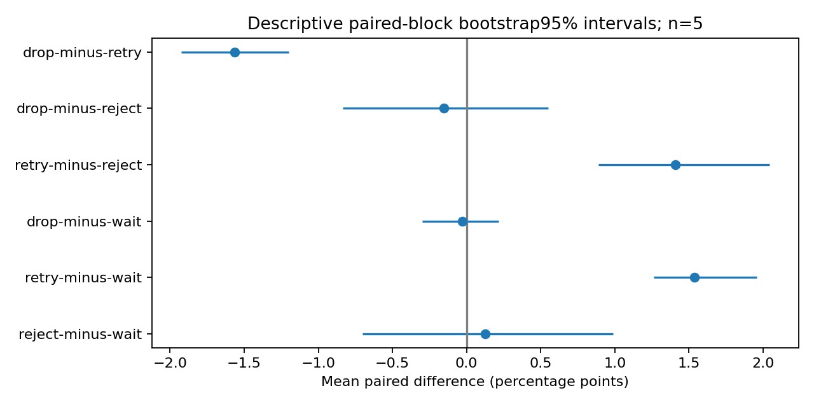
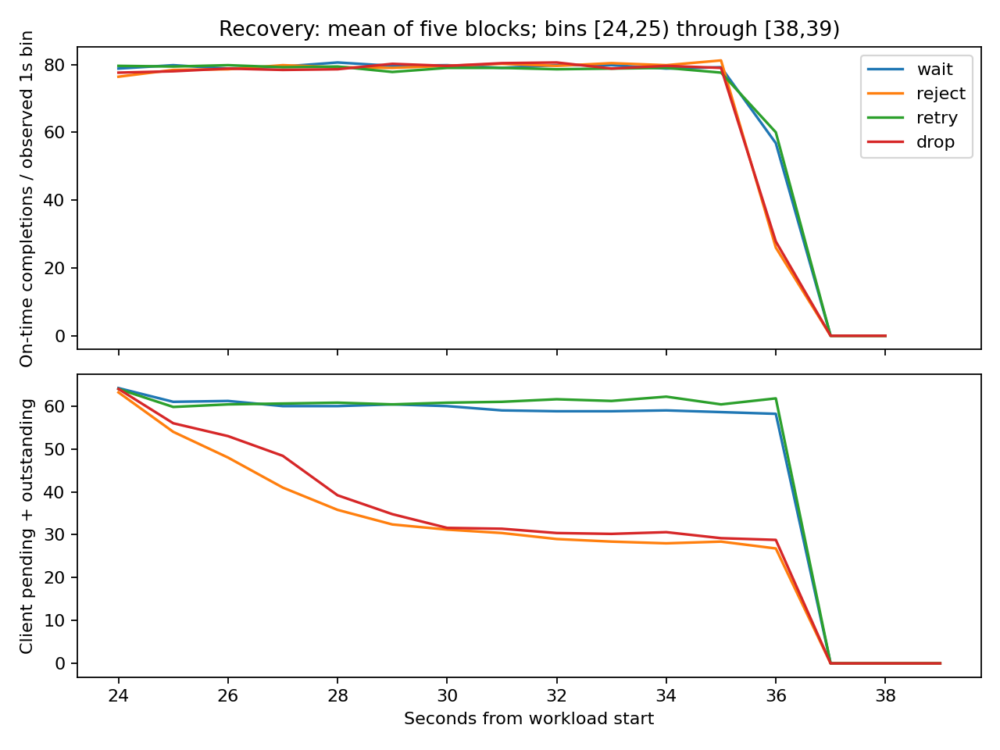

# Experiment 003 — Stage 5 primary matched comparison

**PASS. GO for Stage 6 planning after independent review.** Five preregistered matched blocks completed:20 fresh-process runs, no exclusions, replacements, safety aborts or missing outcomes. No Stage6 experiment or Blog3 was started. This is a controlled single-host result, not a universal policy winner.

## Freeze and execution

The preregistration and four new runner/verifier/analysis scripts were committed before primary execution at `905e2db815705cbd3edf2071b0d7dacee6e6a62d`. Application source and lockfiles are byte-identical to accepted Stage4 `e1370b0e625eec48fb39b94c6a5b4487f1abd962`. [Frozen manifest](results/stage5/FROZEN-MANIFEST.json) records a clean build tree, dependency/source hashes, toolchains, repeated normal-build hashes, environment and cgroup limits. Runtime manifests truthfully include subsequently untracked evidence. No Rust/Go application, normative specification or historical E1/E2/E3 evidence was changed.

Normal debug builds were repeated and copied to private read-only executable paths; no Cargo tests ran afterward. The server SHA256 is `e5ed863d309f7e43aa507adde7d04d2f010e408a9133c2adc57cd6a0f318e257`; client SHA256 is `a54ffd85b71db8571943e81afcd96a097b8e7b3211abc42872f935fab9d1c25f`. Go VCS metadata changes with the preregistration commit; application bytes do not. Rust/cargo1.99.1, Go1.27.3, Python3.12.14, Linux x86_64; recorded cgroup4 CPU cores/32GiB.

The unchanged A01 configuration is outstanding33/pending32/server admission32; one serial worker; staging1, terminal/immediate32 each, response64, events1024. Every run uses the exact same workload bytes/hash:2,880 originals,80/s for36s,16KiB payloads/seed1, scheduled+2s deadlines, service10/40/10ms selected at worker start across12s phases, observation through39s. Direct event logging0 bytes, HTTP/2 windows65535, unchanged retry/deadline/transport/runtime settings and identical instrumentation apply to every policy. Guards remain CPU30s/process, sampled RSS256MiB/process, file64MiB, core0, wall51s,200ms sampling/<500ms maximum gap.

[STAGE5-PLAN.md](STAGE5-PLAN.md) and [machine run plan](results/stage5/RUN-PLAN.json) freeze order, seeds, exclusions, replacements, six paired comparisons and analysis before outcomes. Runs were serial, with fresh client/server processes; no barriers or injected decisions. Valid unfavorable runs were retained. Each block used the same original workload and jitter seed for all policies; only RETRY consumes retry randomness.

## All blocks and validity

|Block|Seed|Order|WAIT|REJECT|RETRY|DROP|
|---|---|---|---|---|---|---|
|1|1134903123497516951|wait, drop, retry, reject|PASS|PASS|PASS|PASS|
|2|7335427334695112769|retry, reject, wait, drop|PASS|PASS|PASS|PASS|
|3|9136803124150509004|drop, reject, wait, retry|PASS|PASS|PASS|PASS|
|4|1435626977494426790|drop, wait, reject, retry|PASS|PASS|PASS|PASS|
|5|16813872846671630229|drop, retry, wait, reject|PASS|PASS|PASS|PASS|

[MATRIX.json](results/stage5/MATRIX.json), [run ledger](results/stage5/RUN-LEDGER.json), and [exclusions](results/stage5/EXCLUSIONS.json) preserve all20 attempts. Per-run `verification.json` records exact process commands, parameters, source/binary hashes and exit statuses; `primary-verification.json` records independently replayed gates. No primary data was selected by outcome.

All20 passed clock alignment, phase/cutoff coverage, sequence/tail completeness, original/attempt identity, max3 attempts, all-original terminal partitions, payload/permit/resource bounds, duplicate-execution checks, EOF/drain, process supervision and zero final ownership. The post-matrix [independent audit](results/stage5/analysis/OFFLINE-AUDIT.json) replayed all20 gates and independently recomputed unique U and all six paired bootstrap comparisons using integer count differences and NumPy percentiles. No new workload was executed for that audit.

Clock uncertainty was 1.573–2.484µs (<5ms); maximum sampling gap 213.12ms. Maximum phase-marker lateness was 7.727ms. RPC completion occurred 36.234–36.777s after epoch, before39s; both processes remained observed through cutoff. Successful final reconciliation contains no UNKNOWN; cancellation/expiry and late completions remain distinct valid outcomes.

## Primary all-original results

N=2,880 for every row, including unsent/backlog originals. U is a unique authoritative completion timestamp at or before the immutable original deadline. Each cell below is U; every run is valid.

|Block|WAIT|REJECT|RETRY|DROP|
|---|---|---|---|---|
|1|2198|2161|2236|2191|
|2|2155|2201|2223|2163|
|3|2196|2201|2235|2199|
|4|2202|2197|2244|2188|
|5|2199|2208|2233|2205|

|Policy|Mean U/N|Mean U/36s|Mean A/F/S/R|Mean retries|A/N|
|---|---|---|---|---|---|
|WAIT|76.042%|60.833/s|2340.2 / 2340.2 / 2340.2 / 2340.2|0.0|0.8126|
|REJECT|76.167%|60.933/s|2529.8 / 2529.8 / 2529.8 / 2529.8|0.0|0.8784|
|RETRY|77.576%|62.061/s|2621.0 / 2496.2 / 2621.0 / 2621.0|124.8|0.9101|
|DROP|76.014%|60.811/s|2529.6 / 2529.6 / 2529.6 / 2529.6|0.0|0.8783|

A is initiated attempts, F first-attempt originals, S successful Send calls and R decoded attempts. All initiated attempts in these runs successfully sent/decoded; Send success alone is not delivery. RETRY added112–134 attempts/run; retries/N averaged4.333%, while A/F averaged 1.0500. Per-run values, distributions and all comparisons remain in [RESULTS.json](results/stage5/analysis/RESULTS.json) and [runs.csv](results/stage5/analysis/runs.csv).

Primary effects are paired **within block**, then averaged; percentage points below. Intervals enumerate all3,125 ordered paired-block bootstrap resamples with linear2.5/97.5 percentiles. With five shared-host blocks these are descriptive uncertainty summaries, not significance tests, multiplicity-adjusted claims or population confidence guarantees.

|Paired difference|Mean pp|Descriptive95% interval pp|Five block count differences|
|---|---|---|---|
|reject-minus-wait|0.125|[-0.701, 0.986]|-37, 46, 5, -5, 9|
|retry-minus-wait|1.535|[1.264, 1.958]|38, 68, 39, 42, 34|
|drop-minus-wait|-0.028|[-0.299, 0.215]|-7, 8, 3, -14, 6|
|retry-minus-reject|1.410|[0.889, 2.042]|75, 22, 34, 47, 25|
|drop-minus-reject|-0.153|[-0.833, 0.549]|30, -38, -2, -9, -3|
|drop-minus-retry|-1.562|[-1.924, -1.201]|-45, -60, -36, -56, -28|



## Outcomes across all originals

Mean counts/run; each row sums to2,880. UNKNOWN, cancellation, expiry-before-send and unresolved outcomes have zero originals in the complete partitions; these are not omitted originals. Late completion is not U.

|Policy|COMPLETED_ON_TIME|COMPLETED_LATE|REJECTED_FINAL|DROPPED|EXPIRED_WAITING_OR_QUEUED|EXPIRED_PROCESSING|CLIENT_BACKLOG_EXHAUSTED|
|---|---|---|---|---|---|---|---|
|WAIT|2190.0|2.4|0.0|0.0|0.2|147.6|539.8|
|REJECT|2193.6|5.2|302.6|0.0|0.0|28.4|350.2|
|RETRY|2234.2|1.8|230.4|0.0|13.8|16.0|383.8|
|DROP|2189.2|7.0|0.0|302.2|0.0|31.2|350.4|

RETRY refusal attempts are not final refused originals. Natural full-budget activation and retries were:

|Policy|Full refusal attempts/run range|Full drops/run range|Retries/run range|
|---|---|---|---|
|WAIT|0–0|0–0|0–0|
|REJECT|285–323|0–0|0–0|
|RETRY|340–366|0–0|112–134|
|DROP|0–0|289–319|0–0|

## Latency, waiting and worker occupancy

Conditional completion latency is scheduled→authoritative completion **only for completed originals**, including late completions; it cannot substitute for the all-original endpoint. Failures and unsent work remain in N above. Reported ranges below are across five per-run quantiles, not pooled quantiles. Full n/p50/p95/p99 for completed, on-time-only, original-schedule phase cohorts and all-original attainment are in RESULTS.json. Client ACK-observed latency is a separate last-observed-terminal-frame cohort; it is not necessarily the time a retrying original finally expires locally.

|Policy|Completed p50 ms|Completed p95 ms|Completed p99 ms|Started queue p95 ms|Admitted wait p95 ms|Cumulative admitted wait s/run|
|---|---|---|---|---|---|---|
|WAIT|675.04–777.91|1978.02–1980.42|1994.32–1995.42|1133.25–1145.09|22.86–25.81|8.29–8.81|
|REJECT|268.81–389.71|1957.28–1968.83|1990.82–1996.00|1250.73–1269.51|1.60–2.05|2.68–2.93|
|RETRY|676.32–704.02|1931.47–1960.99|1982.65–1993.28|1240.62–1259.81|1.59–1.83|2.70–2.87|
|DROP|293.32–392.53|1948.03–1977.97|1994.21–1997.85|1254.76–1270.64|1.61–2.45|2.73–3.15|

Completion latency by **original scheduled phase**, conditional on completion; ranges of per-run p50/p95/p99 in ms:

|Policy|Scheduled cohort|p50 ms|p95 ms|p99 ms|
|---|---|---|---|---|
|WAIT|initial|16.46–18.81|18.45–36.20|20.56–43.33|
|WAIT|slowdown|1966.10–1970.03|1995.52–1997.42|1998.79–2000.43|
|WAIT|recovery|696.62–803.59|750.50–843.02|757.59–856.24|
|REJECT|initial|16.33–17.14|17.81–47.67|19.00–63.66|
|REJECT|slowdown|1920.10–1936.70|1993.38–1997.78|1998.12–2003.06|
|REJECT|recovery|316.40–478.44|573.26–733.48|694.47–767.04|
|RETRY|initial|16.48–17.41|18.41–42.82|20.49–49.47|
|RETRY|slowdown|1876.24–1932.98|1986.14–1994.47|1994.15–1999.77|
|RETRY|recovery|705.75–734.95|1053.55–1099.58|1153.37–1416.46|
|DROP|initial|16.57–32.46|19.28–68.74|22.78–71.28|
|DROP|slowdown|1908.92–1956.17|1994.91–1998.62|2000.58–2002.55|
|DROP|recovery|366.83–503.34|664.16–779.76|679.66–789.18|

Measured service-time medians for **completed work by worker-start phase** (cancellation-shortened work is separate), in ms:

|Policy|Initial|Slowdown|Recovery|Worker occupancy /39s|Idle-with-backlog s/run|
|---|---|---|---|---|---|
|WAIT|11.68–11.79|41.52–41.62|11.69–11.81|90.18–90.52%|1.26–1.46|
|REJECT|11.68–11.78|41.55–41.73|11.70–11.82|89.46–89.73%|1.19–1.33|
|RETRY|11.68–11.80|41.60–41.64|11.71–11.78|90.51–90.61%|1.23–1.31|
|DROP|11.71–11.74|41.64–41.75|11.67–11.78|89.44–89.68%|1.22–1.44|

Requested10/40/10ms timers exceed their nominal delays in observed occupied time. Idle-with-backlog is the event-replayed integral of queued>0/running=0, including dispatch/scheduling gaps; it is not zero and must not be labeled free of instrumentation effects. Busy time by completion/expiry/cancellation disposition and worker start/exit counts are retained.

## Resource and transport observations

|Policy|Payload MiB·s mean (Q+W)|Server RSS peak MiB|Client RSS peak MiB|Server CPU s/window|Client CPU s/window|TCP write MiB/run mean|
|---|---|---|---|---|---|---|
|WAIT|11.935|9.34–9.72|20.71–22.76|13.08–15.19|3.52–4.42|36.812|
|REJECT|11.434|9.37–9.52|20.91–23.72|13.56–15.23|3.53–4.25|39.794|
|RETRY|11.793|9.37–9.66|21.34–24.36|13.65–15.00|3.39–3.98|41.229|
|DROP|11.561|9.30–9.74|20.91–24.85|13.83–16.53|3.69–4.80|39.791|

Final ledger record-allocation estimates were 1460245–1460245 bytes/server and 1106573–1119573 bytes/client. These estimates exclude transport/runtime/allocator overhead. Server Q+W reached32, client pending32/outstanding33 in every run; high-water resources and zero final ownership passed independent replay. Separate resource maxima must not be summed as simultaneous occupancy. Staging payload-byte-time is reported separately from queued+worker ownership.

RSS peaks are sampled lower bounds, not process-memory bounds. CPU endpoints are first samples at/after0 and39s, quantized to10ms ticks. gRPC message/wire counters and plaintext TCP-stream reads/writes are retained separately; these are not packet, retransmission or NIC-byte counters. Send/local-writer duration includes scheduling, serialization and instrumentation; neither isolates HTTP/2 flow-control blocking. The short wrapped Send calls do not negate upstream client-credit/pending waiting.

## Recovery and hypotheses

Recovery clearance is narrowly frozen as time after24s until no **pre24s-admitted** queued/running originals remain. It does not mean all upstream backlog has disappeared or steady state has returned. All20 clearance observations are uncensored.

|Policy|Clearance ms range|Mean ms|
|---|---|---|
|WAIT|389.41–420.70|408.225|
|REJECT|389.26–427.60|416.419|
|RETRY|392.98–405.69|399.337|
|DROP|366.27–418.62|395.254|

DROP−WAIT clearance averaged−12.971ms, descriptive95% interval[−19.254,−6.117]ms, negative in5/5 blocks. RETRY−REJECT averaged−17.083ms,[−28.466,−3.360]ms, negative in4/5. Other comparisons are preserved, including intervals crossing0; these small differences do not establish general recovery superiority.



|Hypothesis|Assessment|Measured support/qualification|
|---|---|---|
|H1 WAIT|Descriptively supported|All5 show confirmed slowdown, occupancy32, upstream pending and expiry/backlog.|
|H2 REJECT|Descriptively supported|Retention lower than WAIT in5/5; paired mean −0.500MiB·s (interval −0.854 to−0.174); all5 have refusals.|
|H3 RETRY|Descriptively supported in this model|RETRY−REJECT U/N positive5/5; mean+1.410pp;88,95,100,83,77 on-time originals first refused then completed. Extra attempts/retention remain costs.|
|H4 DROP|Not supported; no distinct tradeoff established|DROP−REJECT U/N interval crosses0; retention interval also crosses0. Explicit outcome labels differ, but not a demonstrated operational advantage. This meets the contract’s adverse/indistinguishable result criterion descriptively, not an equivalence proof.|
|H5 recovery|Descriptive differences under frozen criterion|At least one uncensored paired clearance interval excludes0 with consistent direction; pending/outstanding and goodput series provide context. Small effects, not general recovery claims.|

Upstream pending work persists well beyond clearance of the pre24-admitted cohort. Mean client pending+outstanding / server occupied at sampled recovery endpoints:

|Policy|t24 client/server|t30 client/server|t36 client/server|t39 client/server|
|---|---|---|---|---|
|WAIT|64.2 / 32.0|60.0 / 29.4|58.2 / 30.8|0.0 / 0.0|
|REJECT|63.2 / 31.4|31.2 / 29.2|26.8 / 26.0|0.0 / 0.0|
|RETRY|64.0 / 31.6|60.8 / 30.2|61.8 / 29.8|0.0 / 0.0|
|DROP|64.0 / 31.4|31.6 / 30.6|28.8 / 26.2|0.0 / 0.0|

RETRY also has a worse recovery-scheduled completed-cohort p95 (1.054–1.100s) than REJECT (0.573–0.733s) in these runs. This conditional-cohort cost is retained alongside the all-original goodput gain; it is not evidence of an overall winner. Neither a short admitted-cohort clearance nor successful EOF proves immediate upstream recovery.

RETRY’s gain is not inferred from aggregate noise alone: the independent audit checks each converted ID had earlier REJECTED_OVERLOAD attempt(s), one subsequent successful execution and on-time completion. Conversion counts are not the net counterfactual gain; retries can displace other originals. The primary paired effect, attempt costs and all-original outcomes must be read together. H4’s negative finding and inconclusive WAIT/REJECT/DROP goodput comparisons are retained. No universal null is rejected: primary goodput differences involving RETRY were directionally consistent here, while other contrasts remain uncertain. No significance or equivalence test was preregistered.

## Measurement limitations and deviations

All policies used identical direct0 instrumentation; no new buffering control or performance tuning was introduced during the matrix. Stage4’s single direct/buffered control did not establish negligible overhead. Event construction, shared locks, polling, debug execution, process sampling and timer scheduling remain part of this measured model. Server CPU and nonzero dispatch gaps reinforce that this cost cannot be ignored. Shared-host load, order/cache/time drift, one host, five fresh-process blocks and non-independent timer/runtime effects limit inference. Matched blocks improve comparison but do not guarantee statistical independence or cross-host generality. Clock checks assume inherited CLOCK_MONOTONIC/time namespace; endpoint brackets do not prove every unobserved transient.

Two reporting details are disclosed without changing measurements or endpoints. The unchanged Go command emits legacy `pilot_only:true`; primary membership is established by the preregistered block and `verification.json` manifests, not that raw CLI label ([note](results/stage5/LEGACY-CLIENT-LABEL.md)). The frozen recovery plot includes a zero closure sentinel at39s; no [39,40) rate was observed. The added `recovery-observed-intervals` display excludes that sentinel from rate bins while retaining occupancy at39s. The original figure/script/data are preserved. No frozen endpoint, policy, exclusion or contract changed.

## Reproduction and files changed

The only committed changes before execution are STAGE5-PLAN, the four new Python fixtures and machine plan/workload/preflight artifacts. New report/evidence/analysis files are under E3. Existing application source, tests and E1/E2 evidence are unchanged. Accepted Stage4 correctness tests remain applicable to identical application source; Stage5 added source/binary freeze, primary manifest/seed/attempt gates, analysis self-tests and20 replay/audit checks. No primary workload was rerun to produce favorable results.

Executed from repository root (exact compiler/process argv and exits also in manifests):

```sh
python3 experiments/003/fixtures/analyze-stage5.py --selftest
# Commit preregistration before any primary run (905e2db81570).
python3 experiments/003/fixtures/stage5.py freeze
python3 experiments/003/fixtures/stage5.py execute > experiments/003/results/stage5/execution.log 2>&1
python3 experiments/003/fixtures/analyze-stage5.py
python3 experiments/003/results/stage5/analysis/audit-stage5.py
python3 experiments/003/results/stage5/analysis/publish-stage5.py
python3 experiments/003/results/stage5/analysis/verify-package.py
```

Freeze builds use `source scripts/dev-env.sh`, `cargo build --locked --manifest-path experiments/003/server/Cargo.toml`, then `go mod verify` and `go build -mod=readonly -o /workspace/toolchains/bin/e3-primary-client ./cmd/pilot` from the client directory. Both normal builds repeat for hash equality. Self-tests/builds/execute/analyze/audit passed. Initial figure generation emitted a Fontconfig cache warning but exited0 and produced figures; the supplemental display uses a writable /tmp cache. No measurements were rerun.

For offline reproduction, rerun analysis/audit/publish against saved evidence. The execute command refuses existing artifacts; a new experiment execution requires a fresh checkout and explicit new evidence root/freeze, not deletion or overwriting of this package. Per-run verification can be recomputed in memory using the audit, preserving original verifier outputs.

## Evidence-to-claims mapping

|Claim|Evidence|Scope|
|---|---|---|
|All20 valid, no selection|[Matrix](results/stage5/MATRIX.json), [exclusions](results/stage5/EXCLUSIONS.json), per-run primary-verification|Preregistered gates, all attempts|
|Unchanged source/config/binaries|[Freeze](results/stage5/FROZEN-MANIFEST.json), per-run verification.json, [audit](results/stage5/analysis/OFFLINE-AUDIT.json)|Exact application bytes/debug profile|
|Primary paired goodput effects|[RESULTS](results/stage5/analysis/RESULTS.json), [independent reanalysis](results/stage5/analysis/OFFLINE-AUDIT.json), raw ledgers|N2880, paired blocks; descriptive uncertainty|
|Retry conversion and costs|Audit conversion IDs; raw server attempt terminals; runs.csv|Earlier refusals + unique on-time completion; no counterfactual per-ID causation|
|H1/H2 pressure and retention|RESULTS integrals/HWMs; raw events and metrics|Payload ownership distinct from RSS|
|H4 no distinct tradeoff|DROP−REJECT paired U/N and retention intervals in RESULTS|Not an equivalence proof|
|H5 recovery differences|RESULTS clearance/series; corrected recovery figure|Pre24-admitted cohort, not whole-system recovery|
|Resource/clock/worker coverage|[Supplementary](results/stage5/analysis/SUPPLEMENTARY.json), per-run gates, process CSVs|Sampled/estimated counters with limits|

## Review decision

**Stage5 PASS; GO for Stage6 planning, subject to independent review of this package.** Runner, accounting and measurement-validity gates passed for the complete preregistered matrix. Negative/inconclusive policy findings are study results, not validity exclusions. Stage6 must preserve aggregate demand and preregister secondary questions; these results do not authorize tuning the completed comparison. Stop here for review.
