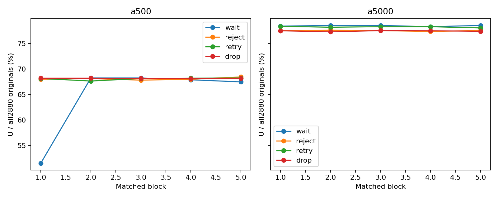
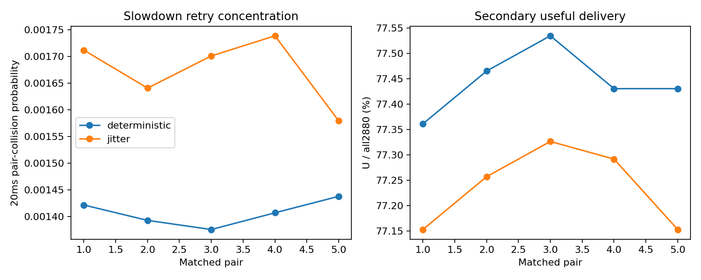
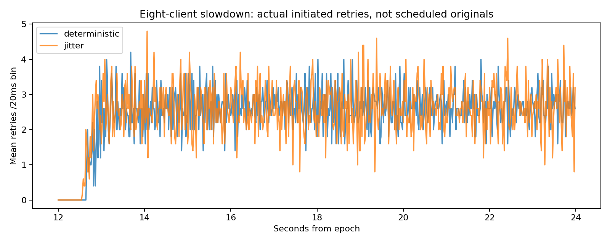
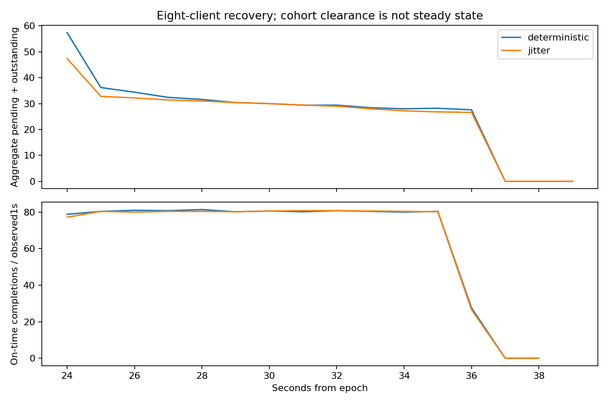

# Experiment 003 — Stage 6 secondary studies

**Stage6 PASS. GO for Stage7 independent publication review.** These are secondary observations; Stage5 evidence and conclusions remain unchanged. No Blog3 draft was written.

## Preregistration, isolated runtime and provenance

[STAGE6-PLAN.md](STAGE6-PLAN.md) and [RUN-PLAN.json](results/stage6/RUN-PLAN.json) were committed before study execution at `ec97c831d085bd96c102a3af6beaadfda6e92669`. [FROZEN-MANIFEST.json](results/stage6/FROZEN-MANIFEST.json) records exact source/lock hashes, clean build state, toolchains, Rust normal debug and default Go executables, environment/cgroup and two identical normal-build hash pairs. Private read-only binary copies prevent test feature unification from replacing measured executables.

The accepted primary CLI supports only2s deadlines and Rust claims one stream. Running eight primary servers would create eight budgets/workers and invalidate the intended model. The separately versioned [secondary runtime](secondary/README.md) adds deadline/partition controls and a bounded multi-stream adapter over one shared admission32, staging1, serial worker, FIFO, sweep/logger/response writer. The primary Rust/Go implementation, normative contracts, Stage5 plan/report/data, E1/E2 and earlier E3 evidence are untouched.

**Pre-StudyB seed amendment:** [STAGE6-B-SEED-AMENDMENT.md](STAGE6-B-SEED-AMENDMENT.md) and [RUN-PLAN-B2.json](results/stage6/RUN-PLAN-B2.json), committed at `5c2ccfd5d2db0228ac9d1b5e1fb6a1648e8e1dbc` before B2 traffic, replace only the per-client seed derivation. Source inspection during A found the original affine seeds generated overlapping phase-shifted SplitMix streams. No numeric secondary outcome had been analyzed and no B traffic had run. B2 uses domain-separated SHA256 seeds, keeps every master seed/order and all H6/statistical definitions, and verifies disjoint next8640 states/client plus actual RNG draw counts within that range. This is not a proof of infinite-stream independence. Bit-identical app binaries still come from ec97c83; new orchestration revision is recorded separately.

The original runner was explicitly stopped at the A/B boundary; [boundary proof](results/stage6/BOUNDARY-VERIFICATION.json) records whether any startup traffic occurred. The original plan, interrupted matrix/available artifacts and exclusion reason remain preserved. The [derived combined matrix](results/stage6/MATRIX-COMBINED.json) includes only valid original A blocks and separately preregistered valid B2 pairs. No unfavorable valid B result motivated seed replacement. A late-A boundary watcher is additional supervisory host activity, disclosed alongside shared-host overhead limitations.

Each client keeps A01 outstanding33/pending32, response64, event1024. Eight clients therefore permit aggregate264 outstanding/256 pending/512 response events/8192 event slots, with bounded global-index metadata arrays2880/8640 per client. The server retains global admission32, terminal32/immediate32, original2880/attempt8640 and one worker. Only the transport response bridge scales1 per stream (8 total). Server Work/Cancel ownership must match the immutable client ID. EOF is global after all streams half-close; a stream failure cancels the whole secondary run. This is not independent-client failure isolation or a whole-process memory bound.

Eight-client originals are partitioned id%8,360/client at10/s with12.5ms inter-client staggering: total80/s, N2880. Attempt namespace client_id+j*client_count is disjoint and bounded. Extra connections/metadata/credits differ from primary, but are identical within StudyB. No primary2s measurements are reclassified or pooled.

All cases preserve16KiB payload/seed1,36s arrivals, service10/40/10ms at worker start across12/24s,10ms drain, max3 attempts and immutable original deadlines. Direct client logging0, original server buffering65536, transport windows65535, disabled compression/configured gRPC retry/replay and same instrumentation apply within every comparison. Guards: CPU30s/process, sampled RSS256MiB/process,64MiB/file, core0,200ms sampling/<500ms gaps, wall=cutoff+12s. StudyB aggregate sampled RSS guard envelope is2.25GiB for9 processes; server remains256MiB. Recorded cgroup is4 cores/32GiB. No safety limit was weakened.

500ms scenarios retain cutoff39s. **5s scenarios use cutoff42s**, predeclared before execution: last original deadline40.9875s plus>1s cancellation/ACK grace. Their wall guard is54s rather than51s; other guards are unchanged. Both ledgers/processes remain alive through scenario cutoff. Raw39/42s CPU/utilization/integral exposures are labeled; the audit also extracts preregistered common[0,39] quantities.

## Correctness, failures retained and execution ledger

[Structured checks](results/stage6/checks/validated/COMMANDS.json) record exact argv, logs and zero exits for Rust fmt/tests/clippy, Go race tests(count3)/vet/module verification, analysis self-tests and normal build restoration. The final suite passed34 Rust tests and30 Go top-level tests repeated3 times under the race detector. Added tests cover immutable deadlines, ownership/attempt namespaces, owned-only reconciliation, fixed delays and independent jitter golden vectors, eight-stream one-worker/routing/drain, and global cancellation/permit/task cleanup. Final committed-source real Go/Rust fixtures (80 originals,8s cutoff) passed for both deadlines and both8-client retry modes; they are excluded from performance analysis. Six synthetic offline corruptions were rejected.

Pre-study failures are retained: initial Clippy type-complexity rejection fixed with a type alias; a response-reader-only cancellation test timed out because it had left the request half alive. The corrected both-half abort fixture matches the accepted primary cancellation fixture and passes. This does not assert detection of an application that merely stops reading. Earlier developmental fixture versions retain dirty-tree/source/binary hashes and are not study evidence; final pinned fixtures and all secondary study runs use committed reconstructible source. See checks and preflight directories; no failed study run is hidden in these checks.

Matrix status **COMPLETE**;50 attempted study runs,50 analyzed valid runs,0 failed measurement attempts,1 superseded pre-traffic plan/block records. No unfavorable valid measurement block was excluded. [combined matrix](results/stage6/MATRIX-COMBINED.json) and [combined exclusions](results/stage6/EXCLUSIONS-COMBINED.json) preserve every attempt and replacement reason. Valid unfavorable outcomes were never exclusion criteria.

### Study A blocks

|Block/attempt|Seed|Order|Verdicts|
|---|---|---|---|
|1/1|3230235474862838262|a500-drop, a5000-retry, a500-retry, a500-wait, a500-reject, a5000-wait, a5000-drop, a5000-reject|a500-drop:PASS, a5000-retry:PASS, a500-retry:PASS, a500-wait:PASS, a500-reject:PASS, a5000-wait:PASS, a5000-drop:PASS, a5000-reject:PASS; VALID|
|2/1|9548838229514957687|a500-wait, a5000-wait, a500-drop, a500-reject, a5000-reject, a5000-drop, a5000-retry, a500-retry|a500-wait:PASS, a5000-wait:PASS, a500-drop:PASS, a500-reject:PASS, a5000-reject:PASS, a5000-drop:PASS, a5000-retry:PASS, a500-retry:PASS; VALID|
|3/1|17182457733526921878|a500-retry, a5000-reject, a500-wait, a500-drop, a500-reject, a5000-wait, a5000-retry, a5000-drop|a500-retry:PASS, a5000-reject:PASS, a500-wait:PASS, a500-drop:PASS, a500-reject:PASS, a5000-wait:PASS, a5000-retry:PASS, a5000-drop:PASS; VALID|
|4/1|15133099369218606263|a5000-wait, a500-wait, a500-reject, a500-retry, a5000-drop, a5000-reject, a500-drop, a5000-retry|a5000-wait:PASS, a500-wait:PASS, a500-reject:PASS, a500-retry:PASS, a5000-drop:PASS, a5000-reject:PASS, a500-drop:PASS, a5000-retry:PASS; VALID|
|5/1|11855545033508639373|a5000-retry, a5000-reject, a500-drop, a500-retry, a5000-wait, a5000-drop, a500-reject, a500-wait|a5000-retry:PASS, a5000-reject:PASS, a500-drop:PASS, a500-retry:PASS, a5000-wait:PASS, a5000-drop:PASS, a500-reject:PASS, a500-wait:PASS; VALID|

### Study B blocks

|Block/attempt|Seed|Order|Verdicts|
|---|---|---|---|
|1/1|13819103293325858276|b-deterministic, b-jitter|b-deterministic:PASS, b-jitter:PASS; VALID|
|2/1|16633640269546976327|b-deterministic, b-jitter|b-deterministic:PASS, b-jitter:PASS; VALID|
|3/1|17958156311306776733|b-deterministic, b-jitter|b-deterministic:PASS, b-jitter:PASS; VALID|
|4/1|9043764941866104881|b-jitter, b-deterministic|b-jitter:PASS, b-deterministic:PASS; VALID|
|5/1|15299322588890134026|b-deterministic, b-jitter|b-deterministic:PASS, b-jitter:PASS; VALID|

The [independent offline audit](results/stage6/analysis/OFFLINE-AUDIT.json) replayed50 valid runs, recomputed unique on-time U from each actual workload deadline, attempt/burst identity and paired U intervals, and verified426 Stage5 package checksums unchanged. Resource/FIFO/permit/payload ownership, event sequences/tails, every scheduled original, max3 attempts, RNG/fixed-backoff replay, per-client clocks/coverage, phase selection, EOF/drain/task/log-flush gates are checked independently of Rust/Go reconciliation.

## Study A — actual deadline sensitivity runs

N2880 for every row, including unsent originals. U uses authoritative completion<=the scenario’s immutable deadline; useful rate U/36s remains distinct from completed-only throughput. Means below are across five runs. No Stage5 measurement enters this table.

|Condition|Mean U/N|Mean U/36s|Mean A/F/S/R|Mean retries|Mean unsent|
|---|---|---|---|---|---|
|a500-wait|64.701%|51.761/s|2880.0 / 2880.0 / 2880.0 / 2880.0|0.0|0.0|
|a500-reject|68.104%|54.483/s|2880.0 / 2880.0 / 2880.0 / 2880.0|0.0|0.0|
|a500-retry|68.097%|54.478/s|2986.8 / 2880.0 / 2986.8 / 2986.8|106.8|0.0|
|a500-drop|68.201%|54.561/s|2880.0 / 2880.0 / 2880.0 / 2880.0|0.0|0.0|
|a5000-wait|78.500%|62.800/s|2260.8 / 2260.8 / 2260.8 / 2260.8|0.0|619.2|
|a5000-reject|77.549%|62.039/s|2531.8 / 2531.8 / 2531.8 / 2531.8|0.0|348.2|
|a5000-retry|78.278%|62.622/s|2620.6 / 2487.6 / 2620.6 / 2620.6|133.0|392.4|
|a5000-drop|77.479%|61.983/s|2525.0 / 2525.0 / 2525.0 / 2525.0|0.0|355.0|

All StudyA per-run U counts (N2880 each), retaining the low500ms WAIT result:

|Block|500ms wait|500ms reject|500ms retry|500ms drop|5s wait|5s reject|5s retry|5s drop|
|---|---|---|---|---|---|---|---|---|
|1|1485|1959|1963|1965|2259|2233|2258|2233|
|2|1966|1963|1949|1965|2263|2236|2253|2227|
|3|1966|1954|1963|1964|2263|2234|2256|2234|
|4|1956|1959|1965|1963|2256|2229|2256|2233|
|5|1944|1972|1966|1964|2263|2235|2249|2230|

**Unexpected valid run:**500ms WAIT block1 had U1485 (51.5625%),363 late completions and1030 processing expirations. The other four WAIT runs had U1944–1966 and5–26 late completions. All clocks, source/binary/configuration, event/accounting, service-phase, coverage and resource gates passed. Server CPU was17.38s versus16.35–16.65s in the other WAIT500ms runs, but the telemetry does not isolate a root cause. Completion/deadline boundary sensitivity and shared-host/instrumentation effects remain possible, unproven explanations. No rerun/exclusion was made. This run lowers the mean and widens the paired deadline interval; every block value and the median remain available rather than a selected four-run headline.

Paired5s−500ms U/N differences, percentage points with descriptive95% paired-block bootstrap intervals:

|Policy|Mean pp [interval]|Five within-block differences pp|
|---|---|---|
|wait|13.799 [10.333, 20.403]|26.875, 10.313, 10.313, 10.417, 11.076|
|reject|9.444 [9.271, 9.604]|9.514, 9.479, 9.722, 9.375, 9.132|
|retry|10.181 [9.972, 10.403]|10.243, 10.556, 10.174, 10.104, 9.826|
|drop|9.278 [9.181, 9.361]|9.306, 9.097, 9.375, 9.375, 9.236|

Policy contrasts are paired within each deadline/block; no independent-run comparison is substituted:

|Deadline|Paired contrast|Mean pp [interval]|
|---|---|---|
|a500|reject-minus-wait|3.403 [-0.188, 9.986]|
|a500|retry-minus-wait|3.396 [-0.222, 10.083]|
|a500|drop-minus-wait|3.500 [0.007, 10.125]|
|a500|retry-minus-reject|-0.007 [-0.292, 0.236]|
|a500|drop-minus-reject|0.097 [-0.111, 0.264]|
|a500|drop-minus-retry|0.104 [-0.049, 0.333]|
|a5000|reject-minus-wait|-0.951 [-0.986, -0.924]|
|a5000|retry-minus-wait|-0.222 [-0.382, -0.063]|
|a5000|drop-minus-wait|-1.021 [-1.160, -0.882]|
|a5000|retry-minus-reject|0.729 [0.583, 0.875]|
|a5000|drop-minus-reject|-0.069 [-0.222, 0.056]|
|a5000|drop-minus-retry|-0.799 [-0.868, -0.722]|

Deadline-policy interactions are paired differences-of-differences: (policy contrast at5s)−(same contrast at500ms), U/N percentage points:

|Contrast|Mean pp [interval]|
|---|---|
|reject-minus-wait|-4.354 [-10.924, -0.778]|
|retry-minus-wait|-3.618 [-10.181, -0.021]|
|drop-minus-wait|-4.521 [-11.097, -1.035]|
|retry-minus-reject|0.736 [0.563, 0.931]|
|drop-minus-reject|-0.167 [-0.333, 0.000]|
|drop-minus-retry|-0.903 [-1.194, -0.687]|

Two further negative/context-dependent results are retained: at500ms RETRY−REJECT U/N averaged−0.00694pp with an interval crossing0 despite extra attempts; at5s RETRY−WAIT averaged−0.222pp with descriptive interval[−0.382,−0.063]pp. These are secondary within-runtime comparisons and do not revise the accepted2s primary conclusions.



These answer the preregistered sensitivity questions in this secondary runtime. Directionally positive/negative intervals are descriptive; intervals crossing0 are inconclusive. Longer deadlines do not automatically confer a useful-completion benefit, and different outcome costs remain visible below. No Stage5 conclusion is amended.

## Study B — deterministic versus full-jitter retries

Both variants use8 independent clients, one server worker/global budget, same2s deadlines, same original population/ownership and the same instrumentation. “Synchronized” means common deterministic relative backoff100/200ms after refusal; no wall-grid barrier or simultaneous-arrival manipulation is injected. Natural phase coherence is the measured question. Fixed-cap backoff100/200ms versus uniform[0,cap] also changes mean waiting, so this comparison does not isolate timing variance or desynchronization alone.

|Mode|Mean U/N|A/N|Retries/N|A/F|Mean retries|Slowdown retries/run range|20ms collision range|
|---|---|---|---|---|---|---|---|
|b-deterministic|77.444%|1.5576|0.5576|1.5576|1606.0|1468–1485|0.001375–0.001438|
|b-jitter|77.236%|1.5473|0.5473|1.5473|1576.2|1476–1515|0.001579–0.001739|

|Pair|Deterministic U|Jitter U|Deterministic retries in[12,24)|Jitter retries in[12,24)|Collision D|Collision J|
|---|---|---|---|---|---|---|
|1|2228|2222|1474|1493|0.0014213325153532468|0.0017121904006004787|
|2|2231|2225|1480|1485|0.0013924675182281673|0.0016408469238657919|
|3|2233|2227|1473|1515|0.00137529885769946|0.001701174080419931|
|4|2230|2226|1485|1476|0.001406699519907067|0.0017390106104450875|
|5|2230|2222|1468|1487|0.0014376222396817171|0.0015794127842829874|

Primary secondary burst endpoint: probability that two initiated retries selected without replacement in slowdown[12,24) occupy the same20ms bin. Fixed600 bins include empty bins; it is not the number of scheduled originals or transport Send latency. Fewer than2 retries yields undefined rather than a fabricated0.

**H6 assessment: NO_MATERIAL_SECONDARY_SUPPORT.** Deterministic−jitter collision -0.000268 [-0.000321, -0.000201]; mean relative change -15.873 [-18.704, -12.236]%. Material support required a positive interval,>=4/5 positive pairs and>=10% mean relative increase, all chosen before study outcomes. This operational threshold is not a universal practical-significance standard.

The **directional H6 prediction is contradicted in this controlled model**: deterministic retry collision was lower in all5 pairs, averaging15.873% lower relative to jitter (descriptive interval12.236–18.704% lower). The sign also remains negative for shifted20ms,10ms and50ms bins. This is not an inconclusive positive result or a universal claim that jitter is harmful. Uniformly staggered original demand need not create a synchronized herd under fixed relative backoff; different mean backoff and retry populations also prevent attributing the effect solely to synchronization. No new grid, bursty arrivals, timing parameter or favorable variant was introduced to make H6 succeed.

|Burst definition/sensitivity|Mean paired collision difference [interval]|Mean relative% [interval]|
|---|---|---|
|retry_burst20|-0.000268 [-0.000321, -0.000201]|-15.873 [-18.704, -12.236]|
|retry_burst20_shift10|-0.000239 [-0.000258, -0.000217]|-14.380 [-15.643, -13.111]|
|retry_burst10|-0.000214 [-0.000235, -0.000189]|-26.045 [-27.790, -23.627]|
|retry_burst50|-0.000263 [-0.000317, -0.000199]|-6.256 [-7.480, -4.804]|
|all_attempt_burst20|-0.000106 [-0.000125, -0.000073]|-6.861 [-8.125, -4.768]|

|Endpoint (D−J)|Mean paired difference [descriptive95% interval]|Units|
|---|---|---|
|U_over_N|0.208 [0.167, 0.250]|pp|
|A_over_N|0.010 [-0.001, 0.023]|raw units|
|retries_over_N|0.010 [-0.001, 0.023]|raw units|
|payload_byte_ns_common_39|80459072477593.594 [-176066657995980.812, 332025248884326.375]|raw units|
|client_pending_item_ns|117337137404.600 [114508452172.600, 119677216013.400]|raw units|
|recovery_clearance_ns|-20.058 [-25.796, -11.298]|ms|
|tcp_write_bytes_per_original|170.706 [-19.479, 376.929]|raw units|

The table’s resource integrals retain byte·ns or item·ns units; raw values are not RSS. Max/p95 bin counts, Fano dispersion, shifted20ms and10/50ms sensitivity and all-attempt bursts are in RESULTS.json. Different retry counts, phase-window selection, clock/bin boundaries and scheduler/transport effects limit interpretation even with finite-sample collision normalization. Negative or inconclusive H6 results remain study findings; no delay, deadline, queue, rate or jitter parameter was tuned.





## All-original outcomes and conditional timing

All-original partitions include every unsent original; mutually exclusive categories are independently replayed. Mean counts/run below are descriptive and may be fractional across five repetitions. Full per-run terminal categories, unknown/ACK flags and client-observed/server-authoritative states are preserved.

|Condition|On time|Late|Refused|Dropped|Expiry before send|Waiting/queued expiry|Processing expiry|Backlog exhausted|Failed|Cancelled|UNKNOWN|
|---|---|---|---|---|---|---|---|---|---|---|---|
|a500-wait|1863.4|83.2|0.0|0.0|0.0|1.8|931.6|0.0|0.0|0.0|0.0|
|a500-reject|1961.4|4.4|128.0|0.0|0.0|0.2|786.0|0.0|0.0|0.0|0.0|
|a500-retry|1961.2|2.2|1.2|0.0|0.0|93.6|821.8|0.0|0.0|0.0|0.0|
|a500-drop|1964.2|1.4|0.0|126.4|0.0|0.4|787.6|0.0|0.0|0.0|0.0|
|a5000-wait|2260.8|0.0|0.0|0.0|0.0|0.0|0.0|619.2|0.0|0.0|0.0|
|a5000-reject|2233.4|0.0|298.4|0.0|0.0|0.0|0.0|348.2|0.0|0.0|0.0|
|a5000-retry|2254.4|0.0|233.2|0.0|0.0|0.0|0.0|392.4|0.0|0.0|0.0|
|a5000-drop|2231.4|0.0|0.0|293.6|0.0|0.0|0.0|355.0|0.0|0.0|0.0|
|b-deterministic|2230.4|0.0|649.6|0.0|0.0|0.0|0.0|0.0|0.0|0.0|0.0|
|b-jitter|2224.4|0.0|655.6|0.0|0.0|0.0|0.0|0.0|0.0|0.0|0.0|

|Condition|Full refusal attempts/run|Full drops/run|ACK missing/run|
|---|---|---|---|
|a500-wait|0–0|0–0|0–0|
|a500-reject|124–136|0–0|0–0|
|a500-retry|83–122|0–0|0–0|
|a500-drop|0–0|113–150|0–0|
|a5000-wait|0–0|0–0|0–0|
|a5000-reject|286–308|0–0|0–0|
|a5000-retry|342–385|0–0|0–0|
|a5000-drop|0–0|282–304|0–0|
|b-deterministic|2234–2298|0–0|0–0|
|b-jitter|2198–2268|0–0|0–0|

Latency below is **conditional on completed originals**, including late completions; the n and quantile ranges are across per-run distributions, not pooled p95. This is not an all-original success measure. Queue residence applies to started work and admission waiting to admitted work. On-time-only, ACK-observed and original-schedule phase distributions with n/p50/p95/p99 are saved in RESULTS.json. A last observed refusal ACK can precede a retry original’s final local expiry; it is not final-resolution latency.

|Condition|Completed cohort n/run|Completion p50 ms|p95 ms|p99 ms|Queue p95 ms|Admitted wait sum s/run|
|---|---|---|---|---|---|---|
|a500-wait|1848–1972|29.16–444.69|479.82–501.57|495.80–504.88|385.79–386.26|4.49–4.73|
|a500-reject|1961–1972|177.84–290.27|376.80–416.48|442.03–476.18|443.46–458.59|3.18–3.30|
|a500-retry|1951–1969|172.49–333.45|380.21–452.87|442.59–488.50|390.92–399.84|3.18–3.55|
|a500-drop|1965–1967|128.66–327.92|375.50–383.48|448.33–464.36|444.26–456.20|3.13–3.38|
|a5000-wait|2256–2263|618.42–724.76|2701.41–2722.26|2719.78–2740.84|1302.33–1308.49|8.50–8.95|
|a5000-reject|2229–2236|244.48–334.04|1993.59–2028.87|2045.11–2072.71|1291.66–1299.26|2.55–2.68|
|a5000-retry|2249–2258|612.96–689.08|2012.46–2041.88|2059.21–2093.25|1294.97–1297.02|2.56–2.77|
|a5000-drop|2227–2234|255.85–341.80|2008.96–2041.07|2044.03–2073.71|1289.49–1299.18|2.52–2.68|
|b-deterministic|2228–2233|317.31–378.95|1500.10–1521.68|1753.04–1766.23|1329.88–1340.66|2.70–2.76|
|b-jitter|2222–2227|305.76–355.72|1414.04–1459.25|1604.61–1624.21|1335.59–1349.49|2.65–2.82|

Phase-specific completed-cohort p95/p99, by original scheduled phase, in ms; no failure is assigned zero latency:

|Condition|Scheduled phase|n/run|p95 ms|p99 ms|
|---|---|---|---|---|
|a500-wait|initial|960–960|17.67–26.41|20.23–33.81|
|a500-wait|slowdown|52–55|500.45–501.75|500.92–518.93|
|a500-wait|recovery|834–960|480.83–503.14|487.84–506.07|
|a500-reject|initial|960–960|17.80–20.60|19.34–22.57|
|a500-reject|slowdown|45–54|494.36–502.55|496.24–504.26|
|a500-reject|recovery|954–959|378.55–452.35|398.58–464.19|
|a500-retry|initial|960–960|17.44–22.90|20.02–29.22|
|a500-retry|slowdown|48–54|479.71–500.47|486.99–512.04|
|a500-retry|recovery|937–958|393.24–465.49|414.69–484.75|
|a500-drop|initial|960–960|17.65–28.63|18.95–31.18|
|a500-drop|slowdown|47–50|488.73–499.95|495.47–503.61|
|a500-drop|recovery|956–958|378.65–387.78|394.41–436.80|
|a5000-wait|initial|960–960|18.16–42.37|20.36–44.21|
|a5000-wait|slowdown|347–349|2721.56–2741.66|2727.97–2749.73|
|a5000-wait|recovery|949–955|727.17–786.97|742.24–795.80|
|a5000-reject|initial|960–960|17.22–22.00|18.59–29.27|
|a5000-reject|slowdown|338–343|2047.77–2076.23|2055.90–2088.50|
|a5000-reject|recovery|929–938|623.71–653.09|666.82–722.17|
|a5000-retry|initial|960–960|17.60–56.65|19.07–60.18|
|a5000-retry|slowdown|343–344|2066.01–2098.96|2697.29–2721.88|
|a5000-retry|recovery|945–955|962.96–1083.36|1080.79–1203.08|
|a5000-drop|initial|960–960|17.56–50.54|19.24–66.12|
|a5000-drop|slowdown|337–343|2047.60–2077.77|2061.13–2097.89|
|a5000-drop|recovery|927–936|613.96–708.21|684.04–735.56|
|b-deterministic|initial|960–960|17.41–29.87|18.34–43.66|
|b-deterministic|slowdown|319–324|1755.40–1774.11|1772.68–1796.27|
|b-deterministic|recovery|947–951|397.68–541.89|543.13–752.47|
|b-jitter|initial|960–960|17.62–19.35|19.27–20.79|
|b-jitter|slowdown|312–316|1637.24–1668.84|1692.57–1746.75|
|b-jitter|recovery|949–952|394.78–475.76|490.92–612.82|

## Resources, measurement coverage and recovery

The common-window audit extracts [0,39] event-state areas and sampled CPU for A as preregistered; raw full-cutoff quantities remain in the frozen analyzer output. This supplements fields without altering that script, endpoints, exclusions or hypotheses. Each CPU window uses first samples at/after0 and39s; timestamps and10ms resolution are retained. Summed client RSS peaks are **not simultaneous aggregate peaks**.

|Condition|Cutoff s|Server CPU s common39|Sum client CPU s common39|Server sampled peak MiB|Sum client peaks MiB (non-simultaneous)|Q+W MiB·s mean common39|Aggregate pending/outstanding HWM|
|---|---|---|---|---|---|---|---|
|a500-wait|39.0|16.35–17.38|3.51–3.87|9.64–9.89|19.46–25.37|11.511|12–12 / 33–33|
|a500-reject|39.0|15.91–16.67|3.48–3.80|9.60–9.77|21.14–25.92|10.442|10–11 / 33–33|
|a500-retry|39.0|15.84–17.73|3.33–4.08|9.63–9.85|21.29–26.68|10.346|12–13 / 33–33|
|a500-drop|39.0|15.81–17.11|3.52–3.99|9.60–9.77|20.98–27.43|10.278|9–11 / 33–33|
|a5000-wait|42.0|12.02–13.26|3.20–3.97|9.39–9.74|20.86–24.60|11.946|32–32 / 33–33|
|a5000-reject|42.0|12.95–13.81|3.31–3.81|9.36–9.47|19.88–24.30|10.899|32–32 / 33–33|
|a5000-retry|42.0|13.21–14.72|3.38–4.10|9.47–9.64|21.00–25.12|11.799|32–32 / 33–33|
|a5000-drop|42.0|12.87–13.78|3.35–3.70|9.39–9.65|21.03–26.22|11.227|32–32 / 33–33|
|b-deterministic|39.0|21.24–21.78|15.59–16.04|10.39–10.52|192.28–237.91|11.739|24–25 / 42–44|
|b-jitter|39.0|20.69–22.30|15.19–16.63|10.34–10.51|212.22–239.86|11.663|16–17 / 45–47|

|Condition|Ledger estimate server bytes|Sum clients estimate bytes|Worker occupied s/run (full cutoff)|Idle-with-backlog s/run|TCP write MiB/run|
|---|---|---|---|---|---|
|a500-wait|1460247–1460247|1129599–1129599|34.69–34.74|1.50–1.59|45.31–45.31|
|a500-reject|1460247–1460247|1129599–1129599|34.53–34.62|1.43–1.48|45.31–45.31|
|a500-retry|1460247–1460247|1132879–1134399|34.47–34.65|1.38–1.55|46.60–47.20|
|a500-drop|1460247–1460247|1129599–1129599|34.48–34.69|1.40–1.51|45.31–45.31|
|a5000-wait|1460247–1460247|1104639–1104919|35.24–35.30|1.17–1.29|35.49–35.60|
|a5000-reject|1460247–1460247|1115279–1116079|34.84–34.90|1.16–1.23|39.68–39.99|
|a5000-retry|1460247–1460247|1118319–1120039|35.24–35.33|1.19–1.28|40.87–41.55|
|a5000-drop|1460247–1460247|1114999–1115759|34.79–34.88|1.16–1.23|39.57–39.87|
|b-deterministic|1460247–1460247|8293712–8296312|34.87–34.93|1.24–1.30|70.22–71.24|
|b-jitter|1460247–1460247|8292152–8294792|34.82–34.92|1.21–1.31|69.61–70.65|

Completed service-duration medians by **worker-start** phase, ranges across runs in ms (distinct from scheduled-phase completion latency):

|Condition|Initial median ms|Slowdown median ms|Recovery median ms|
|---|---|---|---|
|a500-wait|11.68–11.74|41.44–41.57|11.68–11.74|
|a500-reject|11.73–11.76|41.46–41.95|11.66–11.70|
|a500-retry|11.71–11.82|41.39–41.68|11.63–11.71|
|a500-drop|11.69–11.79|41.28–41.70|11.59–11.71|
|a5000-wait|11.68–11.72|41.52–41.60|11.66–11.71|
|a5000-reject|11.67–11.82|41.56–41.65|11.62–11.68|
|a5000-retry|11.66–11.72|41.56–41.68|11.69–11.74|
|a5000-drop|11.67–11.74|41.57–41.69|11.67–11.72|
|b-deterministic|11.69–11.77|41.85–42.22|11.71–11.79|
|b-jitter|11.70–11.79|41.99–42.36|11.69–11.77|

Application payload ownership (Q+W and staging separately), pending/outstanding time, ledger storage estimates and process RSS are distinct quantities. Bounded queues do not prove bounded process memory. gRPC payload/wire and observed plaintext TCP-stream bytes are separate; packet/retransmission/NIC counters remain unsupported. Send and local response-writer elapsed include scheduling/serialization/instrumentation, never isolated HTTP/2 blocking. No claim of client application consumption follows successful server writes.

Across valid runs: cross-process clock uncertainty 0.971–2.233µs (<5ms); maximum process-sampling gap 219.860ms; maximum phase-marker lateness 11.561ms. Service delay selection is verified at worker start and completed timers must meet the requested10/40/10ms minimum; cancellation-shortened executions are not used to infer service capacity. EOF, zero final payload/permit/queue ownership, joined tasks and flushed logs are required gates.

Recovery clearance is the predeclared **pre24-admitted server cohort**;0 means empty at24, unresolved at cutoff is censored. It is not the disappearance of all client backlog or recovered steady state. Per-second on-time completions and aggregate client pending/outstanding/server occupancy are preserved through each scenario cutoff; rate bins stop before the final endpoint.

|Condition|Cohort clearance ms/run|Censored runs|Client pending+outstanding at24 mean|at36 mean|
|---|---|---|---|---|
|a500-wait|333.54–381.87|0|41.4|36.8|
|a500-reject|364.21–393.79|0|35.8|20.4|
|a500-retry|279.32–357.52|0|41.8|18.6|
|a500-drop|353.64–406.07|0|34.8|18.4|
|a5000-wait|401.14–419.88|0|64.8|55.0|
|a5000-reject|387.09–412.30|0|64.2|20.6|
|a5000-retry|391.52–410.27|0|63.8|57.8|
|a5000-drop|392.03–433.62|0|63.2|22.4|
|b-deterministic|396.22–423.80|0|57.4|27.6|
|b-jitter|410.03–449.79|0|47.4|26.6|



## Uncertainty, limitations and deviations

All inferential comparisons are paired within the preregistered block. Exactly five valid blocks per study were planned; all5 values and means are retained. Descriptive95% intervals enumerate5^5 ordered paired-block bootstrap samples with linear percentiles. No significance/equivalence test, multiple-comparison-adjusted confidence claim, universal winner, or causal claim beyond this model is made. Conditional cohorts differ. Small n, shared host/time/cache drift, one server, timers instead of production work, normal debug builds, polling/state locks/event construction/logging and process sampling remain limitations. Equal instrumentation within a comparison does not prove negligible overhead; Stage5’s instrumentation limitations remain unchanged.

Native multi-stream arbitration/response routing adds code and bounded bookkeeping relative to the single-stream primary, with different aggregate credit/transport/metadata capacity. Consequently these are secondary runtime observations, not interchangeable replications of Stage5. Within A, only deadline/cutoff changes; within B, only retry timing mode changes (seeds recorded in both). Deterministic backoff need not create synchronization under staggered open-loop arrivals. Transport smoothing and different retry populations may limit what client-attempt burst metrics say about server decode bursts.

No normative document, primary executable, original demand/deadline/backoff decision or Stage5 conclusion was modified. The pre-B seed correction is an explicit source-inspection amendment, not outcome tuning; original seed records and boundary exclusion are retained. The isolated runtime and explicit42s observation extension are the planned secondary implementation differences. Common39 extraction implements a quantity already in the human plan and is disclosed as a supplement to the frozen analyzer. Earlier developmental fixtures are labeled separately; no corrected fixture is represented as a failed study’s replacement. Negative/inconclusive findings and every attempted run remain accessible.

## Reproduction and changed files

New files are STAGE6-PLAN/REPORT and the documented B seed amendment, the isolated `secondary/` source/locks/tests/runner/verifier/analysis, and `results/stage6/` evidence. Primary application/tests, three normative specifications and all historical measurements/reports are unchanged. Exact check/build/process commands and exit statuses are archived. Executed from repository root:

```sh
python3 experiments/003/secondary/fixtures/checks.py
# Commit preregistration before the new studies (ec97c83).
python3 experiments/003/secondary/fixtures/study.py freeze
python3 experiments/003/secondary/fixtures/preflight.py pinned
python3 experiments/003/secondary/fixtures/faults.py
python3 experiments/003/secondary/fixtures/study.py execute > experiments/003/results/stage6/execution.log 2>&1
# The boundary controller ran concurrently while original StudyA executed:
python3 experiments/003/results/stage6/analysis/stop-before-b.py > experiments/003/results/stage6/boundary-watch.log 2>&1
# After the original driver stopped (zero B traffic):
python3 experiments/003/results/stage6/analysis/finalize-boundary.py
# Commit B2 preregistration before B2 traffic (5c2ccfd).
python3 experiments/003/secondary/fixtures/study_b2.py freeze
python3 experiments/003/secondary/fixtures/study_b2.py preflight
python3 experiments/003/secondary/fixtures/faults_b2.py
python3 experiments/003/secondary/fixtures/study_b2.py execute
python3 experiments/003/results/stage6/analysis/combine.py
python3 experiments/003/results/stage6/analysis/analyze_b2.py
python3 experiments/003/results/stage6/analysis/audit.py
python3 experiments/003/results/stage6/analysis/publish.py
python3 experiments/003/results/stage6/analysis/verify-package.py
```

The freeze records normal `cargo build --locked` and `go mod verify`/`go build -mod=readonly` argv twice. Test feature-unified binaries are not used for studies. These are archived commands, including a concurrent boundary controller, not a linear rerun-in-place recipe. Never execute the superseded correlated-seed B plan. Execution refuses existing artifact directories. Offline analysis/audit/publish can be repeated from preserved data without workload reruns; do not delete or overwrite raw runs to reproduce a new study.

## Evidence-to-claims table

|Claim/question|Measured support|Qualification|
|---|---|---|
|Aggregate demand preserved|Immutable workloads + per-client arrival replay + global N2880 reconciliation|Eight clients each360; no8x demand|
|Deadline effects|Actual500ms/5s runs, workload deadlines, paired contrasts/interactions|No reclassification/pooling of Stage5|
|Retry synchronization H6|Actual retry events,20ms collision pairs, fixed/jitter generator replay, predeclared sensitivities|Client initiation; not isolated transport blocking or guaranteed phase coherence|
|All-original useful outcomes/costs|Authoritative ledger + independent all-ID partitions, U/N,A/N,unsent/UNKNOWN/ACK flags|Conditional latency never replaces denominator|
|Resource/worker/cancellation correctness|Per-run gates, bounded IO, FIFO/permits, process samples, phase/EOF/drain markers|RSS sampled; metadata/payload separate; timers not CPU|
|Recovery|Clearance and per-second client/server/rate series|Pre24-admitted cohort is not whole-system recovery|
|Primary preserved|Frozen source + offline audit426 historical checksum checks|Primary source/evidence/conclusions unchanged|

**PASS; GO for Stage7 independent evidence-to-claims/publication review. Stop here for independent review; no Blog3 draft.
