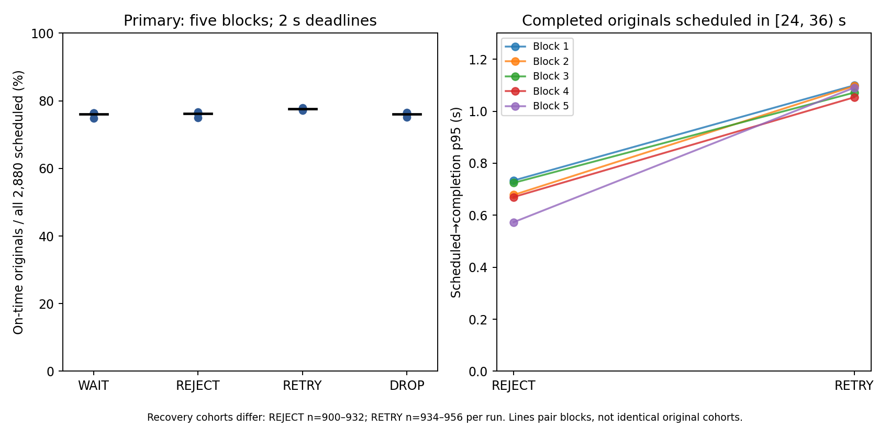

# Experiment 003 — Stage 7 independent evidence-to-claims review

**Verdict: PUBLISH — the evidence is ready to support drafting a narrowly scoped Blog3 using the claim restrictions below.** This is evidence/publication-readiness approval, not approval of an unwritten manuscript. No universal winner, significance claim, causal anomaly explanation or general anti-jitter recommendation is approved. No new performance runs are required for these scoped findings; none were executed. Stop after this review.

## Review scope and independence

Reviewed repository revision `25771cda76abfbcee32f994841a67e900efe5833`. Read the three normative specifications, Stage5/6 plans/reports/indexes, frozen inputs, original and B2 ledgers/exclusions, existing offline audits and supporting analysis/source. [New audit](results/stage7/audit.py) separately recomputes U from raw authoritative completions and actual immutable deadlines, original partitions, A/F/S/R, retry conversions, per-phase conditional quantiles, server payload-time, H6 bins/denominators and paired bootstrap arithmetic. It does not import the application’s reconciliation code or historical analysis functions.

It additionally replays the archived Python validity functions **in memory**. Those are shared-logic regression checks, not a newly independent protocol validator; existing offline audits also reuse them. “Independent” here means a new raw arithmetic review, not a separate experimental team, external laboratory replication or externally attested execution. Historical audit/report mains were not invoked because some write back into their evidence directories.

[REVIEW-AUDIT.json](results/stage7/audit/REVIEW-AUDIT.json) and [RUNS.csv](results/stage7/audit/RUNS.csv) record70 successful replays:20 primary runs,40 secondary deadline runs and10 secondary B2 runs. All key recalculations match archived results within floating interpolation tolerance. **No primary/secondary populations are pooled.** Every comparison retains five paired blocks;70 runs,2,880 originals/run and roughly a million possible retry pairs in each B2 slowdown window are not alternative independent replication counts.

## Integrity, completeness and provenance

|Check|Result|Limit|
|---|---|---|
|Historical content|426 Stage5 +2,230 Stage6 =2,656 source/data/derived file checksums pass before/after audit|Package checksum/control files exclude themselves by design; verified manifest bindings separately|
|Raw coverage|All70 run directories have expected manifests, events, ledgers, clocks, phase/EOF/drain markers, process samples and verification outputs|Reconciliation is embedded in client reports, not always a standalone reconciliation.json; literal layout differs from the normative §7 filename list; equivalent content is present, not an exact-filename-conformance claim|
|Accounting|All2,880 original IDs/run reconcile; attempts correspond; no duplicate execution, missing ACK, UNKNOWN or unaccounted permit in the reviewed runs|Healthy-run evidence does not establish crash durability or exactly-once external effects|
|Validity|All archived reports and in-memory gate replays PASS|Gate code sharing limits independence; new arithmetic provides an additional check|
|Source/config|Every frozen source SHA matches current bytes and its declared Git commit; case seed/order/workload/provenance checked|Git/wall-clock records are internal provenance, not external trusted timestamp attestation|
|Binary provenance|All four unique currently available read-only primary/secondary executable copies match declared hashes; A and B2 reuse identical secondary binaries|Executables are not committed; archive-only readers have hashes/build commands/locks/toolchain records, and must rebuild or obtain copies to recheck bits|
|Exclusions|Primary:none; secondary:no failed measurement run or replacement, one original B plan/block intercepted before traffic|Original interrupted/finalized matrices and boundary proof retained; do not describe a failed or rerun unfavorable measurement|
|Preregistration|Primary/A source+plan committed/frozen before their runs; B2 correction committed/frozen before B2 traffic|B2 is an explicit pre-traffic amendment, not the original unamended seed plan|

The review touched only Stage7 artifacts. Normative files, application code, earlier reports/measurements and published endpoints remain unchanged. Original primary/secondary binary and source provenance is distinct: primary905e2db; secondary app/A ec97c83; B2 orchestration5c2ccfd with the **ec97c83-built binaries**. Rust uses normal debug builds; Go uses default `go build`, not an asserted Go debug profile.

## Primary finding: useful work gained, attempts and conditional tails paid

Primary context only: one client/stream, one serial worker,32 total admitted slots including running/cancellation-pending ownership,2s **application-level original deadlines**,80 scheduled originals/s for36s, N2,880, observation39s. The stream RPC has a separate longer context deadline. All-original on-time completion uses the server timestamp<=the original scheduled-time deadline; local Send or ACK timing is not substituted.

|Policy|Mean U/N|Mean U|Mean A / F|Mean retries|A/N|Mean A/F|
|---|---|---|---|---|---|---|
|WAIT|76.042%|2190.0|2340.2 / 2340.2|0.0|0.8126|1.0000|
|REJECT|76.167%|2193.6|2529.8 / 2529.8|0.0|0.8784|1.0000|
|RETRY|77.576%|2234.2|2621.0 / 2496.2|124.8|0.9101|1.0500|
|DROP|76.014%|2189.2|2529.6 / 2529.6|0.0|0.8783|1.0000|

All comparisons below are means of five **within-block** U/N differences, percentage points; bracketed intervals are the prespecified descriptive95% paired-block bootstrap summaries (all3,125 ordered resamples, linear quantiles). No significance/equivalence or population coverage guarantee is inferred.

|Comparison|Mean pp [descriptive interval]|Five block U count differences|
|---|---|---|
|reject-minus-wait|0.125 [-0.701, 0.986]|-37, 46, 5, -5, 9|
|retry-minus-wait|1.535 [1.264, 1.958]|38, 68, 39, 42, 34|
|drop-minus-wait|-0.028 [-0.299, 0.215]|-7, 8, 3, -14, 6|
|retry-minus-reject|1.410 [0.889, 2.042]|75, 22, 34, 47, 25|
|drop-minus-reject|-0.153 [-0.833, 0.549]|30, -38, -2, -9, -3|
|drop-minus-retry|-1.562 [-1.924, -1.201]|-45, -60, -36, -56, -28|

**Confirmed primary RETRY gain:**+1.410pp over REJECT,+40.6 useful originals per2,880 scheduled on average, positive in5/5 blocks. Its own124.8 retry attempts/run equal4.333% of scheduled N and about5% overhead over its first-attempt F. **Total attempts versus REJECT increased only91.2/run (3.605%), not124.8**, because RETRY also initiated33.6 fewer distinct originals. A/N=0.9101 can be below1 while retry amplification exists; the missing denominator consists of unsent originals. All recorded initiated attempts in these healthy runs sent/decoded, but Send success alone does not prove useful completion.

Raw lifecycles confirm previously refused originals later completed on time: [88, 95, 100, 83, 77]. Those IDs are not the net paired gain [75, 22, 34, 47, 25]; changed admission/sending can displace other originals. Neither an individual counterfactual rescue count nor a retry return-on-investment ratio is established.

**Confirmed conditional recovery cost, with an essential qualifier:** for completed originals originally scheduled in[24,36), RETRY p95 is higher in every block. The cohorts include any late completions and are not identical; this is not a statement that every request, or the same requests, were slowed by that amount.

|Block|REJECT n / p95 ms|RETRY n / p95 ms|Shared completed IDs|RETRY-only / REJECT-only completed|
|---|---|---|---|---|
|1|900 / 733.48|942 / 1099.58|882|60 / 18|
|2|927 / 678.05|941 / 1096.78|910|31 / 17|
|3|916 / 724.37|954 / 1071.81|911|43 / 5|
|4|925 / 669.89|956 / 1053.55|922|34 / 3|
|5|932 / 573.26|934 / 1090.56|907|27 / 25|



WAIT/REJECT/DROP goodput ordering remains **INCONCLUSIVE**; their three descriptive intervals cross0, without proving equivalence. REJECT’s retained Q+W payload-time was lower than WAIT in5/5 pairs, mean−0.500MiB·s over39s; that excludes staging/metadata/transport/allocator memory and is not an RSS guarantee. Both reach occupied32. DROP’s distinct operational advantage over REJECT was not established in this all-expendable, per-message-response protocol; loss semantics still differ.

Old-server-cohort clearance is around0.4s after restoration, but the primary archive still shows mean client pending+outstanding58.2(WAIT) and61.8(RETRY) at36s. Thus H5’s narrow cohort comparison does not establish full-system recovery. U/36s is useful completions per offered-workload second, including eligible drain completions, not an instantaneous worker processing rate or U/39s.

## Secondary A: context dependence and the valid anomaly

These are40 new executions on the separately versioned secondary runtime, not a reclassification of Stage5. Each comparison uses actual500ms or5s immutable original deadlines. Observation39/42s respectively leaves>1s after the last5s deadline40.9875s. Primary2s data are not mixed into a three-point deadline curve. Resource/CPU totals need labeled windows or the existing common[0,39] supplement.

|Policy|5s−500ms mean pp [descriptive interval]|Paired median pp|Positive blocks|
|---|---|---|---|
|WAIT|13.799 [10.333, 20.403]|10.417|5|
|REJECT|9.444 [9.271, 9.604]|9.479|5|
|RETRY|10.181 [9.972, 10.403]|10.174|5|
|DROP|9.278 [9.181, 9.361]|9.306|5|

|Secondary contrast|Mean pp [descriptive interval]|
|---|---|
|500ms RETRY−REJECT|-0.007 [-0.292, 0.236]|
|5s RETRY−WAIT|-0.222 [-0.382, -0.063]|

Longer deadlines improved U/N for every policy in all five pairs here. That does not mean longer deadlines remove overload or are universally preferable: waiting/retention/loss costs change. RETRY’s500ms advantage over REJECT is unresolved; at5s RETRY has lower observed U/N than WAIT. These are context-dependent secondary findings, not a revision of the primary2s result.

|500ms WAIT block|U|U/N%|Late completions|Processing expirations|Paired5s−500ms pp|
|---|---|---|---|---|---|
|1|1485|51.5625|363|1030|26.8750|
|2|1966|68.2639|6|907|10.3125|
|3|1966|68.2639|5|906|10.3125|
|4|1956|67.9167|16|908|10.4167|
|5|1944|67.5000|26|907|11.0764|

**Retain block1.** Its51.5625% useful completion and363 late completions are valid under the frozen gates. The all-five WAIT500ms mean is64.701%, median67.917%. All-five deadline-gain mean13.799pp exceeds its median10.417pp; block1’s26.875pp paired gain is much larger than the other10.313–11.076pp values. The outlier changes magnitude/uncertainty, but every paired direction remains positive. No reduced four-run estimate replaces the preregistered result. No cause is identified: CPU/timer observations, warm-up stories, GC and cancellation-race narratives are not isolated explanations. A deadline plus cooperative cancellation does not prohibit recorded late completion; late completions remain outside U.

## Secondary B2/H6: the negative result and its denominator

The negative result reproduces. Define M as **actual initiated retries** (attempt_number>1) with timestamps in[12,24), not N scheduled originals, all application attempts or R decoded attempts. There are600 fixed20ms bins, including empty bins. For bin counts k, collision =Σ choose(k,2)/choose(M,2), equivalent toΣk(k−1)/(M(M−1)); undefined for M<2. The review reconstructs raw timestamps with independent histogram edges and also exhaustively counts unordered same-bin retry pairs for the main metric. Millions of pairs are not millions of independent experimental replicates.

|Pair|M fixed|M jitter|Same-bin/all pairs fixed|Same-bin/all pairs jitter|Collision fixed|Collision jitter|
|---|---|---|---|---|---|---|
|1|1474|1493|1543/1085601|1907/1113778|0.001421333|0.001712190|
|2|1480|1485|1524/1094460|1808/1101870|0.001392468|0.001640847|
|3|1473|1515|1491/1084128|1951/1146855|0.001375299|0.001701174|
|4|1485|1476|1550/1101870|1893/1088550|0.001406700|0.001739011|
|5|1468|1487|1548/1076778|1745/1104841|0.001437622|0.001579413|

Deterministic−jitter collision mean-0.000267843; descriptive interval[-0.000321446,-0.000201212], negative in5/5. Mean of the five relative differences is-15.873%, interval[-18.704,-12.236]%. This is **15.9% lower fixed-backoff concentration**, not15.9 percentage points of useful completion or a ratio of pooled retry events. The direction remains negative with shifted20ms,10ms and50ms bins.

The directional H6 prediction is unsupported/opposite **in this operational model**. It is not a test of an injected synchronized herd: originals are evenly staggered across eight10/s clients, total80/s. “Synchronized” in the plan means a common deterministic relative delay, not a common absolute retry instant. Fixed100/200ms delays versus uniform[0,cap] also changes nominal means to50/100ms for jitter; this is not a variance-only causal intervention. Different retry populations, periodic arrivals, queue/transport behavior and bin boundaries limit interpretation. Do not publish “jitter is harmful” or “synchronized herds are disproved.”

The aggregate B2 client budget is264 outstanding/256 pending, not the single-client33/32; eight connections/response bridges/ledger copies share one32-slot server and one worker. This does not multiply originals to640/s, but it prevents treating B2 as a direct replication of the single-client primary.

## B2 amendment chronology

The original seed spacing used the same increment as SplitMix:client j draw2 equalsclient j+1 draw1. The correction uses SHA256 domain-separated client seeds with a checked finite range. The review independently regenerates every corrected seed, verifies the next8,640 states/client do not overlap, checks unchanged master seeds/pair order, and replays actual per-client RNG through the archived gate. This does not prove infinite-stream mathematical independence.

|Archived event|Bangkok time (UTC+07),2026-11-02|Source|
|---|---|---|
|Original B boundary stop|2026-11-02T11:46:35.197+07:00|BOUNDARY-STOP / interrupted matrix|
|B2 preregistration commit|2026-11-02T11:47:12.000+07:00|Git5c2ccfd;1s timestamp resolution|
|B2 freeze|2026-11-02T11:47:13.495+07:00|FROZEN-MANIFEST-B2|
|B2 matrix start|2026-11-02T11:48:10.780+07:00|MATRIX-B2|
|First B2 workload epoch|2026-11-02T11:48:13.940+07:00|First run verification manifest|

The interrupted original matrix has no B run entries or B attempts; no B event files/arrivals/attempts/decodes exist, and the interrupt trace is in the pre-run source check. The corrected method was committed/frozen before B2 traffic. No StudyB outcome was available to choose its seeds. Derived secondary results/analysis logs are absent at the B2 preregistration commit. A raw deadline study already existed by then; archives cannot independently prove what someone privately inspected in A. These are internally consistent Git/clock/source records, not external attestation. The superseded original plan and interrupted/finalized matrices are preserved, not rewritten as successful B data.

## Editorial findings and required disclosures

|Finding|Assessment|Publication action|
|---|---|---|
|Original Stage5 recovery.png assigns a zero rate sentinel at39s|Existing chart artifact, disclosed and already corrected elsewhere|Keep historical original; promote recovery-observed-intervals.png only. No[39,40) rate was observed|
|Whole-workload conditional latency plot is not recovery latency|Endpoint/cohort mismatch if used to support the recovery claim|Use phase-specific existing p95 values with n and cohort membership caveat|
|Stage6 retry-pairs useful-goodput panel has a narrow77.15–77.55% axis|Valid zoomed line plot, risky as a visual winner claim|Label zoom and report its0.208pp effect in context; prefer the collision panel for H6|
|Primary+1.410pp gain vs percent retry overhead|Different denominators can silently be mixed|Use N,F,A definitions and total-attempt comparison explicitly; never say1.410%relative without calculation|
|“Synchronized retries” and variance-only explanation|Common relative delay is not demonstrated herd synchronization; nominal means differ|Use fixed-backoff under staggered arrivals and preserve the negative directional finding|
|“Recovered”, “immediate reject”, “2s gRPC deadline”|Ambiguous without the protocol scope|Say pre24-admitted cohort clearance; nonblocking admission refusal; application deadline per scheduled original|
|“32-item queue bounds memory”|Budget is Q+W including running/cancellation-pending, plus separate staging; not whole RSS|Label ownership limits and sampled metrics, not total memory guarantees|
|Payload “precompute” wording vs implementation|Go Manifest.Work calls Payload(m.Seed) per attempt; source is not a reusable cached payload path|Disclose generation/hashing/serialization in measured cost. Do not claim it was excluded or universally interpret the specification as a cache guarantee|
|Reconciliation/artifact filename differences and legacy pilot_only label|No semantic missing data detected; layout/CLI-label ambiguity already documented|Point to embedded reconciliations and authoritative membership manifests/indexes|
|Statistical language and existing unsupported extrapolations|All key arithmetic reproduces, not statistical significance/equivalence/general causation|Use descriptive n5 intervals; preserve unresolved ordering and negative results|
|Host/instrumentation overhead|Unisolated shared-host/debug/timer/logging cost; boundary watcher added late in A|Keep disclosure; do not assign it as the anomalous block1 cause (watcher was later)|

No performance-data correction, hypothesis change, new endpoint, exclusion or additional experiment is recommended for the approved claims. Production CPU saturation, correlated-burst synchronization, more workers/hosts and anomaly-cause experiments would be separate future preregistrations, not evidence currently available. The specification’s payload-precompute phrase warrants an implementation-accurate methods note; this review does not silently fix or reinterpret the frozen runtime.

## Claim classifications, outline and chart shortlist

[CLAIMS.md](results/stage7/CLAIMS.md), [CSV](results/stage7/CLAIMS.csv) and [JSON](results/stage7/CLAIMS.json) classify29 reported candidates/review stress tests as SUPPORTED, QUALIFIED, INCONCLUSIVE or UNSUPPORTED, with direct artifact links and approved wording. Rejected extrapolations are labeled as review tests, not allegations that the authors made them. JSON fragments are field locators for the referenced data, not promises of a rendered HTML anchor.

**Central thesis:** Backpressure limits where work can accumulate; an overload policy decides what happens to demand that cannot be served in time. Costs move among server queues, clients, retries and discarded work; capacity is not created.

[PUBLICATION-OUTLINE.md](results/stage7/PUBLICATION-OUTLINE.md) supplies the seven-section plan, a semantic policy decision table, four main charts plus appendix shortlist, exact caption constraints and the compact methods/disclosure block. [CHARTS.json](results/stage7/CHARTS.json) separates approved selections from figures not to promote. The new review chart only renders already-published primary endpoints with explicit cohorts; it introduces no new measurement endpoint. Keep seed algebra, ledger implementation and full build metadata in the methods/evidence appendix rather than the main backend-engineering narrative. No Blog3 prose draft was produced.

## Reproduce this review offline

From repository root; Python3 with NumPy, and Matplotlib only for the review chart. The scripts write only Stage7. Do **not** run archived benchmark runners, historical verifier mains, historical audit mains or report generators that write into Stage5/6.

```sh
PYTHONDONTWRITEBYTECODE=1 python3 experiments/003/results/stage7/audit.py
python3 experiments/003/results/stage7/claims.py
PYTHONDONTWRITEBYTECODE=1 python3 experiments/003/results/stage7/charts.py
PYTHONDONTWRITEBYTECODE=1 python3 experiments/003/results/stage7/report.py
PYTHONDONTWRITEBYTECODE=1 python3 experiments/003/results/stage7/checks.py
```

Audit output may be directed to another Stage7 subdirectory with `--output`. Audit logs, data, provenance/chronology and script hashes are indexed in [EVIDENCE-INDEX.md](results/stage7/EVIDENCE-INDEX.md). Review checks cover link/claim/chart schemas, derived context arithmetic, frozen-input preservation and content hashes; numerical/gate status is independent of whether any hypothesis was favorable.

**PUBLISH for the qualified evidence-to-claims package and outline.** A future manuscript must retain these captions, uncertainty and limitations. No manuscript has been reviewed or authorized for publication by this verdict, and no Blog3 was written. Stop here for review.
